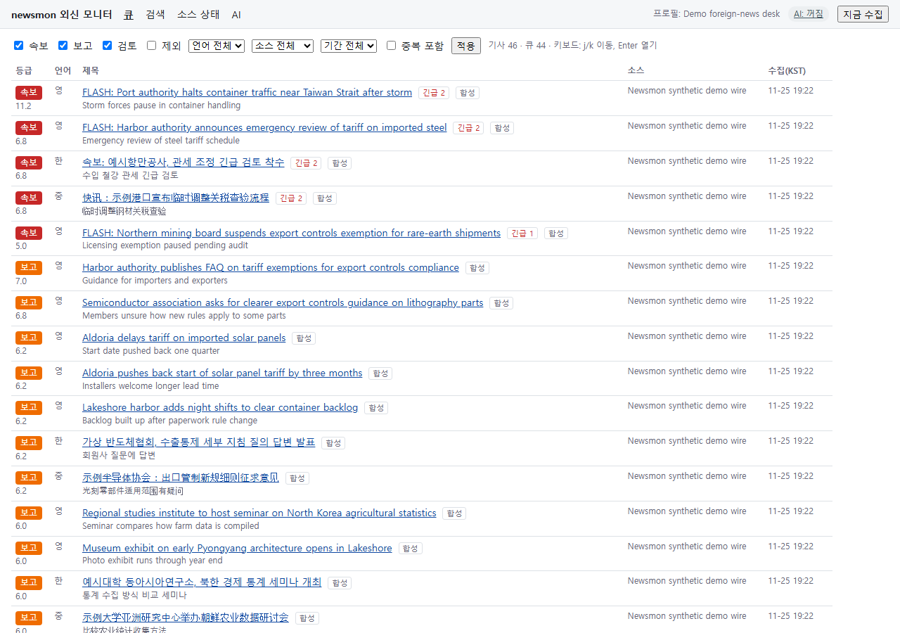
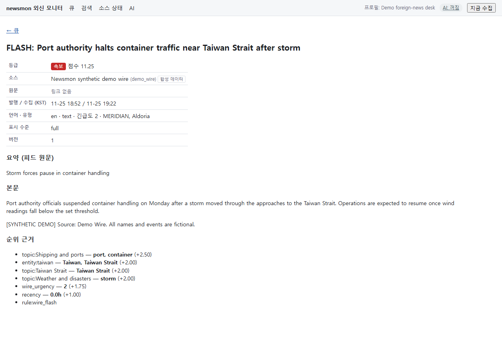
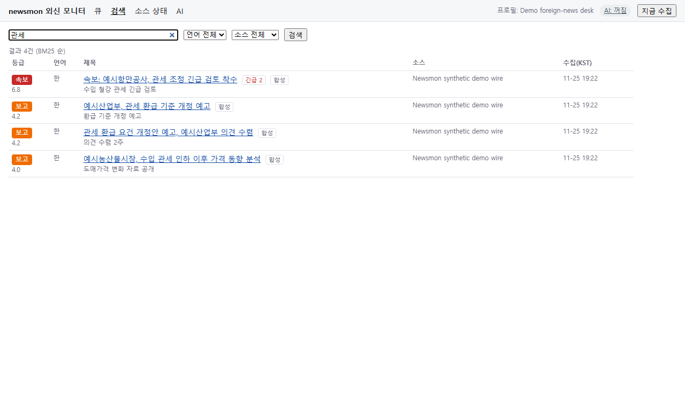
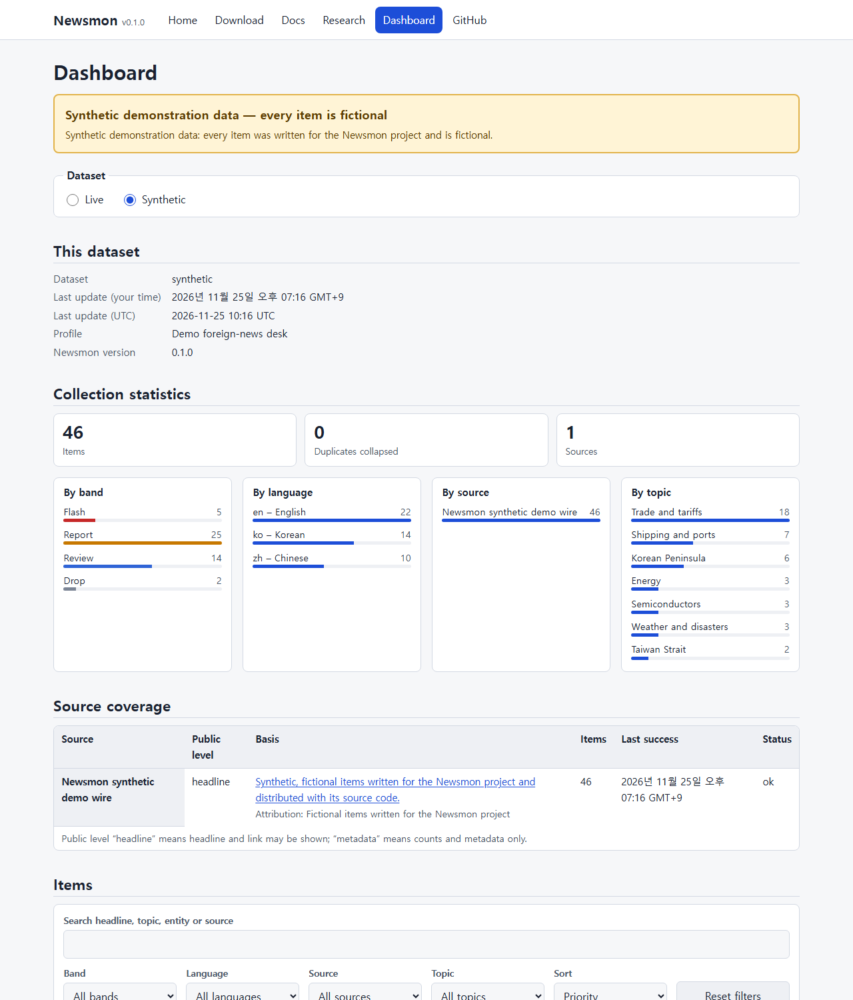

# Newsmon — 외신 모니터링, 뉴스 모니터링 프로그램

[English](README.md) | **한국어**

**Newsmon은 국제부·외신팀에서 쓰는 뉴스 모니터링 프로그램입니다.** 이용 권한을 확보한 RSS/Atom 피드와 통신사 기사
파일을 한곳에 모아 중복 기사를 정리하고, 데스크가 정해 둔 규칙에 따라 기사마다 등급을 매깁니다. 결과는 브라우저에서
검색할 수 있는 기사 목록으로 확인합니다.

유료 클리핑 서비스가 아니라 **내 PC에 설치해 쓰는 프로그램**입니다. 서버도, 회원 가입도, AI 서비스도 필요 없고, 데이터는
모두 SQLite 파일 하나에 저장됩니다.

- 소개 페이지, 데모 대시보드, 연구 자료: **https://pon00050.github.io/newsmon/ko/**
- 내려받기: **https://github.com/pon00050/newsmon/releases**
- 라이선스: 소프트웨어는 Apache-2.0, 연구 문서와 합성 데모 데이터는 CC BY 4.0

## 화면

가상의 데모 기사로 실행한 화면입니다. 기사 내용은 모두 지어낸 것이고, 프로그램 화면은 한국어로 되어 있습니다.

| | |
|---|---|
|  |  |
| **기사 목록(큐).** 중복을 정리한 영어·한국어·중국어 기사를 데스크 규칙에 따라 속보·보고·검토로 나눕니다. | **등급 근거.** 어떤 주제, 감시 대상, 통신사 긴급도, 최신성 때문에 이 등급이 나왔는지 기사마다 확인할 수 있습니다. |
|  |  |
| **한국어·중국어 검색.** 두 글자 단위(바이그램)로 색인하므로 한국어와 중국어도 제대로 검색됩니다. | **공개 대시보드.** 수집 통계, 출처별 현황과 이용 조건을 보고 기사를 검색할 수 있습니다. |

## 이런 곳에 맞습니다

국제부·외신팀은 근무 시간 내내 국내외 매체와 통신사 수십 곳을 살핍니다. Newsmon은 그중 손이 많이 가는 수집, 중복 정리,
1차 분류, 검색을 맡습니다. 뉴스 가치 판단은 여전히 데스크가 하고, 프로그램은 등급마다 매긴 이유를 남깁니다.

- 외신과 통신사 기사를 실시간으로 확인하는 언론사 국제부·외신팀
- 정해 둔 주제나 기관, 인물에 관한 보도를 빠짐없이 챙겨야 하는 기업 홍보팀·연구기관 (수집과 분류까지만 하며, 클리핑
  보고서는 만들지 않습니다)
- 서버나 클라우드 없이 PC 한 대로 기사 모니터링을 하려는 개인

## 기능 (v0.2.0)

| 영역 | 내용 |
|---|---|
| 수집 | RSS/Atom 피드 (robots.txt 준수, 적정 수집 간격, SSRF 차단, 용량·시간 제한). 감시 폴더에 들어오는 통신사 기사 파일 (NewsML-G2, NITF, ninjs, 일반 텍스트) |
| 정리 | URL·언어·시각(UTC) 통일, 중복·유사 기사 판별 (URL, 본문 해시, MinHash), 통신사 기사의 수정·정정·철회 반영 |
| 등급 | 프로필 규칙(한·영·중 키워드로 정한 주제, 감시 대상 기관·인물, 출처별 가중치와 제외, 통신사 긴급도, 최신성)으로 `속보`·`보고`·`검토`·`제외` 중 하나를 매기고 이유를 표시 |
| 검색 | SQLite FTS5와 한중일 바이그램 색인으로 한국어·중국어 검색. 별칭 사전을 써서 같은 대상의 다른 표기로도 검색 |
| 화면 | 기사 목록, 검색, 기사 상세, 소스 상태를 `http://127.0.0.1:8765/`에서 확인 (이 PC에서만 접속 가능) |
| 데스크 업무 | 기사마다 보고 / 확인 / 무시 판정과 메모 (단축키 `r` `v` `x`), 인쇄용 교대 보고. 판정 뒤 철회·수정된 기사는 따로 표시 |
| 검색 부가 기능 | 등급·기간·영상 유무 필터, 수집이 실패하는 피드 안내, 새 기사 수를 세고 알림을 보내는 저장 검색 |
| 영상 | 통신사 영상 클립을 내 PC의 ffmpeg로 점검 (기술 정보, 블랙·무음 구간과 타임코드, 이용 조건이 허용할 때만 썸네일), 프로필 주제별 분류, '인제스트 완료' 표시, CSV 시트 내보내기 |
| 알림 | `속보` 기사, 설정하면 `보고` 기사, 수집 장애 피드를 앱 안에서 알림 (배지, 알림 페이지, 탭이 열려 있을 때 브라우저 알림) |
| 이용 조건 관리 | 출처마다 저장, 화면 표시, AI 전송, 외부 공개 허용 여부를 설정. 사용 제한·엠바고·철회를 자동으로 지킴 |
| AI (선택) | 고른 기사마다 한 번 호출해 관련성, 중요도, 주제, 한국어 판단 근거를 받고, 이용 조건이 허용하면 한국어 제목이나 요약도 생성. 기본은 꺼짐이고, 본인 Anthropic API 키와 하루 비용 한도가 필요하며, AI 처리를 허용한 출처만 대상 |
| 공개 내보내기 | `newsmon export-public`으로 웹사이트용 정적 JSON 생성. 외부 공개를 따로 허용한 출처만 포함 |

### 한계

- 기사 단위로 보여 줍니다. 여러 매체가 쓴 같은 사건 기사를 하나로 묶는 기능은 아직 없습니다.
- 이메일, 요약 메일, JSON API, 로그인, 백업, 음성 인식, AI 영상 분석은 아직 없고, 알림은 앱 안에서만 뜹니다. 앞으로의
  계획은 [`docs/ROADMAP.md`](docs/ROADMAP.md)에 있지만 정해진 일정은 없습니다.
- PC 한 대, 사용자 한 명이 쓰는 구조입니다. 로그인 기능이 없어서 화면은 그 PC에서만 열립니다.
- 등급은 키워드와 규칙으로 정합니다. 결과를 투명하게 예측할 수 있는 대신, 키워드로 드러나지 않는 의미는 놓칩니다. 데모에서는
  "Harbor City FC"라는 축구단 기사가 *항만* 주제로 분류됩니다.
- AP나 로이터 같은 유료 통신사 연동은 API 연결이 아닙니다. 계약한 통신사 프로그램이 기사 파일을 내려받는 폴더를 감시 폴더로
  지정해 읽는 방식이며, 통신사 API에 직접 접속하는 기능은 없습니다.

## Windows에서 바로 시작하기 (명령어 없이)

**설치 없이 쓰기:** [최신 릴리스](https://github.com/pon00050/newsmon/releases/latest)의 *Assets*에서
`newsmon-<버전>-windows-portable.zip`을 내려받아 압축을 풀고 `Newsmon\Newsmon.exe`를 더블클릭합니다. 코드 서명이 없어
Windows SmartScreen 경고가 뜨면 *추가 정보* → *실행*을 누릅니다. 자세한 내용은 [`docs/windows.md`](docs/windows.md)(영문)를
참고하세요.

**소스 압축 파일로 쓰기:**

1. 최신 릴리스에서 소스 ZIP을 내려받아 원하는 곳에 풉니다. 경로에 공백이 있어도 괜찮습니다.
2. **`Start-Newsmon.cmd`**를 더블클릭합니다.
3. 처음 실행하면 [uv](https://docs.astral.sh/uv/)(관리자 권한 없이 설치되는 무료 도구)를 설치할지 묻습니다. 이어서 Python과
   필요한 라이브러리를 한 번 내려받는 데 몇 분이 걸리고, 끝나면 브라우저가 열리면서 수집이 시작됩니다.
4. 종료하려면 창을 닫거나 Ctrl+C를 누릅니다.

설정과 데이터베이스는 `%LOCALAPPDATA%\Newsmon\`(`config\`, `data\`)에 따로 저장되므로, 프로그램 폴더를 옮기거나 새 버전으로
바꿔도 그대로 남습니다. 처음 실행할 때 이 폴더에 예시 설정이 복사되니, 그 파일을 고쳐 출처와 규칙을 정하면 됩니다.

## 개발 환경 설치 (Windows, macOS, Linux)

[uv](https://docs.astral.sh/uv/)가 필요합니다. Python 3.12 이상이 없으면 uv가 알아서 설치합니다.

```
git clone https://github.com/pon00050/newsmon.git
cd newsmon
uv sync --frozen
uv run newsmon-desktop            # 런처와 같음: 설정 준비, 서버 시작, 브라우저 열기
```

| 명령 | 하는 일 |
|---|---|
| `newsmon init` | 데이터베이스를 만들거나 새 버전으로 올리고, 출처와 프로필을 불러옵니다 |
| `newsmon collect` | 한 번 수집합니다 (`--force` 수집 간격 무시, `--source KEY` 특정 출처만, `--loop` 계속 수집) |
| `newsmon serve` | 로컬 웹 화면을 띄웁니다 (`--auto-collect`를 붙이면 백그라운드 수집도 함께) |
| `newsmon status` | 출처별 마지막 수집 결과, 실패 횟수, 기사 수를 보여 줍니다 |
| `newsmon search "<검색어>"` | 웹 화면의 검색을 명령줄에서 실행합니다 |
| `newsmon rerank` | 프로필을 다시 읽어 저장된 기사의 등급을 다시 매깁니다 |
| `newsmon media-check` | 들어온 영상 클립을 바로 점검합니다 |
| `newsmon export-public` | 공개 웹사이트용 데이터를 만듭니다 |

## 출처와 프로필 설정

설정 폴더와 데이터 폴더는 따로 둡니다. [`config.example/`](config.example/)를 복사해 시작하세요.

- `sources.yaml`: 출처 하나에 한 줄씩, 이용 조건 항목(`storage`, `display`, `ai_processing`, `permitted_ops`,
  `public_redistribution` 등)을 적습니다. 비워 둔 항목은 안전한 쪽으로 처리됩니다.
- `profiles/*.yaml`: 무엇을 지켜보고 어떤 기준으로 등급을 매길지 정합니다.
- `gazetteer.yaml`: 감시 대상 목록입니다. 대상마다 한·영·중 별칭을 붙입니다.
- `settings.yaml`: 화면 포트, 수집할 때 쓰는 User-Agent, 감시 폴더 확인 간격, AI 설정(기본은 모두 꺼짐).

자세한 설명은 [`docs/configuration.md`](docs/configuration.md)(영문)에 있습니다. API 키 같은 비밀값은 이 파일들에 넣을 수
없으며, 넣으면 설정을 불러오지 않습니다.

## 문의와 기여

- 버그 제보와 질문: [GitHub 이슈](https://github.com/pon00050/newsmon/issues). 한국어로 남기셔도 됩니다.
- 보안 문제: 공개 이슈로 올리지 마시고 [`SECURITY.md`](SECURITY.md)의 안내를 따라 주세요.
- 기여 방법: [`CONTRIBUTING.md`](CONTRIBUTING.md)

## 라이선스

소프트웨어는 [Apache License 2.0](LICENSE), 연구 문서(`research/`)와 합성 데모 데이터(`demo/`)는
[CC BY 4.0](LICENSE-CC-BY-4.0.txt)을 따릅니다. 사용한 외부 패키지는 [`THIRD_PARTY_NOTICES.md`](THIRD_PARTY_NOTICES.md)에
정리했습니다. Newsmon으로 수집한 뉴스 콘텐츠의 권리는 각 언론사에 있으며, 이 라이선스의 적용 대상이 아닙니다.
