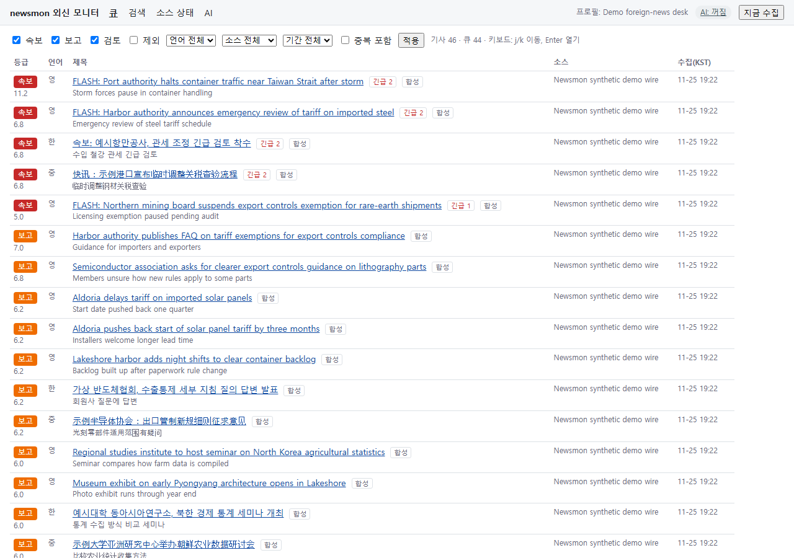
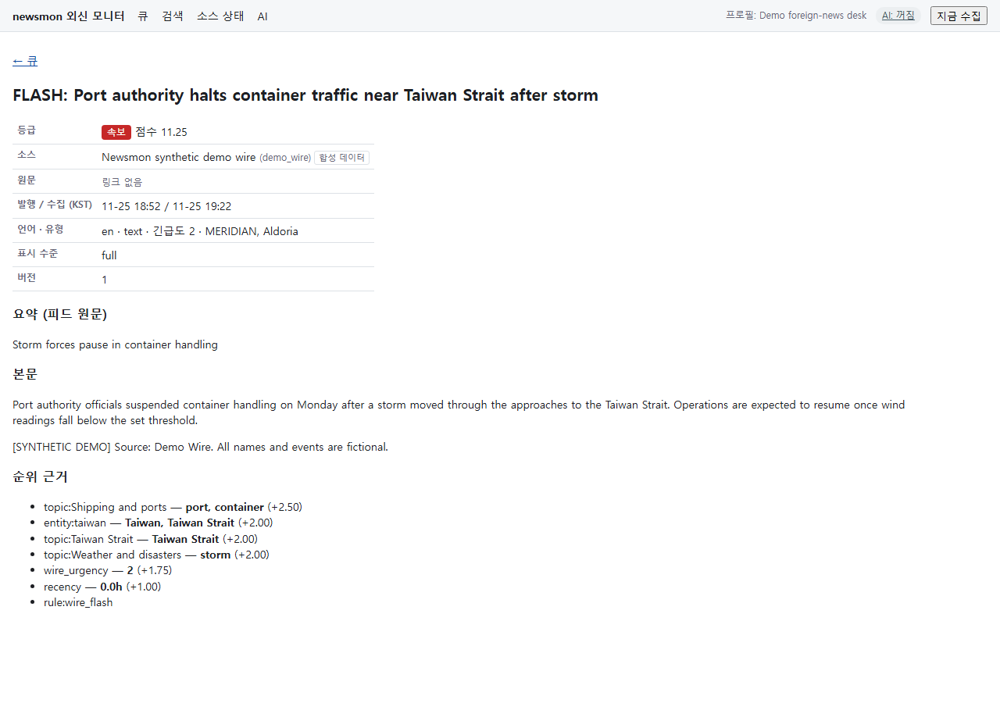
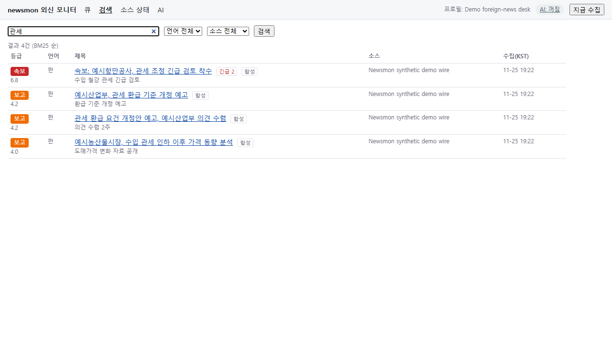
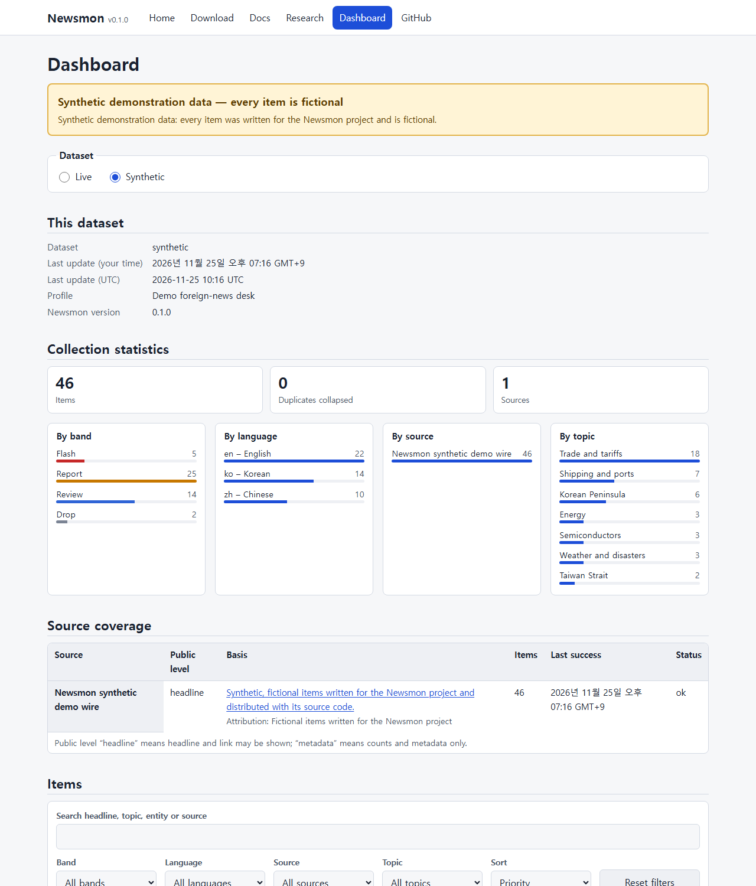

# Newsmon

**Local news monitoring for foreign-news desks.** Newsmon collects the RSS/Atom feeds and wire files you are
licensed to use, removes duplicates, ranks every item against your desk's own rules, and shows a searchable,
prioritised queue in your browser. It runs on one computer, needs no AI provider and no account, and keeps
everything in one SQLite file.

- Website, live demo and research library: **https://pon00050.github.io/newsmon/**
- Download: **https://github.com/pon00050/newsmon/releases**
- Licence: Apache-2.0 (software); CC BY 4.0 (research documents and synthetic demo data)

## Screenshots

The local application, running on the synthetic demo wire (every item is fictional). The interface is in Korean
because it was built for a Korean foreign-news desk.

| | |
|---|---|
|  |  |
| **The queue.** Deduplicated items in three languages, ranked into bands (속보 flash, 보고 report, 검토 review) by the desk's rules. | **Why it ranked.** Each item lists the topics, watch entities, wire urgency and recency that placed it. |
|  |  |
| **Korean and Chinese search** with CJK bigrams. | **The public dashboard** on the project website: statistics, source coverage and permissions, searchable items. |

## The problem it addresses

A foreign-news desk watches dozens of English, Korean and Chinese sources and newswires during every shift. The
same story arrives many times, from agencies, syndication and revisions. Important items have to be noticed within
minutes, and the desk has to respect what each source's licence allows. Newsmon automates the repetitive part:
collection, deduplication, first-pass ranking and search. Editorial judgement stays with the desk, and every ranking
comes with an explanation.

## What it does today (v0.2.0)

| Area | Implemented |
|---|---|
| Collection | RSS/Atom feeds (robots.txt, polite intervals, SSRF guard, size and time limits); a watched folder of customer wire files in NewsML-G2, NITF, ninjs or plain text |
| Processing | normalisation (canonical URL, language, UTC time); exact and near-duplicate detection (URL, content hash, MinHash); wire versions, corrections and kills |
| Ranking | profile rules: topics with KO/EN/ZH keywords, watch entities, source weights and mutes, wire urgency, recency; bands `flash` / `report` / `review` / `drop` with the reasons shown |
| Search | SQLite FTS5 with CJK bigrams, so Korean and Chinese work; aliases from a watch-list gazetteer |
| Interface | local web queue, search, item detail and source health on `http://127.0.0.1:8765/` (loopback only) |
| Editorial workflow | verdicts per item (보고 / 확인 / 무시, with a note, keyboard `r` `v` `x`) and a printable shift report of what was marked, flagged when an item was later withdrawn or revised |
| Search+ | band, time and footage-only filters, a failing-feed banner, and saved searches that count new matches and can alert on them |
| Footage | wire video clips checked with local ffmpeg (technical facts, black/silence with timecodes, licence-gated thumbnails), classified by profile topics, tracked to an "ingest done" mark, exported as a CSV ingest sheet |
| Alerts | in-app alerts for `flash` items, optionally `report`-band items, and failing feeds: a badge, an alerts page and browser notifications while a tab is open |
| Licensing controls | per-source flags decide what is stored, displayed, sent to AI and published; restrictions, embargoes and withdrawals are enforced |
| Optional AI | one structured call per selected item (relevance, importance, topics, Korean rationale, and a Korean headline or summary where the licence allows), off by default, capped by a daily budget, and only for sources that explicitly permit it |
| Public export | `newsmon export-public` writes a static JSON dataset for a website, behind a separate, deny-by-default public-redistribution permission |

### Limitations

- The queue lists items, not events: related stories from different outlets are not grouped yet.
- No e-mail, digests, JSON API, authentication, backup, speech-to-text or AI video analysis yet; alerts are in-app only. See
  [`docs/ROADMAP.md`](docs/ROADMAP.md) for what may follow. None of it has a date.
- Single user on one machine. The web UI binds to loopback only because there is no authentication.
- Ranking is keyword- and rule-based. It is transparent and predictable, and it misses meaning that keywords do not
  capture. In the demo, a sports club called "Harbor City FC" matches the *ports* topic.
- Licensed newswire integration (AP, Reuters and others) means pointing the watched folder at the files your own
  agency software delivers. No vendor API connector is built.

## Start it on Windows (no terminal)

1. Download the source ZIP from the [latest release](https://github.com/pon00050/newsmon/releases/latest) and
   extract it anywhere. Paths with spaces are fine.
2. Double-click **`Start-Newsmon.cmd`**.
3. On first use it offers to install [uv](https://docs.astral.sh/uv/), a free per-user tool with no administrator
   rights needed. It then downloads Python and Newsmon's libraries, which takes a few minutes once. Newsmon then opens
   in your browser and starts collecting.
4. To stop, close the window or press Ctrl+C.

Settings and the database are kept in `%LOCALAPPDATA%\Newsmon\` (`config\` and `data\`), so updating or moving
the program folder keeps them. On first start the example configuration is copied there; edit those files to choose
sources and rules. A release may also include a portable `newsmon-windows-portable.zip` that needs no installation
at all (see [`docs/windows.md`](docs/windows.md)).

## Install for development (Windows, macOS, Linux)

Requires [uv](https://docs.astral.sh/uv/). Python 3.12 or newer is installed by uv if missing.

```
git clone https://github.com/pon00050/newsmon.git
cd newsmon
uv sync --frozen
uv run newsmon-desktop            # same as the launcher: seeds config, starts the server, opens the browser
```

Or run the commands yourself with explicit folders:

```
# PowerShell                                   # bash
$env:NEWSMON_CONFIG_DIR = "config.example"      export NEWSMON_CONFIG_DIR=config.example
$env:NEWSMON_DATA_DIR   = "data"                export NEWSMON_DATA_DIR=data
uv run newsmon init
uv run newsmon serve --auto-collect
```

| Command | What it does |
|---|---|
| `newsmon init` | create or upgrade the database, load sources and profiles |
| `newsmon collect` | one collection cycle (`--force` ignores intervals, `--source KEY` limits it, `--loop` keeps going) |
| `newsmon serve` | local web UI (`--auto-collect` also collects in the background) |
| `newsmon status` | sources, last fetch result, failures, counts |
| `newsmon search "<query>"` | the web page's search on the command line |
| `newsmon rerank` | reload profiles and re-rank stored articles |
| `newsmon enrich` | run optional AI enrichment now |
| `newsmon export-public` | write the public website dataset (see the publication policy) |

## Configure sources and profiles

Configuration is a folder; state is another folder. Start from [`config.example/`](config.example/):

- `sources.yaml`: one row per source with its licence flags (`storage`, `display`, `ai_processing`,
  `permitted_ops`, `public_redistribution`, …). Missing flags default to the safe choice.
- `profiles/*.yaml`: what to watch and how to rank.
- `gazetteer.yaml`: watch entities with KO/EN/ZH aliases.
- `settings.yaml`: UI port, fetch User-Agent, inbox scan interval, AI switches (all off).

Details: [`docs/configuration.md`](docs/configuration.md). Secrets never go in these files; the loader refuses them.

## Optional AI enrichment

Off by default. Everything above works the same with it off, failing, paused or over budget. To use it you supply
your own Anthropic API key and enable it per source. Public feeds ship with no AI permission. See
[`docs/ai-enrichment.md`](docs/ai-enrichment.md).

## Public website and demonstration

The website is built from this repository by GitHub Actions and served by GitHub Pages:

- a **synthetic dashboard**: fictional wire items run through the real pipeline, labelled as synthetic;
- a **live dashboard**: headlines and links from US federal sources whose public redistribution is documented
  (currently NASA news releases), refreshed every three hours with no AI and no secrets;
- the **research library** ([`research/`](research/README.md)): the business-process analysis, source and licensing
  registries, technology evaluations, experiments, architecture decisions, specification and engineering reviews
  behind Newsmon;
- the documentation in [`docs/`](docs/).

What may be published, and why, is set out in [`docs/publication-policy.md`](docs/publication-policy.md). In short:
collecting, storing or displaying an item never implies permission to republish it. Only sources with a written
basis are published, and then only headline, link, times and Newsmon's own labels.

## Tests

```
uv sync --frozen --all-groups
uv run pytest -q -m "not live and not slow"      # regression gate: no network (enforced), no AI
```

About 60 tests use fixtures built from captured third-party news. Those fixtures cannot be redistributed and are not
in this repository, so the tests are reported as skipped here. The remaining ~300 tests cover parsing, deduplication,
ranking, search, licence and display policy, the web UI's security controls, AI routing (against a stub), the
publication gate and an end-to-end synthetic run. CI runs them on Linux and Windows. Live provider tests run only
with `NEWSMON_LIVE=1` and your own key.

## Reporting issues and contributing

- Bugs and questions: [GitHub issues](https://github.com/pon00050/newsmon/issues)
- Security problems: see [`SECURITY.md`](SECURITY.md); please do not open a public issue
- Contributions: [`CONTRIBUTING.md`](CONTRIBUTING.md)

## Licence

Software: [Apache License 2.0](LICENSE). Research documents (`research/`) and synthetic demo data (`demo/`):
[CC BY 4.0](LICENSE-CC-BY-4.0.txt). Third-party packages: [`THIRD_PARTY_NOTICES.md`](THIRD_PARTY_NOTICES.md).
News content collected by Newsmon belongs to its publishers and is not covered by these licences. Quotations in
`research/`, such as statute and court-decision text, licence terms and job-advertisement duty phrases, keep their own
status and are not licensed by this project.
