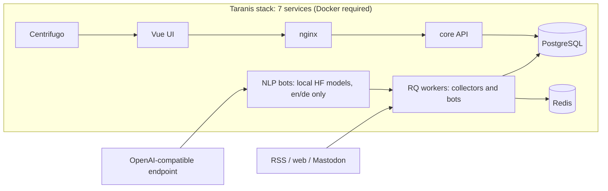
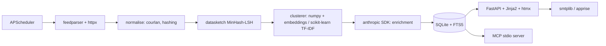
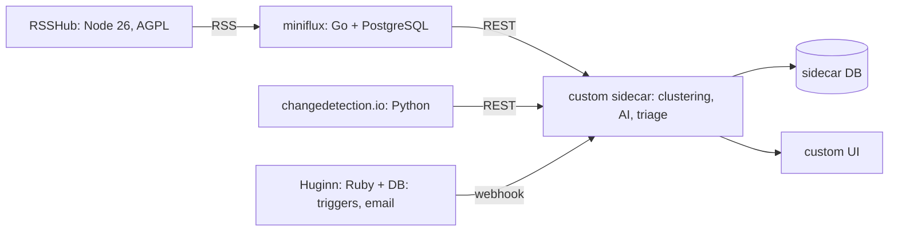
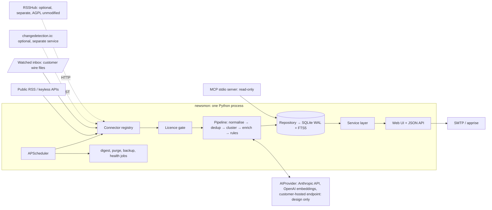
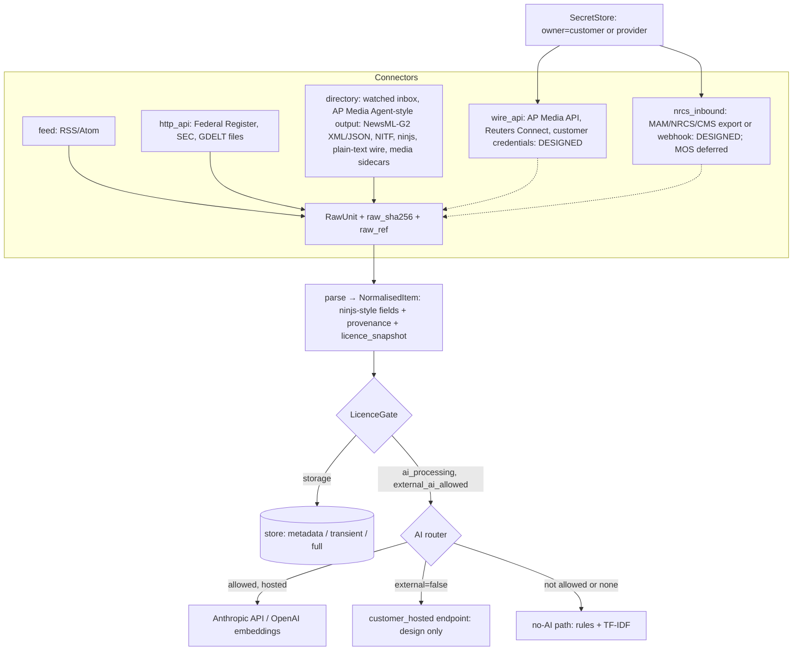
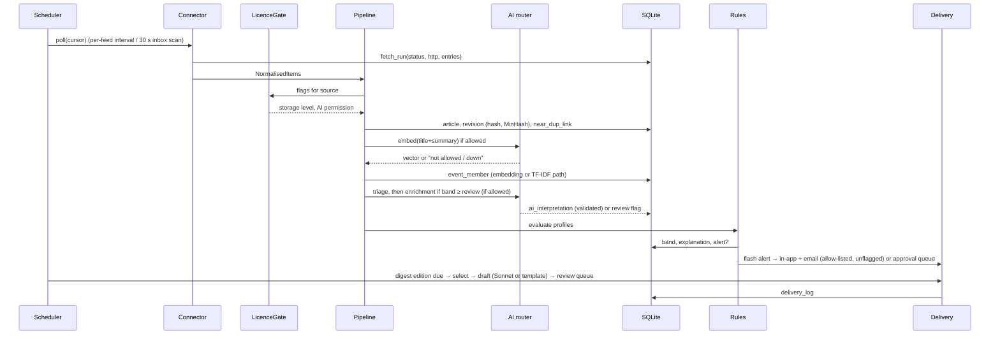
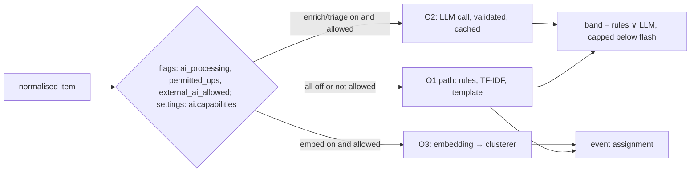

# 11 · Recommended system architecture (S1, 2026-11-25)

> **Status: Design proposal (not built).** Deliverable 11. This document describes the FULL MVP. Most of it is not built: Release A + A.1 implements only a subset (collection of authorised feeds and wire files, normalisation, deduplication, rule ranking, search, a local queue, and optional AI assessment). See the [decision log](../decision-log.md) for what is built.
> Part of the [Newsmon research library](../README.md). Evidence dates default to 2026-11-25; first-person statements are by the AI research agents that wrote the notes.

**Status:** PROPOSED. **Decisions:** ADR-001…ADR-010 in this folder. **MVP scope:** [`specification/mvp-specification.md`](../specification/mvp-specification.md).
**Rule for versions:** a version appears here only if a phase-1 file records it (registry row, requirements file or
trial log). Anything else says "pin at build".

> **Round-1 review amendments (2026-11-25, from [`reviews/review-v1.md`](../reviews/review-v1.md) and S2's gap list; these supersede §5, §7
> and §8 where they differ).** The backlog's T-07, T-02 and T-54 implement them, and [`specification/implementation-backlog.md`](../specification/implementation-backlog.md)
> §6 records them as G-1…G-6.
> 1. **§5 DDL adds `feed_entry`.** One row per observation of an article in a feed: `workspace_id`, `source_id`,
>    `article_id`, `feed_guid`, `seen_utc`, unique on (source_id, feed_guid). FR-07(a) needs it.
> 2. **`workspace_id NOT NULL`** is added to `spend_day`. Child tables (memberships, relations, revisions) are scoped
>    through their parent's FK, and NFR-23 counts root tables only.
> 3. **PyYAML** (pin at build) is a core dependency for `config/*.yaml`.
> 4. **§8 backups:** rotation keeps no backup older than the shortest active `retention_days` (default rotation: 14
>    dailies, capped by that minimum). Purge receipts list the backups that were rotated out.
> 5. **`audit_log`** gains `op_kind` (fetch | classify | summarise | translate | embed | send | export | purge),
>    `derivative_kind`, `retention_until` and `credential_ref` (an id, never a secret), plus a CLI command
>    `newsmon audit export --source <key> --from --to` that produces the DR-20 licence-audit report. DR-16
>    `commercial_model` is satisfied by construction: single tenant, Model B.
> 6. The injection pre-filter runs in every mode (12 FR-14).

## 0. Summary

One Python process (FastAPI web app plus an in-process APScheduler) runs over one SQLite file in WAL mode. It contains:

- connectors behind one contract (public feeds, keyless APIs, and a watched inbox directory for customer-licensed wire
  files);
- a licence gate driven by per-source flags;
- deterministic dedup (URL, hash, MinHash-LSH);
- incremental event clustering on cloud embeddings, with a TF-IDF fallback;
- one tool-less, schema-constrained LLM enrichment call per item, through a provider abstraction;
- a rules engine;
- an editorial queue, a flash notice, a reviewed digest, a read-only JSON API and a read-only MCP server (stdio).

The system is **fully functional with AI off** (mode O1, §4a). AI is switched on per capability and per source. No model is trained. It is single-tenant, and one instance runs per customer.

## 1. Alternatives (ADR-001)

### K-A · Adopt Taranis AI (not chosen)



This option is blocked by four facts: Docker is not available here; the default NLP runs local models (no-local-inference policy);
there is no Korean support; and the licence is EUPL-1.2 ([`technology/open-source-applications-evaluation.md`](../technology/open-source-applications-evaluation.md)).

### K-B · Library assembly (the MVP's core)



### K-C · Integrate existing applications (not chosen)



This option means four runtimes and four stores. The product core still sits in the sidecar, and licence flags would have
to be enforced across applications that do not know about them.

### K-D · Hybrid (chosen; ships as K-B, with optional adapters off by default)



## 2. Component boundaries

| Component | Responsibility | Depends on (interfaces) | Must not |
|---|---|---|---|
| `config` | Load env and the YAML config dir; validate with Pydantic; expose typed settings | — | Hold secrets in the DB |
| `registry` | Source rows with licence flags; import/export YAML | Repository | Contain source-specific code |
| `connectors` | `feed`, `http_api`, `directory` (MVP); `wire_api`, `nrcs_inbound`, `changedetection`, `rsshub` (designed) | `HttpFetcher`, `SecretStore`, Repository | Raise on remote failure; read outside their root |
| `fetcher` | HTTP with UA, conditional GET, robots (RFC 9309 matcher), per-host lock, connect-time private-IP refusal, size and time limits | — | Follow a redirect to a private address; retry 4xx |
| `licence` | `LicenceGate` (what may be stored or sent to which AI) and `DisplayPolicy` (what may be shown, exported or sent outside) | registry | Be bypassed: UI, API, MCP, digest and export all call it |
| `pipeline.normalise` | Canonical URL, NFC/NFKC, UTC timestamps (raw kept), language by script ratio, content hash, boilerplate strip | registry rules | Drop items with bad dates (it flags them) |
| `pipeline.dedup` | GUID/URL/hash; MinHash-LSH links; revisions; `story_key`; live-blog exclusion | Repository | Call any AI |
| `pipeline.cluster` | Incremental event assignment; TF-IDF fallback; editor merge/split | `AIProvider.embed`, Repository | Send text the gate forbids |
| `ai` | Router (flags → endpoint), triage and enrichment prompts, 3-layer validation, injection handling, cache, spend cap | `AIProvider`, Repository | Attach tools to content calls; render markdown |
| `rules` | Profile evaluation: keywords, entities, countries, languages, source weights, thresholds → band and explanation; spike detector | Repository | Let an LLM raise an item to `flash` |
| `delivery` | Alerts, digests (draft → review → send), feed-incident notices, delivery log, outbox | `Notifier`, `AIProvider`, `DisplayPolicy` | Send to non-allow-listed recipients without approval |
| `web` | Queue, detail, search, digest editor, profile editor, health, sources; JSON API | Service layer, `AuthProvider` | Write directly to SQL |
| `mcp` | Read-only tools of [`technology/mcp-tool-design.md`](../technology/mcp-tool-design.md) §3 | Service layer (read-only DB connection) | Expose SQL, URL fetch or outbound actions |
| `ops` | init, migrate, backup, restore, export, import, purge, sbom | Repository | Delete data without an explicit command |

## 3. Source connector architecture (ADR-010)



- **Contract:** `poll(cursor) → PollResult(status, raw_units, next_cursor)`, `parse(raw) → [NormalisedItem]`, `health()`.
  Every poll writes a `fetch_run` row, and "empty" is a status, never a silent null.
- **Directory watcher:**
  - read-only, inside one root, with symlink escape refused;
  - a stable-size/mtime check before ingest;
  - a ledger keyed by path, size, mtime and sha256;
  - format detection by content;
  - XML parsed with external entities disabled;
  - footage recorded as a `media_asset` reference only.
- **Licence flags** (DR-1 names, plus `external_ai_allowed` and `allowed_contexts`) are snapshotted onto each item at
  ingest. The customer enters its own contract terms at onboarding (DR-30 checklist, with attestation). An unconfigured
  tenant source stays disabled; its safe defaults are `external_ai_allowed=false`, `redistribution=none`, no AI ops and a
  required `retention_days`. Those defaults are a safety choice, not a statement about any contract.
- **AI provider abstraction:** `anthropic_api` and `openai_embeddings_api` are hosted and in the MVP. `customer_hosted`
  is design only; nothing runs locally on this workstation.
- **NRCS/MAM/CMS integration** is outbound first: a file export of registered items in ninjs JSON (SHOULD, post-MVP
  slice 1), then a signed webhook (deferred). Inbound uses the directory watcher. MOS is deferred.
- **MVP demonstration:** synthetic NewsML-G2, ninjs and plain-text wire fixtures go into a watched inbox, alongside the
  live public feeds (ADR-010 §8).

## 4. Data flows



Feed-health flow: after each `fetch_run`, the health job updates `source_health`. It opens an `incident` on N consecutive
failures, on HTTP 200 with 0 entries against a non-zero baseline, or when a feed is silent for more than k× its median
interval. It closes the incident on recovery. Notices to an outside party are drafted for approval.

## 4a. AI usage options O1–O4 (ADR-006; project-owner guidance 2026-11-25)

All four options run on the same codebase, selected by configuration. **No model training or fine-tuning is used
anywhere.** The full comparison table is in ADR-006, covering coverage, measured quality, cost, licence compatibility
and failure modes. The architectural consequences are:

| Option | Components active | Per-item external calls | Works on `external_ai_allowed=false` wires | Key measured number |
|---|---|---|---|---|
| **O1 fully deterministic** (the MVP's baseline, fully functional) | connectors, licence gate, normalise, URL/hash/MinHash dedup, gazetteer + dateline regex, TF-IDF incremental clustering, rules engine, rolling-z spikes, FTS5 bigram search, template digest, queue, alerts | 0 | yes | clustering pair F1 0.371, cross-lingual recall 0; dedup recall 0.99; KO/ZH search recall 1.00 |
| **O2** O1 + single LLM calls | + `ai` router: Haiku triage and enrichment, Sonnet digest draft, query rewrite | 1–2 (cached by content hash) | only via a customer-hosted endpoint (design) | 22/22 Korean summaries correct on read; triage noise ±15; injection score shift +22.6 |
| **O3** O2 + embeddings | + `AIProvider.embed` feeding the clusterer | +1 (batched) | same as O2 | clustering pair F1 0.776, cross-lingual recall 0.36 |
| **O4** + external agent | + read-only MCP server (the agent runs in the user's client) | 0 server-side | MCP returns headline and metadata only for those items | not measured |



O1 is weakest where the desk most needs help reading foreign text. It produces no Korean summary or translation of English
or Chinese items, no cross-lingual event linking, same-language clusters that under-merge (recall 0.21), and relevance
only for what the rules name (ADR-006, "Where O1 is plainly weaker").

## 5. Database schema (SQLite DDL, building on R6)

This builds on [`technology/data-model-and-lifecycle.md`](../technology/data-model-and-lifecycle.md) §3, with these changes:

- a `workspace_id` on every owned table (ADR-009);
- DR-1 licence flags on `source`, plus `external_ai_allowed` and `allowed_contexts`;
- connector, ledger, ninjs and restrictions fields;
- alert, digest, incident, delivery, outbox, audit, user and token tables;
- `enrichment_status`, `generated_by_ai` and validation state;
- a contentless bigram FTS index.

The claim, evidence and entity tables are kept from R6, but in the MVP only the enrichment call writes to them.
Timestamps are ISO-8601 UTC text.

```sql
PRAGMA journal_mode = WAL;  PRAGMA foreign_keys = ON;

CREATE TABLE schema_version (version INTEGER NOT NULL, applied_utc TEXT NOT NULL);
CREATE TABLE workspace (workspace_id INTEGER PRIMARY KEY, name TEXT NOT NULL, use_context TEXT NOT NULL
  CHECK (use_context IN ('private','internal')), created_utc TEXT NOT NULL);           -- one row in the MVP

-- Sources, licence flags (DR-1 + S1 additions), connectors -------------------------------------
CREATE TABLE source (
  source_id INTEGER PRIMARY KEY, workspace_id INTEGER NOT NULL DEFAULT 1 REFERENCES workspace,
  key TEXT NOT NULL,                                -- registry id, e.g. 'yna_intl', 'mock_wire_gated'
  name TEXT NOT NULL, registrable_domain TEXT, owner_group TEXT, lang_default TEXT, country TEXT, is_wire INTEGER NOT NULL DEFAULT 0,
  access_method TEXT NOT NULL CHECK (access_method IN ('feed','http_api','directory','wire_api','nrcs_inbound','changedetection','rsshub')),
  tos_url TEXT, tos_checked_on TEXT, robots_ok INTEGER,
  storage TEXT NOT NULL DEFAULT 'metadata' CHECK (storage IN ('none','metadata','transient','full')),
  display TEXT NOT NULL DEFAULT 'headline' CHECK (display IN ('none','headline','snippet','full')),
  ai_processing TEXT NOT NULL DEFAULT 'unknown' CHECK (ai_processing IN ('yes','no','unknown')),
  external_ai_allowed INTEGER NOT NULL DEFAULT 0,  -- registry seed sets 1 for public floor sources; tenant sources stay 0
  redistribution TEXT NOT NULL DEFAULT 'none' CHECK (redistribution IN ('none','internal','external')),
  training TEXT NOT NULL DEFAULT 'no' CHECK (training = 'no'),
  licence_owner TEXT NOT NULL DEFAULT 'unknown' CHECK (licence_owner IN ('provider','tenant','public-domain','unknown')),
  allowed_contexts TEXT NOT NULL DEFAULT 'private,internal',
  retention_days INTEGER, attribution_text TEXT,
  permitted_ops TEXT NOT NULL DEFAULT '[]',          -- JSON subset of ["classify","summarise","translate","embed"]; customer-set
  third_party_processors_allowed INTEGER NOT NULL DEFAULT 0, authorised_users TEXT, territory TEXT,
  licence_holder TEXT, agreement_ref TEXT, valid_until TEXT, attested_by TEXT, attested_on TEXT,   -- DR-17 attestation
  checklist_json TEXT,                               -- DR-30 onboarding answers, as entered by the customer
  synthetic INTEGER NOT NULL DEFAULT 0,
  boilerplate_rules TEXT, live_patterns TEXT, story_key_rule TEXT,   -- JSON
  active INTEGER NOT NULL DEFAULT 1, created_utc TEXT NOT NULL,
  UNIQUE (workspace_id, key),
  CHECK (licence_owner <> 'tenant' OR retention_days IS NOT NULL),
  CHECK (licence_owner <> 'tenant' OR active = 0 OR attested_on IS NOT NULL)   -- no ingestion of a tenant source until attested
);
CREATE TABLE feed (                                  -- one connector endpoint of a source
  feed_id INTEGER PRIMARY KEY, workspace_id INTEGER NOT NULL DEFAULT 1, source_id INTEGER NOT NULL REFERENCES source,
  kind TEXT NOT NULL CHECK (kind IN ('rss','atom','api','gdelt','directory','wire_api','nrcs')),
  url_or_path TEXT NOT NULL, discovered_from TEXT NOT NULL, poll_seconds INTEGER NOT NULL DEFAULT 600,
  etag TEXT, last_modified TEXT, cursor TEXT, secret_name TEXT,      -- name in SecretStore, never the secret
  active INTEGER NOT NULL DEFAULT 1, UNIQUE (workspace_id, url_or_path)
);
CREATE TABLE fetch_run (
  run_id INTEGER PRIMARY KEY, workspace_id INTEGER NOT NULL DEFAULT 1, feed_id INTEGER NOT NULL REFERENCES feed,
  started_utc TEXT NOT NULL, finished_utc TEXT, status TEXT NOT NULL CHECK (status IN ('ok','not_modified','empty','error')),
  http_status INTEGER, bytes INTEGER, entries INTEGER, new_articles INTEGER,
  error_class TEXT CHECK (error_class IN ('timeout','http_4xx','http_5xx','parse','rate_limited','robots','ssrf_blocked','io','quarantine')),
  error_detail TEXT, attempt INTEGER NOT NULL DEFAULT 1
);
CREATE TABLE inbox_ledger (                          -- directory connector: what has been seen
  feed_id INTEGER NOT NULL REFERENCES feed, rel_path TEXT NOT NULL, size INTEGER NOT NULL, mtime_ns INTEGER NOT NULL,
  sha256 TEXT NOT NULL, detected_format TEXT, status TEXT NOT NULL CHECK (status IN ('ingested','quarantined','media')),
  reason TEXT, seen_utc TEXT NOT NULL, PRIMARY KEY (feed_id, rel_path, sha256)
);
CREATE TABLE quarantine (q_id INTEGER PRIMARY KEY, workspace_id INTEGER NOT NULL DEFAULT 1, run_id INTEGER REFERENCES fetch_run,
  raw_ref TEXT, reason TEXT NOT NULL, created_utc TEXT NOT NULL);

-- Articles (ninjs-style), revisions, dedup ------------------------------------------------------------
CREATE TABLE article (
  article_id INTEGER PRIMARY KEY, workspace_id INTEGER NOT NULL DEFAULT 1, uid TEXT NOT NULL UNIQUE,
  source_id INTEGER NOT NULL REFERENCES source, source_uri TEXT,            -- ninjs uri / GUID from the source
  canonical_url TEXT, item_type TEXT NOT NULL DEFAULT 'text' CHECK (item_type IN ('text','video','audio','picture')),
  lang TEXT, slugline TEXT, located TEXT, urgency INTEGER, pubstatus TEXT DEFAULT 'usable', embargoed_utc TEXT,
  usageterms TEXT, restrictions TEXT,                                        -- unknown restriction ⇒ treated as restricted
  subjects TEXT, attributes TEXT,                                            -- JSON
  first_seen_utc TEXT NOT NULL, published_utc TEXT, published_raw TEXT,
  current_revision_id INTEGER REFERENCES article_revision,
  status TEXT NOT NULL DEFAULT 'live' CHECK (status IN ('live','corrected','withdrawn','gone','killed')),
  story_key TEXT, is_live INTEGER NOT NULL DEFAULT 0,
  rule_band TEXT CHECK (rule_band IN ('drop','review','report','flash')), final_band TEXT,
  enrichment_status TEXT NOT NULL DEFAULT 'pending' CHECK (enrichment_status IN ('pending','done','failed','review','not_allowed')),
  licence_snapshot TEXT NOT NULL,                                            -- JSON of source flags at ingest
  UNIQUE (workspace_id, source_id, source_uri), UNIQUE (workspace_id, source_id, canonical_url)
);
CREATE TABLE article_revision (
  revision_id INTEGER PRIMARY KEY, article_id INTEGER NOT NULL REFERENCES article, fetched_utc TEXT NOT NULL,
  headline TEXT, description_text TEXT, body_text TEXT,                      -- body NULL unless storage = 'full'
  body_extractor TEXT, parser TEXT NOT NULL, raw_ref TEXT, raw_sha256 TEXT,
  content_sha256 TEXT NOT NULL, minhash BLOB,
  change_kind TEXT CHECK (change_kind IN ('initial','update','correction','withdrawal','kill')),
  UNIQUE (article_id, content_sha256)
);
CREATE TABLE near_dup_link (a_revision_id INTEGER NOT NULL REFERENCES article_revision, b_revision_id INTEGER NOT NULL REFERENCES article_revision,
  jaccard_est REAL NOT NULL, kind TEXT NOT NULL CHECK (kind IN ('same_item','syndicated','revision')), method TEXT NOT NULL,
  PRIMARY KEY (a_revision_id, b_revision_id));
CREATE TABLE media_asset (asset_id INTEGER PRIMARY KEY, article_id INTEGER REFERENCES article,
  kind TEXT CHECK (kind IN ('image','video','audio','transcript')), href TEXT, sha256 TEXT, size_bytes INTEGER,
  content_type TEXT, duration_s REAL, width INTEGER, height INTEGER, rights_note TEXT, recorded_utc TEXT NOT NULL);  -- reference only

-- Events ------------------------------------------------------------------------------------------------
CREATE TABLE event (event_id INTEGER PRIMARY KEY, workspace_id INTEGER NOT NULL DEFAULT 1, uid TEXT NOT NULL UNIQUE,
  first_seen_utc TEXT NOT NULL, last_update_utc TEXT NOT NULL, centroid BLOB, centroid_model TEXT,
  status TEXT NOT NULL DEFAULT 'open' CHECK (status IN ('open','dormant','closed','merged')), merged_into INTEGER REFERENCES event,
  independent_sources INTEGER NOT NULL DEFAULT 0, final_band TEXT, algo TEXT NOT NULL);
CREATE TABLE event_member (event_id INTEGER NOT NULL REFERENCES event, article_id INTEGER NOT NULL REFERENCES article,
  similarity REAL, added_utc TEXT NOT NULL, added_by TEXT NOT NULL, PRIMARY KEY (event_id, article_id));
CREATE TABLE article_embedding (article_id INTEGER PRIMARY KEY REFERENCES article, model TEXT NOT NULL, vector BLOB NOT NULL, created_utc TEXT NOT NULL);

-- AI output (kept apart from source text) and editorial judgement -----------------------------------------
CREATE TABLE ai_interpretation (
  interp_id INTEGER PRIMARY KEY, workspace_id INTEGER NOT NULL DEFAULT 1,
  target_kind TEXT NOT NULL CHECK (target_kind IN ('revision','event','digest')), target_id INTEGER NOT NULL,
  task TEXT NOT NULL CHECK (task IN ('triage','enrich','digest_draft','query_rewrite')),
  output_json TEXT NOT NULL, generated_by_ai INTEGER NOT NULL DEFAULT 1 CHECK (generated_by_ai = 1),
  provider TEXT NOT NULL, endpoint_kind TEXT NOT NULL, model TEXT NOT NULL, prompt_version TEXT NOT NULL, schema_version TEXT NOT NULL,
  input_sha256 TEXT NOT NULL, fields_sent TEXT NOT NULL,                     -- JSON list (DR-9 audit)
  validation_status TEXT NOT NULL CHECK (validation_status IN ('valid','invalid','retried_valid','review')),
  injection_suspected INTEGER NOT NULL DEFAULT 0, regex_prefilter_hit INTEGER NOT NULL DEFAULT 0,
  input_tokens INTEGER, output_tokens INTEGER, cost_usd REAL, latency_ms INTEGER, created_utc TEXT NOT NULL,
  UNIQUE (target_kind, target_id, task, model, prompt_version, schema_version, input_sha256)
);
CREATE TABLE claim (claim_id INTEGER PRIMARY KEY, revision_id INTEGER NOT NULL REFERENCES article_revision, text TEXT NOT NULL,
  attributed_to TEXT, attribution_type TEXT, extracted_by INTEGER REFERENCES ai_interpretation);
CREATE TABLE entity (entity_id INTEGER PRIMARY KEY, workspace_id INTEGER NOT NULL DEFAULT 1, kind TEXT, canonical_name TEXT,
  wikidata_qid TEXT, names_json TEXT);                                       -- gazetteer: KO/EN/ZH aliases
CREATE TABLE entity_mention (revision_id INTEGER REFERENCES article_revision, entity_id INTEGER REFERENCES entity,
  surface TEXT, name_ko TEXT, method TEXT);
CREATE TABLE editorial_assessment (assess_id INTEGER PRIMARY KEY, workspace_id INTEGER NOT NULL DEFAULT 1,
  target_kind TEXT NOT NULL CHECK (target_kind IN ('article','event')), target_id INTEGER NOT NULL, editor TEXT NOT NULL,
  verdict TEXT NOT NULL CHECK (verdict IN ('report_to_desk','verify','ignore','archived')), note TEXT,
  based_on_interp_id INTEGER REFERENCES ai_interpretation, created_utc TEXT NOT NULL);

-- Profiles, alerts, digests, incidents, delivery -----------------------------------------------------------
CREATE TABLE profile (profile_id INTEGER PRIMARY KEY, workspace_id INTEGER NOT NULL DEFAULT 1, key TEXT NOT NULL,
  yaml TEXT NOT NULL, version INTEGER NOT NULL, active INTEGER NOT NULL DEFAULT 1, updated_by TEXT, updated_utc TEXT NOT NULL,
  UNIQUE (workspace_id, key, version));                                      -- the YAML is the source of truth; versions kept
CREATE TABLE rule_hit (article_id INTEGER NOT NULL REFERENCES article, profile_id INTEGER NOT NULL REFERENCES profile,
  rule_id TEXT NOT NULL, matched TEXT, score REAL, created_utc TEXT NOT NULL, PRIMARY KEY (article_id, profile_id, rule_id));
CREATE TABLE alert (alert_id INTEGER PRIMARY KEY, workspace_id INTEGER NOT NULL DEFAULT 1, kind TEXT NOT NULL
  CHECK (kind IN ('flash','spike','watch','feed_incident')), severity TEXT NOT NULL, event_id INTEGER, article_id INTEGER,
  incident_id INTEGER, reason TEXT NOT NULL, status TEXT NOT NULL DEFAULT 'new' CHECK (status IN ('new','acknowledged','dismissed')),
  created_utc TEXT NOT NULL);
CREATE TABLE incident (incident_id INTEGER PRIMARY KEY, workspace_id INTEGER NOT NULL DEFAULT 1, feed_id INTEGER NOT NULL REFERENCES feed,
  kind TEXT NOT NULL CHECK (kind IN ('failing','empty','silent')), opened_utc TEXT NOT NULL, closed_utc TEXT, detail TEXT);
CREATE TABLE source_health (feed_id INTEGER REFERENCES feed, day TEXT, fetches INTEGER, failures INTEGER, median_latency_ms INTEGER,
  items INTEGER, last_success_utc TEXT, PRIMARY KEY (feed_id, day));
CREATE TABLE digest (digest_id INTEGER PRIMARY KEY, workspace_id INTEGER NOT NULL DEFAULT 1, profile_id INTEGER REFERENCES profile,
  edition TEXT NOT NULL CHECK (edition IN ('morning','evening','handoff','adhoc')), window_start_utc TEXT NOT NULL, window_end_utc TEXT NOT NULL,
  draft_kind TEXT NOT NULL CHECK (draft_kind IN ('ai','template')), body_json TEXT NOT NULL,
  status TEXT NOT NULL CHECK (status IN ('draft','in_review','approved','sent','failed')), reviewed_by TEXT, approved_utc TEXT);
CREATE TABLE digest_item (digest_id INTEGER NOT NULL REFERENCES digest, article_id INTEGER, event_id INTEGER, position INTEGER NOT NULL);
CREATE TABLE outbox (msg_id INTEGER PRIMARY KEY, workspace_id INTEGER NOT NULL DEFAULT 1, channel TEXT NOT NULL, recipient TEXT NOT NULL,
  subject TEXT, body TEXT NOT NULL, needs_approval INTEGER NOT NULL, approved_by TEXT,
  status TEXT NOT NULL CHECK (status IN ('queued','awaiting_approval','sent','failed')), attempts INTEGER NOT NULL DEFAULT 0, created_utc TEXT NOT NULL);
CREATE TABLE delivery_log (msg_id INTEGER REFERENCES outbox, at_utc TEXT NOT NULL, result TEXT NOT NULL, detail TEXT);

-- Users, tokens, audit, spend ---------------------------------------------------------------------------
CREATE TABLE app_user (user_id INTEGER PRIMARY KEY, workspace_id INTEGER NOT NULL DEFAULT 1, login TEXT NOT NULL UNIQUE,
  role TEXT NOT NULL CHECK (role IN ('viewer','editor','admin')), password_hash TEXT, active INTEGER NOT NULL DEFAULT 1);
CREATE TABLE api_token (token_id INTEGER PRIMARY KEY, user_id INTEGER REFERENCES app_user, token_hash TEXT NOT NULL UNIQUE,
  scopes TEXT NOT NULL, created_utc TEXT NOT NULL, revoked_utc TEXT);
CREATE TABLE audit_log (audit_id INTEGER PRIMARY KEY, workspace_id INTEGER NOT NULL DEFAULT 1, at_utc TEXT NOT NULL, actor TEXT NOT NULL,
  action TEXT NOT NULL,          -- fetch | ai_call | verdict | profile_change | send | export | purge | takedown | mcp_call | api_call
  target TEXT, licence_flags TEXT, detail TEXT);
CREATE TABLE spend_day (day TEXT PRIMARY KEY, usd REAL NOT NULL DEFAULT 0, cap_usd REAL NOT NULL, capped INTEGER NOT NULL DEFAULT 0);

-- Search: contentless FTS5 over pre-tokenised text (ADR-004) ---------------------------------------------
CREATE VIRTUAL TABLE search_fts USING fts5(headline_tok, text_tok, ai_tok, entity_tok,
  content='', contentless_delete=1, tokenize='unicode61 remove_diacritics 2');
-- rowid = article_id; *_tok = Latin words unchanged, Hangul/Han runs split into overlapping bigrams.
-- Query: the same tokenizer function turns 북한 → "북한", 대통령 → "대통 통령" (phrase). Indexed text obeys storage flags.
```

Indexes on `(workspace_id, first_seen_utc)`, `(source_id, first_seen_utc)`, `final_band` and `event.last_update_utc` are
listed in the migration file, not repeated here.

## 6. Integration interfaces

| Interface | Shape | Auth | Notes |
|---|---|---|---|
| **REST (JSON, read)** | `GET /api/v1/events?since&band&profile&limit&cursor` · `/events/{uid}` · `/articles?q&lang&source&since&until` · `/articles/{uid}` · `/alerts` · `/digests/{id}` · `/sources` · `/health/feeds` | Bearer token (hashed, scope `news.read`) or session | Every text field passes through `DisplayPolicy`. AI fields are nested under `ai` with model, prompt version and `generated_by_ai: true` |
| **REST (write, UI only)** | `POST /api/v1/assessments` · `/events/{uid}/merge` and `/split` · `/digests/{id}/approve` · `/alerts/{id}/ack` · `/profiles` (YAML) · `/outbox/{id}/approve` | Session, role `editor` or `admin`, CSRF token | Every write is audited |
| **MCP (stdio, read-only)** | `search_articles`, `get_article`, `get_event`, `list_events`, `list_alerts`, `get_briefing`, `get_feed_status`, `list_sources` ([`technology/mcp-tool-design.md`](../technology/mcp-tool-design.md) §3) | Token from environment | Source text sits under `untrusted_source_text` with `content_trust: "untrusted_third_party"`; limit 10 by default, 50 max |
| **Email / notifiers** | SMTP (stdlib `smtplib`); apprise 2.3.0 for other channels later | SMTP credentials via `SecretStore` | Outbox with approval rule (M8) |
| **Digest** | HTML and plain-text email, plus a stored JSON body (`digest.body_json`); every bullet cites article uids | — | "AI 생성" label on AI drafts |
| **Webhooks / NRCS export** | Deferred: signed POST, or a ninjs file drop of registered items | HMAC secret | ADR-010 §7 |

## 7. Technology selections (versions as recorded in phase-1 files)

| Purpose | Package | Version (source) | Licence |
|---|---|---|---|
| Runtime | CPython | 3.13.7 used in phase 1 (`korean_fts/RESULTS.md`); ≥ 3.12 required | PSF |
| Feed parsing | feedparser | 6.0.14 (`component_smoke/requirements.txt`) | BSD-2 |
| HTTP | httpx | 0.28.1 (same) | BSD-3 |
| Article body extraction (only where `storage` ≥ transient) | trafilatura | 2.4.0 (same) | Apache-2.0 |
| URL canonicalisation | courlan | 1.5.0 (same) | Apache-2.0 |
| Registrable domain | tldextract | 5.4.0 (same; bundled suffix list, no network fetch) | BSD-3 |
| Near-dup | datasketch | 2.0.0 (same; [`experiments/deduplication/requirements.txt`](../experiments/deduplication/requirements.txt)) | MIT |
| Vectors / maths | numpy | 2.5.5 (same) | BSD-3 |
| TF-IDF fallback | scikit-learn | 1.9.1 ([`experiments/event-clustering/requirements.txt`](../experiments/event-clustering/requirements.txt)) | BSD-3 |
| LLM | anthropic | 2.14.0 ([`experiments/ai-processing/requirements.txt`](../experiments/ai-processing/requirements.txt)) | MIT (registry row not present; pin at build) |
| Validation, settings | pydantic | 2.14.4 (same) | MIT |
| Env loading | python-dotenv | 1.2.4 (same) | BSD-3 |
| Scheduler | APScheduler | 3.11.3 (`component_smoke`) | MIT |
| Web | FastAPI | 0.165.0 (registry metadata, not run) | MIT |
| ASGI server | uvicorn | 0.54.0 (`component_smoke`) | BSD-3 |
| Templates | Jinja2 | 3.1.6 (`component_smoke`) | BSD-3 |
| UI interactivity | htmx | 4.0.2 (registry metadata, not run) | 0BSD |
| Notifications (later channels) | apprise | 2.3.0 (`component_smoke`, parse-only) | BSD-2 |
| Storage and search | SQLite FTS5 | 3.50.4 bundled with Python (TESTED) | public domain |
| Embeddings | OpenAI `text-embedding-3-small` over HTTPS | API model id (TESTED); no SDK version verified | provider terms |
| MCP | official Python MCP SDK (FastMCP) | **pin at build** (not recorded in phase 1) | MIT (to verify) |
| XML safety | defusedxml | **pin at build** (not evaluated in phase 1) | PSF (to verify) |

## 8. Deployment, operations and recovery

- **Local first (Windows 11, this machine):**
  - `uv venv` on a short path (the long-path MAX_PATH failure is recorded in `05_COMPUTATIONAL…` §4);
  - `newsmon init` then `newsmon serve` (uvicorn on 127.0.0.1, with APScheduler in the same process);
  - an `auth=local` single user.
- **Small VPS (Linux, 1–2 vCPU, 2 GB RAM):**
  - the same artefact, run as a `systemd` service;
  - a reverse proxy with TLS in front (the choice is deferred: none was evaluated in phase 1);
  - `auth=static_users`;
  - the data directory on a persistent volume;
  - backups copied off-host.
- **Docker:** a Dockerfile is specified as an artefact. **It is untested, because this machine has no Docker.**
- **Logging:** JSON lines to stdout, one event per fetch run, AI call, alert, send and error. Secrets are never logged;
  a CI check greps logs for `sk-` key prefixes.
- **Monitoring:**
  - `GET /healthz` reports process, DB writable, scheduler alive, and last pipeline tick;
  - `GET /api/v1/health/feeds` reports per-feed status;
  - `GET /metrics` (JSON) reports fetch success rate (24 h), open incidents, enrichment backlog, items/hour, alert count,
    today's AI spend against the cap, and DB size.
- **Backups:**
  - a daily `VACUUM INTO data/backups/newsmon-YYYYMMDD.sqlite`, followed by `PRAGMA integrity_check` on the copy;
  - the last 14 dailies are kept (configurable);
  - an optional copy to an operator-supplied path.
- **Recovery:**
  - `newsmon restore <file>` stops the scheduler, swaps the file and replays migrations;
  - collection is idempotent (natural keys), so lost hours are simply re-polled within each feed's window;
  - the inbox ledger makes directory ingest restart-safe.
- **Updates:** a pinned lock file. `newsmon migrate` runs at start-up after an automatic pre-migration backup.

## 9. Configuration (editable without code changes)

```
config/
  settings.yaml        # use_context, deployment_model, timezone (Asia/Seoul display), ai.capabilities.{triage,enrich,embed,
                       # digest_draft,query_rewrite} (all false = O1), AI endpoints and daily cap, SMTP host, auth mode
  sources.yaml         # registry rows with licence flags (seeded from [`sources-and-licensing/source-registry.csv`](../sources-and-licensing/source-registry.csv))
  profiles/*.yaml      # monitoring profiles ([`specification/interface-spec.md`](../specification/interface-spec.md) §7): topics, keywords, entities, countries, languages,
                       # source weights, priority rules, thresholds, schedules, recipients
  gazetteer.yaml       # watch-list entities with KO/EN/ZH aliases
  boilerplate.yaml     # per-source strip patterns, live-blog patterns, story_key rules
.env                   # secrets only (ANTHROPIC_API_KEY, OPENAI_API_KEY, SMTP password, customer wire keys)
```

Files are imported into DB rows at start-up and whenever they are edited in the UI (versioned, `profile.version`).
`newsmon config export` and `import` round-trip everything except secrets.

## 10. Deployment models (ADR-009)

| | MVP | CH customer-hosted | MP managed private | SaaS provider-hosted |
|---|---|---|---|---|
| Artefact | venv install (Dockerfile untested) | Same artefact, installed by the customer or the provider | Same artefact, one instance per customer, run by the provider | **New:** multi-tenant build |
| Tenancy | 1 workspace row | 1 per instance | 1 per instance (siloed) | N per database: enforcement on `workspace_id`, or Postgres RLS |
| Database | SQLite | SQLite (Postgres if a trigger fires) | SQLite or Postgres | Postgres |
| Licensed content | Customer files and keys inside the instance | Never leaves the customer's infrastructure | Isolated per instance; §26 entrustment | Isolated per tenant; no shared index (DR-6) |
| AI endpoint | Hosted (Anthropic / OpenAI) | Hosted, or a customer-hosted endpoint (design) | Per instance: provider key or customer key (BYOK caveats, `08_LEGAL…` §9(c)) | Per tenant |
| Collection | Own | Own | Own | Shared public collection, isolated licensed sources (deferred) |
| Auth | local / static users | Same, + SSO later | Same | SSO, tenant admin |
| OSS duty | none (internal) | Shipping = conveying: SBOM, notices, source for any (L)GPL parts; no AGPL in core | Network use: no duty unless AGPL was modified | Same as MP |

Siloed MP is the bridge: it is the MVP artefact operated by the provider, so CH and MP need no new code. SaaS adds the
items listed in ADR-009 "What SaaS would additionally need".

## 11. Known limitations

- **Real wire output is untested.** AP Media Agent's documented layout and formats are VERIFIED from AP's documentation:
  NewsML-G2 XML/JSON, NITF, and `ItemID--Version--ContentID` names (`02_COMMERCIAL…` §8.1). No real customer output has
  been processed, Reuters Connect is UNVERIFIED, and the MVP proves the contract on synthetic fixtures only (ADR-010).
- **The video half of the 외신 seat is out of scope.** That covers footage monitoring, ingest, archive and video feed
  faults (ADR-007, deliverable 09).
- **Cross-lingual event linking is weak** (pair recall 0.36). Clustering thresholds were tuned on an LLM-assisted gold
  set ([`experiments/event-clustering/results.md`](../experiments/event-clustering/results.md)).
- **AI quality has no desk gold set yet.** Triage scores are noisy (±15), so the design uses bands, not fine scores.
- **Public-feed terms are unread for 12 publishers.** In `internal` context, the non-commercial feeds are disabled unless
  licensed.
- **The single SQLite writer** caps concurrency. That is fine for one desk, but not for many analysts (ADR-004
  triggers).
- **State Department briefings are not collectable** (403). The archive duty (R-23) is unmet.
- **Personal data in news text** is sent to US-hosted AI under hosted routing. Counsel must confirm the §28-8 route per
  deployment (`08_LEGAL…` §9(d)).

## 12. Rejected alternatives

| Alternative | Why rejected | Evidence |
|---|---|---|
| Adopt Taranis / AIHOT / miniflux / FreshRSS as the core | ADR-001 | [`technology/open-source-applications-evaluation.md`](../technology/open-source-applications-evaluation.md) |
| n8n, Node-RED, Activepieces, Windmill as glue | n8n's Sustainable Use licence blocks all three commercial models; the others add a platform for glue a scheduler does | [`technology/open-source-applications-evaluation.md`](../technology/open-source-applications-evaluation.md); `08_LEGAL…` §9(a) |
| `reader` as the ingest spine | It means two schemas, a UA-fallback plugin and no per-attempt status (ADR-001) | [`technology/open-source-components-evaluation.md`](../technology/open-source-components-evaluation.md) F-C-01 |
| PostgreSQL, OpenSearch, Meilisearch, Typesense in the MVP | Not needed at MVP volume; licence flags (BUSL files, GPL) | ADR-004 |
| Plain `unicode61` or `trigram MATCH` for KO/ZH | Recall 0.09 on ZH; 0 rows for 2-character queries | `korean_fts/RESULTS.md` |
| SimHash, HDBSCAN, CUSUM | Measured worse | ADR-005 |
| RAG / vector store for search | BM25 plus cross-lingual entity forms is enough | `06_AI…` §5 |
| Runtime agents, multi-agent | Fixed workflows suffice | `06_AI…` §6 |
| `datasette-mcp` as the product MCP surface | Raw SQL bypasses `DisplayPolicy` and trust labels | ADR-008 |
| Celery, RQ, Prefect, Dagster | A broker or platform is not needed | [`technology/open-source-components-evaluation.md`](../technology/open-source-components-evaluation.md) F-C-07 |
| Local models (Whisper, HF NER, ONNX MiniLM, fastembed, kiwipiepy as a required dependency) | Compute policy; kiwipiepy is pending a project-owner decision | project policy; F-C-05 |
| YouTube channel RSS | robots.txt disallows it | ADR-002 |
| Browser automation / stealth fetching | DR-2; not needed | [`sources-and-licensing/acquisition-methods.md`](../sources-and-licensing/acquisition-methods.md) §6 |
| Superdesk ingest as the connector layer | MongoDB, Elasticsearch, Redis, Celery; AGPL | ADR-010 |
