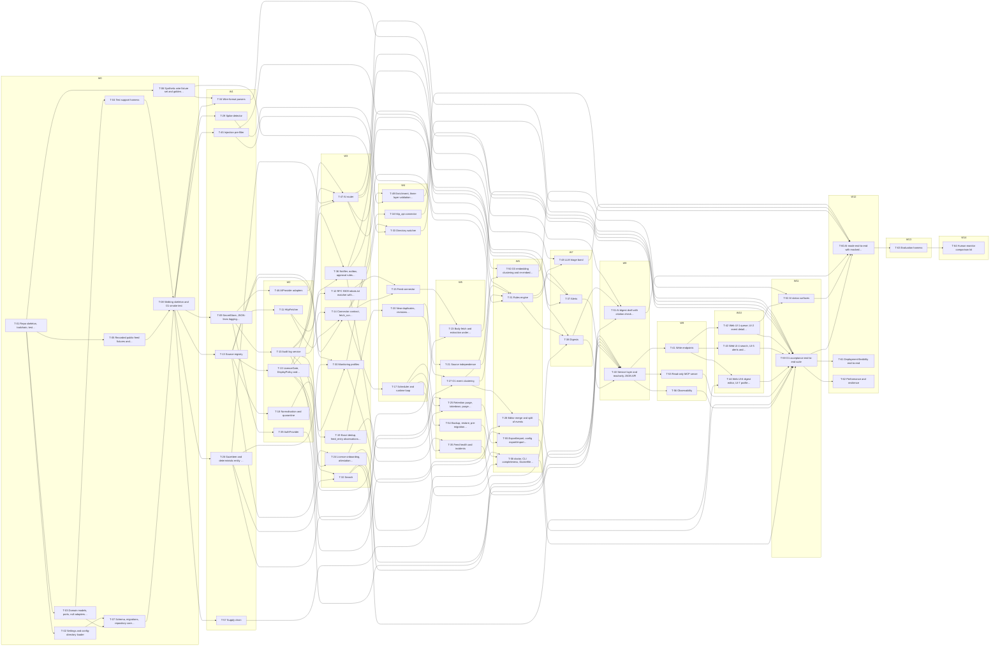

# 13 · Implementation backlog (S2, 2026-11-25)

> **Status: Design proposal (not built).** Deliverable 13. This document describes the FULL MVP. Most of it is not built: Release A + A.1 implements only a subset (collection of authorised feeds and wire files, normalisation, deduplication, rule ranking, search, a local queue, and optional AI assessment). See the [decision log](../decision-log.md) for what is built. Task status is not tracked here.
> Part of the [Newsmon research library](../README.md). Evidence dates default to 2026-11-25; first-person statements are by the AI research agents that wrote the notes.

**Generated** by a private generator script from its TASKS table. The generator is not published. It exited non-zero if any MVP FR
acceptance criterion, NFR, IR, DEP, AC-O1 criterion, workflow, ADR-009 DECIDE-NOW topic or supplement-02 item lacks a
task or a test, or if a J risk in [`technology/reliability-and-security.md`](../technology/reliability-and-security.md) cites no task or test.
Same rows: `backlog.csv`. Test rows: [`specification/test-catalogue.csv`](test-catalogue.csv).

**Inputs:** [`specification/mvp-specification.md`](mvp-specification.md) (FR-01…31, NFR-01…31, IR, DEP, AC-O1), [`architecture/build-vs-reuse-matrix.md`](../architecture/build-vs-reuse-matrix.md),
`11…`, ADR-001…010, [`specification/interface-spec.md`](interface-spec.md), [`technology/ai-threat-model.md`](../technology/ai-threat-model.md), the phase-1 RESULTS.md files. Evidence tag for the
plan itself: INFERRED (S2 engineering decomposition); package versions are the ones deliverable 10 records.

## 1. Rules every task follows

- **O1 first.** The MVP is fully functional with no AI provider (P-008). Every task up to T-44 and the O1 acceptance
  suite (T-59) runs with `ANTHROPIC_API_KEY` and `OPENAI_API_KEY` unset. AI tasks (T-45…T-52) use the AI stub; a live
  call exists only in tests marked `live` (opt-in with `NEWSMON_LIVE=1`, never in CI by default).
- **No network in tests.** An autouse `netguard` fixture (T-04) fails any connection outside the loopback fixture
  ports. Fixtures are recorded feeds and synthetic wire files.
- **Licence behaviour is configuration.** Code never encodes what a contract allows. Every behaviour comes from the
  source flags the customer enters and attests (FR-30, ADR-010 §4). Unconfigured-source defaults are a safety choice.
- **Done means the completion command passes**, plus the regression gate `uv run pytest -q -m "not live and not slow"`
  stays green, plus the architecture tests in `tests/arch`. Each test is marked `@pytest.mark.req("<id>")` so
  `tools/req_coverage.py` can prove requirement coverage from a junit report.
- **Size:** S ≤ 2 h, M 2–4 h, L 4–6 h of one AI coding session. No task is larger than L.
- **Parallel work:** tasks in the same wave have no dependency on each other and can be given to separate coding
  agents. The `parallel_conflicts` column lists any pair in a wave whose owned files overlap; those run one after the
  other. Every non-foundation task depends on T-08 (the smoke gate), added by the script.
- **DEFER items of ADR-009 are not in this backlog** (Postgres adapter, multi-tenant enforcement, SSO, vault, shared
  collection, licence keys, auto-update, billing metering, tested container images).

## 2. Waves

64 tasks. Wave 0 is the foundation the brief requires (repo skeleton, config, test harness, smoke test with
no network and no AI); its internal steps are dependency-ordered. Later waves are computed from the dependencies.

| Wave | Tasks (parallel unless a conflict is listed) | Count |
|---|---|---|
| W0 step 0.1 | T-01 | 1 |
| W0 step 0.2 | T-02, T-03, T-05, T-06 | 4 |
| W0 step 0.3 | T-04, T-07 | 2 |
| W0 step 0.4 | T-08 | 1 |
| W1 | T-09, T-13, T-26, T-29, T-34, T-45, T-57 | 7 |
| W2 | T-10, T-11, T-18, T-22, T-39, T-46 | 6 |
| W3 | T-12, T-14, T-19, T-24, T-30, T-32, T-36, T-47 | 8 |
| W4 | T-15, T-16, T-17, T-20, T-33, T-49 | 6 |
| W5 | T-21, T-23, T-25, T-27, T-35, T-54 | 6 |
| W6 | T-28, T-31, T-50, T-55, T-58 | 5 |
| W7 | T-37, T-38, T-48 | 3 |
| W8 | T-40, T-51 | 2 |
| W9 | T-41, T-53, T-56 | 3 |
| W10 | T-42, T-43, T-44 | 3 |
| W11 | T-52, T-59 | 2 |
| W12 | T-60, T-61, T-62 | 3 |
| W13 | T-63 | 1 |
| W14 | T-64 | 1 |

**Critical path to O1 acceptance (T-59):** T-01 → T-03 → T-04 → T-08 → T-13 → T-18 → T-19 → T-20 → T-27 → T-31 → T-38 → T-40 → T-41 → T-42 → T-59 (≈ 60 h of sequential sessions).

**Critical path overall:** T-01 → T-03 → T-04 → T-08 → T-13 → T-18 → T-19 → T-20 → T-27 → T-31 → T-38 → T-40 → T-41 → T-42 → T-59 → T-60 → T-63 → T-64 (≈ 71 h).

Hours are size midpoints (S = 2, M = 3, L = 5) and are INFERRED; they show ordering, not a schedule.

## 3. Dependency graph

Transitive edges are removed for readability (the CSV keeps the full dependency lists).

## 4. Tasks

### T-01 · Repo skeleton, toolchain, test markers, CLI entry point

- **Wave:** W0 step 0.1 · **Size:** S · **Depends on:** —
- **Objective:** Create the `newsmon` repository with a src layout, a pinned lock, pytest configuration and a CLI stub, so every later task has one place to land.
- **Inputs:** 11 §2 (component list), §7 (versions), §9 (config layout); NFR-17, NFR-18
- **Expected outputs:** pyproject.toml (src/newsmon, entry point `newsmon`), uv.lock, src/newsmon/{__init__,cli}.py, empty packages per 11 §2 (config, domain, connectors, fetcher, licence, pipeline, ai, rules, delivery, web, mcp, ops, repo, adapters), pytest.ini with markers unit/integration/e2e/arch/eval/live/slow and a `req(id)` marker, tests/conftest.py, .gitignore (data/, .env)
- **Reuse (deliverable 10):** uv; CPython >= 3.12; pytest (test tooling, not in deliverable 10: pin at build); stdlib argparse
- **Custom programming:** CLI stub with `--version` and sub-command registry; marker registration
- **Covers:** —
- **Tests required:**
  - `TS-U-cli` (unit, n/a) `tests/unit/test_cli.py`: `newsmon --version` prints the package version; unknown sub-command exits 2
- **Completion (must exit 0):** `uv run newsmon --version && uv run pytest -q -m "not live" tests/unit/test_cli.py`

### T-02 · Settings and config-directory loader (12-factor)

- **Wave:** W0 step 0.2 · **Size:** M · **Depends on:** T-01
- **Objective:** Load typed settings from NEWSMON_CONFIG_DIR plus environment; all state paths from NEWSMON_DATA_DIR / NEWSMON_DB_PATH; O1 is the default.
- **Inputs:** 11 §9; ADR-009 #1, #7; 12 §2 (ai.capabilities), IR-05, DEP-04
- **Expected outputs:** src/newsmon/config/{settings,loader}.py; config.example/{settings,sources,gazetteer,boilerplate}.yaml and profiles/foreign_desk.yaml; Clock port default (system clock, UTC)
- **Reuse (deliverable 10):** pydantic 2.14.4 (settings models); python-dotenv 1.2.4; PyYAML (not in deliverable 10: pin at build, MIT)
- **Custom programming:** Settings schema: use_context, deployment_model, timezone, ai.capabilities.{triage,enrich,embed,digest_draft,query_rewrite} (all false), AI endpoints/region, daily cap, SMTP host, auth mode, allowed_recipient_domains; refusal of secret-looking keys in YAML
- **Covers:** IR-05, DEP-04, NFR-20, ADR9-1, ADR9-7
- **Tests required:**
  - `TS-U-settings` (unit, O1) `tests/unit/config/test_settings.py` [IR-05, NFR-20]: Boot settings from env vars only (no cwd files); every ai.capabilities flag defaults false; unknown keys rejected
  - `TS-DEP04` (unit, n/a) `tests/unit/config/test_no_secrets_in_yaml.py` [DEP-04]: A settings.yaml containing api_key/password/token values is rejected with a message
- **Completion (must exit 0):** `uv run pytest -q -m "not live" tests/unit/config`

### T-03 · Domain models, ports, null adapters, architecture fitness tests

- **Wave:** W0 step 0.2 · **Size:** M · **Depends on:** T-01
- **Objective:** Define NormalisedItem / PollResult / RawUnit / LicenceFlags and the ports (Repository, SearchIndex, Connector, HttpFetcher, AIProvider, Notifier, SecretStore, AuthProvider, Clock, AIStatus) and lock the architecture rules in tests from day one.
- **Inputs:** ADR-009 #2; ADR-010 §1; ADR-006 §5; NFR-08, NFR-19, NFR-21, NFR-22, NFR-27
- **Expected outputs:** src/newsmon/domain/{models,ports,enums}.py; null AIProvider/AIStatus ('AI: 꺼짐'); tests/arch/* with a known-bad control file per checker
- **Reuse (deliverable 10):** pydantic 2.14.4; stdlib ast
- **Custom programming:** AST-based import-boundary, SQL-location, secret-access, no-tools, no-training and parameterised-SQL checkers; each checker must flag its control file (known-answer) and pass the clean tree
- **Covers:** NFR-21, NFR-22, NFR-27, NFR-08, NFR-19, ADR9-2
- **Tests required:**
  - `TS-ARCH-01` (arch, n/a) `tests/arch/test_import_boundaries.py` [NFR-21]: domain/ and pipeline/ import none of sqlite3, httpx, anthropic, smtplib; control file is flagged
  - `TS-ARCH-02` (arch, n/a) `tests/arch/test_sql_location.py` [NFR-22]: No SQL keyword strings outside repo/; control flagged
  - `TS-ARCH-03` (arch, n/a) `tests/arch/test_secret_access.py` [NFR-27]: No os.environ / getenv reads of secret names outside adapters/secrets; control flagged
  - `TS-ARCH-04` (arch, n/a) `tests/arch/test_no_tools_param.py` [NFR-08]: No `tools=` argument in any provider call under ai/; control flagged
  - `TS-ARCH-05` (arch, n/a) `tests/arch/test_no_training_calls.py` [NFR-19]: No fine-tuning / training endpoint names (fine_tuning, /v1/fine_tunes, training_file) anywhere; control flagged
  - `TS-ARCH-06` (arch, n/a) `tests/arch/test_sql_params.py`: No f-string, % or .format() SQL passed to execute(); control flagged (SQL injection)
  - `TS-ARCH-07` (arch, n/a) `tests/arch/test_no_browser_automation.py`: No playwright/selenium/pyppeteer/local-model imports (torch, transformers, whisper, sentence_transformers, kiwipiepy) in src/; control flagged
- **Completion (must exit 0):** `uv run pytest -q -m "not live" tests/arch tests/unit/domain`

### T-04 · Test support harness: fixture HTTP server, SMTP sink, AI stub, clock, netguard, req-coverage tool

- **Wave:** W0 step 0.3 · **Size:** L · **Depends on:** T-01, T-03
- **Objective:** Give every later test a network-free, AI-free, time-controlled environment, and a tool that proves each requirement id has a passing test.
- **Inputs:** 12 §5 test conditions ('fixture set', 'AI stub', [live]); FR-02, FR-03, FR-21, FR-22 fixture needs
- **Expected outputs:** tests/support/{fixture_server,smtp_sink,ai_stub,clock,netguard,resolver}.py; tests/conftest.py autouse netguard; tools/req_coverage.py; tests/requirement_ids.txt
- **Reuse (deliverable 10):** stdlib http.server, socketserver, threading, socket; pytest fixtures
- **Custom programming:** Fixture server with request log (path, headers, timestamp, client) and scripted responses (200/304/404/503/429, redirect, malformed, oversize, slow, robots); minimal SMTP sink that can reject with 550; deterministic AI stub implementing AIProvider with call log, scripted outputs, failures and per-call cost; frozen/advanceable Clock; netguard that fails any connect outside allowed loopback ports; autouse fixture that unsets ANTHROPIC_API_KEY and OPENAI_API_KEY for every non-live test; test resolver mapping *.test names; req_coverage.py reading junit xml + `req` markers
- **Covers:** —
- **Tests required:**
  - `TS-HAR-01` (support, n/a) `tests/support/test_fixture_server.py`: Scripted responses served; request log records UA, conditional headers and timestamps
  - `TS-HAR-02` (support, n/a) `tests/support/test_smtp_sink.py`: Sink accepts and records messages; a configured recipient gets 550
  - `TS-HAR-03` (support, AI-stub) `tests/support/test_ai_stub.py`: Stub records every call with fields, returns scripted JSON, raises scripted 503, reports scripted cost
  - `TS-HAR-04` (support, n/a) `tests/support/test_netguard.py`: Known-answer: connect to 192.0.2.1 and to an AI host name fails; loopback fixture port allowed (instrument control)
  - `TS-HAR-05` (support, n/a) `tests/support/test_req_coverage.py`: req_coverage.py exits non-zero on a junit file missing one id (control) and zero on a complete one
- **Completion (must exit 0):** `uv run pytest -q -m "not live" tests/support`

### T-05 · Recorded public-feed fixtures and gold-set copies

- **Wave:** W0 step 0.2 · **Size:** M · **Depends on:** T-01
- **Objective:** Freeze recorded public-feed responses and the phase-1 gold sets as test fixtures, so no test needs the network.
- **Inputs:** private experiment data (not published) (971 rows); deduplication/handcheck_sample.json (32+4 pairs); event_clustering/gold/* (240 items, labels, corrections, embeddings.npy); [`experiments/korean-fts/fts_experiment.py`](../experiments/korean-fts/fts_experiment.py) queries; 12 §6 seed list
- **Expected outputs:** tests/fixtures/feeds/*.xml (>= 10 RSS/Atom files incl. edge cases), tests/fixtures/gold/{dedup_pairs,cluster_gold_240,cluster_vectors,fts_corpus,fts_queries,lang30}.json, tools/build_fixtures.py; pyproject excludes tests/fixtures from the wheel
- **Reuse (deliverable 10):** feedparser 6.0.14 (to verify fixtures parse); stdlib json, xml.etree for writing
- **Custom programming:** Fixture builder; edge-case items: missing pubDate, ?at_medium=…#frag URL, empty title, Hangul/Han/Latin titles (30 labelled for FR-05b), Guardian live-blog pair, Yonhap '(종합)' pair, 10 iHeart-style subdomain copies + 2 other domains, HTML in summary, an external-entity RSS file
- **Covers:** —
- **Tests required:**
  - `TS-FIX-01` (support, n/a) `tests/support/test_feed_fixtures.py`: Every fixture feed parses; each required edge case is present; gold files have the recorded sizes (240 items, 36 pairs, 10+3 queries per language)
  - `TS-FIX-02` (support, n/a) `tests/support/test_fixture_packaging.py`: Built wheel contains no tests/fixtures path (corpus-derived fixtures are private research data, not shipped)
- **Completion (must exit 0):** `python -I tools/build_fixtures.py --check && uv run pytest -q -m "not live" tests/support/test_feed_fixtures.py`

### T-06 · Synthetic wire fixture set and golden JSON (ADR-010 §8)

- **Wave:** W0 step 0.2 · **Size:** M · **Depends on:** T-01
- **Objective:** Write the project-made mock newswire inbox that stands in for AP Media Agent output, with golden expected values.
- **Inputs:** ADR-010 §3, §8; 07_MULTIMEDIA… §2 (field sets); 02_COMMERCIAL… §8.1 (Media Agent layout)
- **Expected outputs:** tests/fixtures/wire/{newsml_g2,nitf,ninjs,plain}/… (>= 5 G2 incl. a version update and a pubstatus=canceled kill; >= 3 NITF incl. a shotlist; >= 5 ninjs incl. a type=video item with a rendition and an ItemID--Version--ContentID name; >= 5 plain-text incl. URGENCY: 1 and a Korean item); one malformed file per format; an XXE file; a billion-laughs file; an oversize file; a fake video file; a cross-format near-duplicate pair; golden/*.json; a symlink recipe (created at test time)
- **Reuse (deliverable 10):** none (hand-written synthetic text, synthetic=true)
- **Custom programming:** Fixture text and golden JSON; mock_wire_gated / mock_wire_demo source rows for the fixture loader
- **Covers:** S02-fixtures
- **Tests required:**
  - `TS-FIX-03` (support, n/a) `tests/support/test_wire_fixtures.py`: Counts per format meet ADR-010 §8; every valid file has a golden JSON; every file is marked synthetic
- **Completion (must exit 0):** `uv run pytest -q -m "not live" tests/support/test_wire_fixtures.py`

### T-07 · Schema, migrations, repository core, single-writer queue, workspace seam

- **Wave:** W0 step 0.3 · **Size:** L · **Depends on:** T-02, T-03
- **Objective:** Create the SQLite schema of deliverable 11 §5 behind a repository layer that injects workspace_id and owns all SQL.
- **Inputs:** 11 §5 DDL; ADR-004; ADR-009 #3, #4; [`technology/data-model-and-lifecycle.md`](../technology/data-model-and-lifecycle.md) §3
- **Expected outputs:** src/newsmon/repo/{db,migrate,base}.py; repo/migrations/0001_initial.sql (+ a `feed_entry` observation table and workspace_id on spend_day, both missing from 11 §5); query-trace hook; `newsmon migrate`
- **Reuse (deliverable 10):** stdlib sqlite3 (SQLite 3.50.4, WAL, FTS5)
- **Custom programming:** Migration runner with schema_version; connection factory (WAL, foreign_keys, busy_timeout); one writer thread fed by a queue; repository base that adds workspace_id to every statement; sqlite3 trace callback for tests
- **Covers:** FR-01d, FR-30a, NFR-22, NFR-23, ADR9-3, ADR9-4
- **Tests required:**
  - `TS-DB-01` (integration, O1) `tests/integration/repo/test_schema.py` [NFR-22]: migrate creates every table; integrity_check ok; FTS5 contentless_delete=1 accepted (OQ-9); DDL uses only ADR-004 portable types
  - `TS-FR01d` (integration, O1) `tests/integration/repo/test_checks.py::test_training_fixed` [FR-01d]: Insert with training != 'no' fails the CHECK
  - `TS-FR30a-db` (integration, O1) `tests/integration/repo/test_checks.py::test_tenant_needs_attestation` [FR-30a]: Activating a licence_owner=tenant row without attested_on or retention_days fails the CHECK
  - `TS-NFR23a` (integration, O1) `tests/integration/repo/test_workspace_seam.py` [NFR-23]: Every root table in the declared list has workspace_id NOT NULL; child tables reach a root by FK (introspection)
  - `TS-DB-02` (integration, O1) `tests/integration/repo/test_write_queue.py`: 20 concurrent writers produce no 'database is locked' and all rows land
- **Completion (must exit 0):** `uv run pytest -q -m "not live" tests/integration/repo`

### T-08 · Walking skeleton and O1 smoke test (no network, no AI)

- **Wave:** W0 step 0.4 · **Size:** M · **Depends on:** T-04, T-05, T-07
- **Objective:** Run a thin end-to-end path: `newsmon init`, one pipeline cycle on a fixture feed, rows in SQLite, a queue query, with the network guarded and no AI configured.
- **Inputs:** 11 §4 data flow; brief item 1 (Wave 0)
- **Expected outputs:** src/newsmon/pipeline/cycle.py (stage protocol: collect → normalise → dedup → cluster → enrich → rules → deliver, stages pluggable), `newsmon init`, `newsmon run-once`; tests/e2e/test_smoke_o1.py
- **Reuse (deliverable 10):** feedparser 6.0.14; httpx 0.28.1 (plain client for now; hardened in T-11)
- **Custom programming:** Orchestrator with no-op stages that later tasks replace; minimal feed read and article insert
- **Covers:** AC-O1-01
- **Tests required:**
  - `TS-E2E-00` (e2e, O1) `tests/e2e/test_smoke_o1.py` [AC-O1-01]: init + run-once on a fixture feed: articles > 0; netguard sees 0 non-loopback connects; AI stub 0 calls; ANTHROPIC_API_KEY and OPENAI_API_KEY unset
- **Completion (must exit 0):** `uv run pytest -q -m "not live" tests/e2e/test_smoke_o1.py`

### T-09 · SecretStore, JSON-lines logging, redaction, correlation ids

- **Wave:** W1 · **Size:** M · **Depends on:** T-02, T-03, T-08
- **Objective:** Read every secret through one interface and make logs machine-readable and secret-free.
- **Inputs:** ADR-009 #8; NFR-07, NFR-13, NFR-27; DEP-04; AI_THREAT_MODEL M12
- **Expected outputs:** src/newsmon/adapters/secrets.py (env/.env backend, get(name, workspace_id), owner tag); src/newsmon/obs/logging.py (JSON formatter, correlation-id context, redaction filter fed by SecretStore values)
- **Reuse (deliverable 10):** python-dotenv 1.2.4; stdlib logging, contextvars
- **Custom programming:** SecretStore with owner=customer|provider; redaction filter; logging policy: ids and hashes, never source text
- **Covers:** NFR-27, NFR-13, NFR-07, DEP-04, ADR9-8
- **Tests required:**
  - `TS-NFR27b` (unit, n/a) `tests/unit/secrets/test_secret_store.py` [NFR-27]: get() returns by name and workspace; repr/str never show the value; every credential carries an owner tag
  - `TS-NFR13` (unit, n/a) `tests/unit/obs/test_json_logging.py` [NFR-13]: Each record is one JSON line with correlation_id, event type and timestamp
  - `TS-NFR07a` (unit, n/a) `tests/unit/obs/test_redaction.py` [NFR-07]: A canary secret placed in a log message, an exception and extra fields is replaced by [REDACTED] (known-answer)
- **Completion (must exit 0):** `uv run pytest -q -m "not live" tests/unit/secrets tests/unit/obs`

### T-10 · Audit log service (append-only)

- **Wave:** W2 · **Size:** S · **Depends on:** T-07, T-09, T-08
- **Objective:** Record every listed action with its licence flags, immutably and without secrets.
- **Inputs:** FR-26; DR-13, DR-20
- **Expected outputs:** src/newsmon/repo/audit.py; append-only triggers (UPDATE/DELETE on audit_log raise)
- **Reuse (deliverable 10):** stdlib sqlite3
- **Custom programming:** audit(action, actor, target, licence_flags, detail) for fetch, ai_call, verdict, profile_change, send, export, purge, takedown, mcp_call, api_call
- **Covers:** FR-26c
- **Tests required:**
  - `TS-FR26c` (integration, O1) `tests/integration/test_audit.py` [FR-26c]: Rows for each action type; UPDATE/DELETE refused; a grep for configured canary key values over audit_log finds 0
- **Completion (must exit 0):** `uv run pytest -q -m "not live" tests/integration/test_audit.py`

### T-11 · HttpFetcher: UA, limits, connect-time SSRF guard, per-host lock, conditional GET

- **Wave:** W2 · **Size:** L · **Depends on:** T-03, T-04, T-09, T-08
- **Objective:** One HTTP client for every outbound fetch that cannot reach internal addresses and never over-fetches.
- **Inputs:** FR-02, NFR-03, NFR-06; deliverable 10 row 2; changedetection.io SSRF probe (private experiment data (not published))
- **Expected outputs:** src/newsmon/fetcher/{client,ssrf,hostlock}.py
- **Reuse (deliverable 10):** httpx 0.28.1 + own transport hook
- **Custom programming:** Resolve once, refuse loopback/private/link-local/CGNAT/multicast/0.0.0.0/IPv6 ULA and link-local/IPv4-mapped/metadata addresses, connect to the vetted IP (no re-resolution: DNS rebinding), re-check every redirect hop, http/https only, 10 MB cap, 30 s timeout, one in-flight request per host, ETag/Last-Modified; SSRF policy object injected (tests inject a fixture-port allowance; production builds it from settings, which have no such key)
- **Covers:** FR-02c, FR-02d, FR-02e, NFR-06, NFR-03
- **Tests required:**
  - `TS-FR02c` (integration, O1) `tests/integration/fetcher/test_ua.py` [FR-02c, NFR-03]: Every request carries the configured UA exactly (fixture log)
  - `TS-FR02d` (integration, O1) `tests/integration/fetcher/test_ssrf.py` [FR-02d, NFR-06]: 127.0.0.1, 10.0.0.5, 169.254.169.254 and a public.test host that 302s to 127.0.0.1 end ssrf_blocked; the sentinel listener sees no connection
  - `TS-SEC-09` (integration, O1) `tests/integration/fetcher/test_ssrf_extended.py`: ::1, fc00::1, ::ffff:127.0.0.1, 0.0.0.0, 2130706433, 0x7f.1, a name resolving to 127.0.0.1, file:// and gopher:// are all refused
  - `TS-SEC-10` (arch, n/a) `tests/arch/test_ssrf_override_unreachable.py`: The settings schema has no SSRF allowance key and nothing outside tests/ constructs an allowance policy
  - `TS-FR02e` (integration, O1) `tests/integration/fetcher/test_host_lock.py` [FR-02e, NFR-03]: Two feeds on one host never overlap (fixture timestamps)
  - `TS-NFR06` (integration, O1) `tests/integration/fetcher/test_limits.py` [NFR-06]: An 11 MB response is aborted; a slow response hits the (test-shortened) timeout; error_class recorded
  - `TS-FET-01` (integration, O1) `tests/integration/fetcher/test_conditional.py`: Stored validators are sent as If-None-Match / If-Modified-Since
- **Completion (must exit 0):** `uv run pytest -q -m "not live" tests/integration/fetcher`

### T-12 · RFC 9309 robots.txt matcher with daily per-host cache

- **Wave:** W3 · **Size:** M · **Depends on:** T-11, T-08
- **Objective:** Never request a path the publisher disallows, using a correct matcher (not urllib.robotparser).
- **Inputs:** deliverable 10 row 3; [`sources-and-licensing/acquisition-methods.md`](../sources-and-licensing/acquisition-methods.md) §3 (robotparser '?' bug); [`experiments/source-collection/probe_sources.py`](../experiments/source-collection/probe_sources.py)
- **Expected outputs:** src/newsmon/fetcher/robots.py
- **Reuse (deliverable 10):** Port R5's matcher from probe_sources.py (own code)
- **Custom programming:** Longest-match precedence, '*' and '$', allow-over-disallow ties, 4xx = allow all, 5xx/unreachable = disallow all, 24 h cache, re-check daily
- **Covers:** FR-02b, NFR-03
- **Tests required:**
  - `TS-ROB-01` (unit, n/a) `tests/unit/fetcher/test_robots.py` [NFR-03]: RFC 9309 matching table incl. the '?' case that robotparser gets wrong (known-answer control)
  - `TS-FR02b` (integration, O1) `tests/integration/fetcher/test_robots_fetch.py` [FR-02b]: A path under `Disallow: /r?` is never requested: fixture log shows 0 hits
  - `TS-REL-04` (integration, O1) `tests/integration/fetcher/test_robots_change.py`: A robots change to disallow makes the next poll end error_class=robots, no fetch, counted toward a failing incident
- **Completion (must exit 0):** `uv run pytest -q -m "not live" tests/unit/fetcher/test_robots.py tests/integration/fetcher/test_robots_fetch.py`

### T-13 · Source registry: licence flags, sources.yaml seed, use_context activation

- **Wave:** W1 · **Size:** M · **Depends on:** T-02, T-07, T-08
- **Objective:** Load the registry as data with every DR-1 / DR-17 flag and safe defaults; activate sources by use_context.
- **Inputs:** FR-01; 12 §6 seed table; ADR-002; [`sources-and-licensing/source-registry.csv`](../sources-and-licensing/source-registry.csv)
- **Expected outputs:** src/newsmon/registry/{loader,flags}.py; config.example/sources.yaml (27 public + 2 mock rows)
- **Reuse (deliverable 10):** pydantic 2.14.4; PyYAML
- **Custom programming:** Defaults for missing flags; allowed_contexts filter; refusal to activate access_method changedetection/rsshub/wire_api/nrcs_inbound in the MVP (adapter not implemented)
- **Covers:** FR-01a, FR-01b, FR-01c, ADR9-7, ADR9-9
- **Tests required:**
  - `TS-FR01a` (integration, O1) `tests/integration/registry/test_seed.py` [FR-01a]: 27 + 2 rows load to 29 rows; every flag column non-null
  - `TS-FR01b` (integration, O1) `tests/integration/registry/test_defaults.py` [FR-01b]: A row with no flags gets exactly the spec defaults
  - `TS-FR01c` (integration, O1) `tests/integration/registry/test_context.py` [FR-01c]: In internal context the 8 P-only rows are inactive and the fixture server sees no request for them
  - `TS-SEC-12` (integration, O1) `tests/integration/registry/test_adapters_off.py`: Activating a changedetection or rsshub source is refused with 'adapter not implemented'
- **Completion (must exit 0):** `uv run pytest -q -m "not live" tests/integration/registry`

### T-14 · Connector contract, fetch_run recording, retry policy

- **Wave:** W3 · **Size:** M · **Depends on:** T-10, T-11, T-13, T-08
- **Objective:** Implement Connector.poll/parse/health with an explicit status on every poll and the retry rules of FR-03.
- **Inputs:** ADR-010 §1; FR-03, FR-27; DATA_MODEL… §4
- **Expected outputs:** src/newsmon/connectors/base.py; fetch_run writer; audit 'fetch' rows with licence flags; provenance (raw_ref, raw_sha256, parser, received_utc, synthetic, licence_snapshot)
- **Reuse (deliverable 10):** own code over HttpFetcher
- **Custom programming:** PollResult statuses ok/not_modified/empty/error:<class>; backoff for timeout/5xx/429 (max 3 attempts); no retry for 4xx/parse/robots; never raises on remote failure
- **Covers:** FR-03a, FR-03b, FR-03c, FR-03d, FR-27b, FR-27c, S02-interface
- **Tests required:**
  - `TS-FR03a` (integration, O1) `tests/integration/connectors/test_retry.py::test_30_runs` [FR-03a]: 10 feeds x 3 polls -> exactly 30 fetch_run rows
  - `TS-FR03b` (integration, O1) `tests/integration/connectors/test_retry.py::test_503_503_200` [FR-03b]: 503, 503, 200 -> attempts 1-3 and final ok
  - `TS-FR03c` (integration, O1) `tests/integration/connectors/test_retry.py::test_404_once` [FR-03c]: 404 -> exactly 1 attempt
  - `TS-FR03d` (integration, O1) `tests/integration/connectors/test_retry.py::test_malformed` [FR-03d]: Malformed XML -> error_class=parse, 1 attempt
  - `TS-FR27b` (integration, O1) `tests/integration/connectors/test_contract.py::test_provenance` [FR-27b]: Every article row has non-null licence_snapshot and raw_sha256
  - `TS-FR27c` (integration, O1) `tests/integration/connectors/test_contract.py::test_fault_injection` [FR-27c]: Injected DNS failure, reset and TLS error -> status=error:<class>, no exception escapes
- **Completion (must exit 0):** `uv run pytest -q -m "not live" tests/integration/connectors/test_contract.py tests/integration/connectors/test_retry.py`

### T-15 · Feed connector (RSS/Atom)

- **Wave:** W4 · **Size:** M · **Depends on:** T-12, T-14, T-05, T-08
- **Objective:** Poll RSS/Atom feeds politely and turn entries into NormalisedItems.
- **Inputs:** deliverable 10 row 1; [`technology/open-source-components-evaluation.md`](../technology/open-source-components-evaluation.md) F-C-02 (conditional GET via feedparser)
- **Expected outputs:** src/newsmon/connectors/feed.py
- **Reuse (deliverable 10):** feedparser 6.0.14 (parse bytes fetched by HttpFetcher, never let feedparser fetch URLs)
- **Custom programming:** Entry -> NormalisedItem mapping; validator storage; overlap-with-previous-poll signal for window-overflow detection
- **Covers:** FR-02a
- **Tests required:**
  - `TS-FR02a` (integration, O1) `tests/integration/connectors/test_feed.py::test_304` [FR-02a]: Second poll sends validators; 304 -> status=not_modified, 0 new rows
  - `TS-REL-06` (integration, O1) `tests/integration/connectors/test_feed.py::test_window_overflow`: A poll whose entries share no GUID with the previous poll records overlap=0 and a gap warning
  - `TS-SEC-06x` (integration, O1) `tests/integration/connectors/test_feed.py::test_rss_external_entity`: An RSS file with an external entity causes no file read and no outbound request
- **Completion (must exit 0):** `uv run pytest -q -m "not live" tests/integration/connectors/test_feed.py`

### T-16 · http_api connector (Federal Register, SEC, GDELT lastupdate)

- **Wave:** W4 · **Size:** M · **Depends on:** T-14, T-08
- **Objective:** Collect keyless JSON/file APIs through the same contract, with GDELT serialised per IP.
- **Inputs:** ADR-002; 04_INFORMATION_SOURCE… ; [`experiments/event-clustering/results.md`](../experiments/event-clustering/results.md) (GDELT 1 request / 5 s, shared IP)
- **Expected outputs:** src/newsmon/connectors/http_api.py with per-API mappers; recorded API fixtures
- **Reuse (deliverable 10):** httpx 0.28.1 via HttpFetcher
- **Custom programming:** Mappers; GDELT lastupdate 15-minute sequence tracking (a missing file is a gap, never zero)
- **Covers:** FR-02
- **Tests required:**
  - `TS-API-01` (integration, O1) `tests/integration/connectors/test_http_api.py::test_mappers` [FR-02]: Recorded Federal Register, SEC and GDELT responses map to the expected NormalisedItems
  - `TS-API-02` (integration, O1) `tests/integration/connectors/test_http_api.py::test_gdelt_serial`: GDELT requests are >= 5 s apart (simulated clock) and 429 backs off
  - `TS-REL-07` (integration, O1) `tests/integration/connectors/test_http_api.py::test_gdelt_gap`: A skipped 15-minute lastupdate file is recorded as a gap
- **Completion (must exit 0):** `uv run pytest -q -m "not live" tests/integration/connectors/test_http_api.py`

### T-17 · Scheduler and runtime loop (APScheduler, intervals, restart resume)

- **Wave:** W4 · **Size:** M · **Depends on:** T-14, T-08
- **Objective:** Run per-feed polls, the 30 s inbox scan and the periodic jobs in one process, and resume cleanly after a restart.
- **Inputs:** 11 §0, §8; NFR-03, NFR-04; [`technology/open-source-components-evaluation.md`](../technology/open-source-components-evaluation.md) F-C-07
- **Expected outputs:** src/newsmon/runtime/{scheduler,jobs}.py; `newsmon serve` starts web + scheduler; last-tick heartbeat
- **Reuse (deliverable 10):** APScheduler 3.11.3 (in process)
- **Custom programming:** Job registry (feeds, inbox, health, digest, purge, backup, AI drain); interval floor 300 s; graceful shutdown; heartbeat row for /healthz
- **Covers:** NFR-03, NFR-04
- **Tests required:**
  - `TS-SCH-01` (integration, O1) `tests/integration/runtime/test_intervals.py` [NFR-03]: Configured poll_seconds=60 is rejected or clamped to 300; per-feed intervals honoured (simulated clock)
  - `TS-NFR04a` (integration, O1) `tests/integration/runtime/test_resume.py` [NFR-04]: Stop mid-cycle, restart: polling and inbox scanning resume; no job runs twice concurrently
  - `TS-REL-24` (integration, O1) `tests/integration/runtime/test_heartbeat.py`: A dead scheduler thread makes the heartbeat stale; /healthz reads unhealthy after 2 cycles
- **Completion (must exit 0):** `uv run pytest -q -m "not live" tests/integration/runtime`

### T-18 · Normalisation and quarantine

- **Wave:** W2 · **Size:** M · **Depends on:** T-13, T-08
- **Objective:** Produce canonical URL, clean NFC/NFKC text, UTC time with the raw string kept, language, boilerplate strip and content hash; quarantine invalid records.
- **Inputs:** FR-05; deliverable 10 rows 7, 9; [`experiments/deduplication/results.md`](../experiments/deduplication/results.md) D-1, D-2
- **Expected outputs:** src/newsmon/pipeline/normalise.py
- **Reuse (deliverable 10):** courlan 1.5.0 (canonicalisation) + own fragment/tracking strip; stdlib unicodedata, hashlib, html.parser
- **Custom programming:** Script-ratio language id (Hangul / Han / Latin); per-source boilerplate regex with validation (length cap, time-boxed trial on a pathological string); quarantine with reason
- **Covers:** FR-05a, FR-05b, FR-05c, FR-05d
- **Tests required:**
  - `TS-FR05a` (unit, O1) `tests/unit/pipeline/test_normalise.py::test_missing_pubdate` [FR-05a]: Missing pubDate -> published_utc NULL, published_raw empty, first_seen_utc set, not dropped
  - `TS-FR05b` (unit, O1) `tests/unit/pipeline/test_normalise.py::test_lang30` [FR-05b]: >= 29/30 correct on the labelled fixture
  - `TS-FR05c` (unit, O1) `tests/unit/pipeline/test_normalise.py::test_canonical` [FR-05c]: ?at_medium=… and #frag canonicalise to the bare URL
  - `TS-FR05d` (unit, O1) `tests/unit/pipeline/test_normalise.py::test_empty_title` [FR-05d]: Empty title -> quarantine row with reason
  - `TS-SEC-06` (unit, O1) `tests/unit/pipeline/test_normalise.py::test_html_stripped`: <script>,  and javascript: links in titles/summaries are stripped to text
  - `TS-SEC-23` (unit, n/a) `tests/unit/pipeline/test_regex_guard.py`: A catastrophic-backtracking boilerplate pattern is rejected at load (time-boxed trial)
- **Completion (must exit 0):** `uv run pytest -q -m "not live" tests/unit/pipeline/test_normalise.py`

### T-19 · Exact dedup, feed_entry observations, idempotent ingest

- **Wave:** W3 · **Size:** M · **Depends on:** T-18, T-08
- **Objective:** Catch exact duplicates by GUID/URI, canonical URL and content hash, keeping every observation.
- **Inputs:** FR-07, NFR-05; ADR-005
- **Expected outputs:** src/newsmon/pipeline/dedup_exact.py; repo methods using natural keys (INSERT … ON CONFLICT)
- **Reuse (deliverable 10):** stdlib hashlib; SQLite UNIQUE constraints
- **Custom programming:** Observation rows; same_item link on identical content under different URLs
- **Covers:** FR-07a, FR-07b, FR-07c, NFR-05
- **Tests required:**
  - `TS-FR07a` (integration, O1) `tests/integration/pipeline/test_dedup_exact.py::test_two_feeds` [FR-07a]: Same URL in 2 feeds of one source -> 1 article, 2 feed_entry rows
  - `TS-FR07b` (integration, O1) `tests/integration/pipeline/test_dedup_exact.py::test_rerun` [FR-07b, NFR-05]: Re-running ingestion creates 0 new articles; all content-table counts identical
  - `TS-FR07c` (integration, O1) `tests/integration/pipeline/test_dedup_exact.py::test_same_content` [FR-07c]: Two URLs with identical normalised content linked same_item
- **Completion (must exit 0):** `uv run pytest -q -m "not live" tests/integration/pipeline/test_dedup_exact.py`

### T-20 · Near-duplicates, revisions, story_key, live items, wire versions and kills

- **Wave:** W4 · **Size:** L · **Depends on:** T-19, T-08
- **Objective:** Link rewritten copies and revisions with MinHash-LSH and per-source rules, without linking live blogs.
- **Inputs:** FR-08, NFR-11; ADR-005; [`experiments/deduplication/results.md`](../experiments/deduplication/results.md); handcheck_sample.json
- **Expected outputs:** src/newsmon/pipeline/dedup_near.py
- **Reuse (deliverable 10):** datasketch 2.0.0 MinHash-LSH (128 perms, char 4-grams, fixed seed)
- **Custom programming:** Thresholds t >= 0.9 same_item, >= 0.5 syndicated/revision; story_key rules; live-pattern exclusion; NewsML-G2/AP version -> revision; pubstatus=canceled -> killed
- **Covers:** FR-08a, FR-08b, FR-08c, FR-08d, FR-08e, NFR-11
- **Tests required:**
  - `TS-FR08a` (integration, O1) `tests/integration/pipeline/test_dedup_near.py::test_recall` [FR-08a, NFR-11]: Recall >= 0.95 on the R6 labelled pairs with exact Jaccard >= 0.5
  - `TS-FR08b` (integration, O1) `tests/integration/pipeline/test_dedup_near.py::test_yonhap_jonghap` [FR-08b]: Yonhap '(종합)' pair linked revision via story_key
  - `TS-FR08c` (integration, O1) `tests/integration/pipeline/test_dedup_near.py::test_live_blogs` [FR-08c]: Two Guardian live-blog fixtures with shared boilerplate are not linked
  - `TS-FR08d` (integration, O1) `tests/integration/pipeline/test_dedup_near.py::test_wire_version` [FR-08d]: v2 of the same ItemID -> revision 2 of one article
  - `TS-FR08e-1` (integration, O1) `tests/integration/pipeline/test_dedup_near.py::test_kill` [FR-08e]: Kill item sets status=killed
- **Completion (must exit 0):** `uv run pytest -q -m "not live" tests/integration/pipeline/test_dedup_near.py`

### T-21 · Source independence (tldextract offline)

- **Wave:** W5 · **Size:** S · **Depends on:** T-20, T-08
- **Objective:** Count independent sources per event as distinct registrable domains in distinct near-dup clusters.
- **Inputs:** FR-09; ADR-005; [`experiments/deduplication/syndication_breakdown.py`](../experiments/deduplication/syndication_breakdown.py)
- **Expected outputs:** src/newsmon/pipeline/independence.py
- **Reuse (deliverable 10):** tldextract 5.4.0 with its bundled suffix list (no network fetch; cache dir inside NEWSMON_DATA_DIR or disabled)
- **Custom programming:** Independence count; owner_group override
- **Covers:** FR-09a, FR-09b
- **Tests required:**
  - `TS-FR09a` (unit, O1) `tests/unit/pipeline/test_independence.py::test_iheart` [FR-09a]: 10 iHeart subdomain copies + 2 other domains -> 3
  - `TS-FR09b` (unit, O1) `tests/unit/pipeline/test_independence.py::test_syndicated` [FR-09b]: Two outlets carrying the same syndicated text count as 1
  - `TS-TLD-01` (unit, O1) `tests/unit/pipeline/test_independence.py::test_offline`: tldextract makes 0 connections under netguard and writes no file outside the data dir (OQ-9)
- **Completion (must exit 0):** `uv run pytest -q -m "not live" tests/unit/pipeline/test_independence.py`

### T-22 · LicenceGate, DisplayPolicy and safe-rendering library

- **Wave:** W2 · **Size:** L · **Depends on:** T-13, T-03, T-08
- **Objective:** One decision point for what may be stored, sent to which AI, shown, exported or sent outside, and one renderer for model output.
- **Inputs:** FR-06, FR-25, FR-31; ADR-002 flag table; ADR-010 §4; DR-3, DR-8, DR-25; AI_THREAT_MODEL M7
- **Expected outputs:** src/newsmon/licence/{gate,display}.py; src/newsmon/render/safe_text.py
- **Reuse (deliverable 10):** own code; Jinja2 3.1.6 autoescape (used by callers)
- **Custom programming:** LicenceGate.decide(item, op) -> store level / AI route (none | hosted | customer_hosted); DisplayPolicy.render(item, surface, recipient) for ui/api/mcp/digest/export; unknown restrictions -> headline; plain-text model output with links, images and URLs removed; 'AI 생성' wrapper
- **Covers:** FR-06c, FR-06d, FR-06f, FR-25a, FR-27d, FR-31b, S02-flags
- **Tests required:**
  - `TS-GATE-01` (unit, O1) `tests/unit/licence/test_gate_matrix.py`: Full matrix of storage x ai_processing x permitted_ops x external_ai_allowed x endpoint availability -> expected route
  - `TS-FR06c-unit` (unit, O1) `tests/unit/licence/test_display_matrix.py` [FR-06c]: display=headline yields no feed-summary text for every surface
  - `TS-FR06d` (unit, O1) `tests/unit/licence/test_redistribution.py` [FR-06d]: redistribution=none item for an external recipient renders title + link only
  - `TS-FR06f` (unit, AI-stub) `tests/unit/licence/test_display_ai_fields.py` [FR-06f]: V1-01: DisplayPolicy governs ai.* fields; for display<snippet no quote_original or verbatim quote and no source substring >= 20 chars on any surface; Korean summary shown only if permitted_ops contains summarise or translate
  - `TS-FR27d` (unit, O1) `tests/unit/licence/test_synthetic_no_bypass.py` [FR-27d]: V1-04: synthetic=true never changes LicenceGate or DisplayPolicy decisions (same flags, same route, synthetic true vs false)
  - `TS-FR31b` (unit, O1) `tests/unit/licence/test_restrictions.py` [FR-31b]: Unrecognised restriction string -> headline-only
  - `TS-FR25a` (unit, AI-stub) `tests/unit/render/test_safe_text.py` [FR-25a]: Stub output with , a markdown link and http://exfil.example renders inert: no <a>,  or URL
- **Completion (must exit 0):** `uv run pytest -q -m "not live" tests/unit/licence tests/unit/render`

### T-23 · Body fetch and extraction under storage flags

- **Wave:** W5 · **Size:** M · **Depends on:** T-15, T-22, T-08
- **Objective:** Fetch article bodies only where storage allows, through the same guarded fetcher, and discard transient bodies.
- **Inputs:** FR-06a/b; DR-4; deliverable 10 row 5
- **Expected outputs:** src/newsmon/pipeline/body.py
- **Reuse (deliverable 10):** trafilatura 2.4.0 (extraction only; fetching by HttpFetcher, robots-checked)
- **Custom programming:** Body stage keyed on LicenceGate store level; transient discard after features
- **Covers:** FR-06a, FR-06b
- **Tests required:**
  - `TS-FR06a` (integration, O1) `tests/integration/pipeline/test_body.py::test_metadata` [FR-06a]: storage=metadata: fixture server sees no article-page request; body_text NULL
  - `TS-FR06b` (integration, O1) `tests/integration/pipeline/test_body.py::test_transient` [FR-06b]: storage=transient: body requested once; body_text NULL after processing
  - `TS-SEC-09b` (integration, O1) `tests/integration/pipeline/test_body.py::test_article_link_ssrf`: A feed entry whose link points at 169.254.169.254 is refused by the body fetch
- **Completion (must exit 0):** `uv run pytest -q -m "not live" tests/integration/pipeline/test_body.py`

### T-24 · Licence onboarding, attestation, valid_until kill switch, deployment check

- **Wave:** W3 · **Size:** M · **Depends on:** T-13, T-10, T-08
- **Objective:** Make customer-entered contract terms the only source of licence behaviour, with attestation before activation.
- **Inputs:** FR-30; DR-17, DR-27, DR-30; ADR-010 §4; 08_LEGAL… §13.5
- **Expected outputs:** src/newsmon/registry/onboarding.py (DR-30 checklist model, attestation, activation guard, valid_until check, flag-change audit); deployment_checks() used by `doctor`
- **Reuse (deliverable 10):** pydantic 2.14.4
- **Custom programming:** Checklist answers stored in checklist_json; activation refused without attestation and retention_days; poll skipped after valid_until with audit; third_party_processors_allowed vs deployment_model check
- **Covers:** FR-30a, FR-30b, FR-30c, FR-30d, DEP-05, ADR9-9, S02-flags
- **Tests required:**
  - `TS-FR30a-svc` (integration, O1) `tests/integration/registry/test_onboarding.py::test_activate_needs_attestation` [FR-30a, DEP-05]: Service refuses to activate an unattested tenant source
  - `TS-FR30b` (integration, O1) `tests/integration/registry/test_onboarding.py::test_valid_until` [FR-30b]: After valid_until (simulated clock) the next poll is skipped with an audit row
  - `TS-FR30c-unit` (integration, O1) `tests/integration/registry/test_onboarding.py::test_flag_change` [FR-30c]: external_ai_allowed false -> true on mock_wire_demo makes the gate route the next item to AI; change audited
  - `TS-FR30d-unit` (integration, O1) `tests/integration/registry/test_onboarding.py::test_deployment_check` [FR-30d]: third_party_processors_allowed=false on an active tenant source and deployment_model != CH -> 'deployment must be customer-hosted'
- **Completion (must exit 0):** `uv run pytest -q -m "not live" tests/integration/registry/test_onboarding.py`

### T-25 · Retention purge, takedown, purge receipts

- **Wave:** W5 · **Size:** M · **Depends on:** T-22, T-10, T-17, T-24, T-08
- **Objective:** Delete content on schedule or on command and prove it with a receipt.
- **Inputs:** FR-06e, FR-26b; DR-21, DR-27
- **Expected outputs:** src/newsmon/ops/purge.py; nightly purge job; `newsmon source takedown <key> --purge`
- **Reuse (deliverable 10):** stdlib sqlite3; FTS5 contentless_delete
- **Custom programming:** Per-source retention purge of bodies, AI outputs and FTS rows; receipt in audit_log with counts; takedown disables then purges
- **Covers:** FR-06e, FR-26b
- **Tests required:**
  - `TS-FR06e` (integration, O1) `tests/integration/ops/test_purge.py::test_retention` [FR-06e]: Clock past retention_days: bodies and AI outputs of that source deleted; audit purge row lists counts
  - `TS-FR26b` (integration, O1) `tests/integration/ops/test_purge.py::test_takedown` [FR-26b]: takedown --purge leaves 0 article rows for the source and writes a receipt
  - `TS-SEC-27` (integration, O1) `tests/integration/ops/test_purge.py::test_fts_purged`: After purge a search for the purged body's unique token returns 0
- **Completion (must exit 0):** `uv run pytest -q -m "not live" tests/integration/ops/test_purge.py`

### T-26 · Gazetteer and deterministic entity / dateline matcher

- **Wave:** W1 · **Size:** M · **Depends on:** T-02, T-07, T-08
- **Objective:** Match watch-list entities in KO/EN/ZH with aliases, for clustering, rules, search expansion and masking.
- **Inputs:** 11 §9 gazetteer.yaml; INTERFACE_SPEC §7; 06_AI… §5 (cross-lingual entity forms)
- **Expected outputs:** src/newsmon/pipeline/gazetteer.py; config.example/gazetteer.yaml (incl. kim_yo_jong: 김여정 / Kim Yo Jong / 金與正 / 金与正)
- **Reuse (deliverable 10):** stdlib re, unicodedata
- **Custom programming:** Alias index, Latin word boundaries, CJK substring match, entity kind (PERSON/ORG/PLACE), dateline regex
- **Covers:** —
- **Tests required:**
  - `TS-GAZ-01` (unit, O1) `tests/unit/pipeline/test_gazetteer.py`: Aliases match across scripts; 'Kim' alone does not match kim_yo_jong; datelines parsed; unknown ids rejected
- **Completion (must exit 0):** `uv run pytest -q -m "not live" tests/unit/pipeline/test_gazetteer.py`

### T-27 · O1 event clustering (per-language TF-IDF + gazetteer co-occurrence)

- **Wave:** W5 · **Size:** L · **Depends on:** T-20, T-26, T-08
- **Objective:** Group items into events incrementally over a 48 h window with no AI, deterministically.
- **Inputs:** FR-10a, NFR-16, AC-O1-05; ADR-005; event_clustering/cluster_experiment.py, cluster_variants.py; RESULTS.md (precision 0.87, recall 0.21 at θ 0.2)
- **Expected outputs:** src/newsmon/pipeline/cluster_o1.py; algo id 'tfidf-v1-θ0.2+gaz48h'
- **Reuse (deliverable 10):** scikit-learn 1.9.1 (TfidfVectorizer); numpy 2.5.5
- **Custom programming:** Port R6's incremental assignment; gazetteer co-occurrence link within 48 h; membership rows with algo id
- **Covers:** FR-10a, NFR-16, AC-O1-05
- **Tests required:**
  - `TS-FR10a` (integration, O1) `tests/integration/pipeline/test_cluster_o1.py::test_gold` [FR-10a, AC-O1-05]: Pair precision >= 0.80 on the 240-item gold copy (the tuning set, stated in the report), run with and without gazetteer linking (V1-07); recall printed, no floor
  - `TS-NFR16` (integration, O1) `tests/integration/pipeline/test_cluster_o1.py::test_deterministic` [NFR-16]: Same input + same algo id -> identical memberships on two runs; every membership row has algo
- **Completion (must exit 0):** `uv run pytest -q -m "not live" tests/integration/pipeline/test_cluster_o1.py`

### T-28 · Editor merge and split of events

- **Wave:** W6 · **Size:** S · **Depends on:** T-27, T-10, T-08
- **Objective:** Let editors correct grouping, recorded and audited.
- **Inputs:** FR-10c; INTERFACE_SPEC §3
- **Expected outputs:** src/newsmon/pipeline/event_edit.py
- **Reuse (deliverable 10):** own code
- **Custom programming:** merge(event_a, event_b), split(event, members); added_by='editor:<login>'
- **Covers:** FR-10c
- **Tests required:**
  - `TS-FR10c` (integration, O1) `tests/integration/pipeline/test_event_edit.py` [FR-10c]: Merge then split restores original memberships; both audited
- **Completion (must exit 0):** `uv run pytest -q -m "not live" tests/integration/pipeline/test_event_edit.py`

### T-29 · Spike detector (rolling z-score)

- **Wave:** W1 · **Size:** S · **Depends on:** T-07, T-08
- **Objective:** Flag volume spikes on the system's own per-event and per-watch-term counts.
- **Inputs:** FR-17c; spike_detection/RESULTS.md; spike_detect.py
- **Expected outputs:** src/newsmon/rules/spike.py
- **Reuse (deliverable 10):** numpy 2.5.5
- **Custom programming:** Rolling z >= 2.5 over 7 buckets, minimum count 5, missing buckets treated as missing
- **Covers:** FR-17c
- **Tests required:**
  - `TS-FR17c` (unit, O1) `tests/unit/rules/test_spike.py` [FR-17c]: Synthetic hourly series with one 3x peak flags that bucket only; sub-floor series never flags
- **Completion (must exit 0):** `uv run pytest -q -m "not live" tests/unit/rules/test_spike.py`

### T-30 · Monitoring profiles: schema, validation, versioning, preview

- **Wave:** W3 · **Size:** M · **Depends on:** T-13, T-26, T-10, T-08
- **Objective:** Define monitoring without code: YAML or form, validated, versioned, previewable.
- **Inputs:** FR-16; INTERFACE_SPEC §7
- **Expected outputs:** src/newsmon/rules/profile.py; profile import/export; 24 h preview
- **Reuse (deliverable 10):** pydantic 2.14.4; PyYAML
- **Custom programming:** Profile schema; id checks against registry and gazetteer; rejection of flash-from-AI rules; keywords treated as literals; recipients outside allowed domains marked external
- **Covers:** FR-16b, FR-16c, FR-16e, ADR9-7
- **Tests required:**
  - `TS-FR16b` (unit, O1) `tests/unit/rules/test_profile.py::test_unknown_ids` [FR-16b]: Unknown source or entity id rejected with a message
  - `TS-FR16c` (unit, O1) `tests/unit/rules/test_profile.py::test_flash_from_ai` [FR-16c]: Rule setting flash from an AI field rejected
  - `TS-FR16e` (integration, O1) `tests/integration/rules/test_preview.py` [FR-16e]: Last-24 h preview counts equal a direct rule re-run over stored items
  - `TS-PRO-01` (unit, O1) `tests/unit/rules/test_profile.py::test_versions`: Each save creates a new version; previous versions retained
- **Completion (must exit 0):** `uv run pytest -q -m "not live" tests/unit/rules/test_profile.py`

### T-31 · Rules engine: weighted relevance, bands, explanations

- **Wave:** W6 · **Size:** L · **Depends on:** T-30, T-21, T-27, T-29, T-08
- **Objective:** Band every item from configured rules and show why.
- **Inputs:** FR-17, FR-16a; ADR-006 decision 4; INTERFACE_SPEC §2 (근거 line)
- **Expected outputs:** src/newsmon/rules/engine.py; tests/fixtures/gold/relevance30.json (hand-labelled, protocol in deliverable 14 §5.3)
- **Reuse (deliverable 10):** own code (ideas from Huginn Trigger, feeds.fun, AIHOT: MIT/BSD references, no code copied)
- **Custom programming:** Weighted sum (terms, entities, country, source weight, independence, urgency, recency, event size, spike); ordered priority rules -> band; rule_hit rows; re-evaluation on profile change without restart
- **Covers:** FR-17a, FR-17b, FR-16a
- **Tests required:**
  - `TS-FR17a` (integration, O1) `tests/integration/rules/test_engine.py::test_relevance30` [FR-17a]: >= 28/30 bands as expected on the hand-labelled fixture
  - `TS-FR17b` (integration, O1) `tests/integration/rules/test_engine.py::test_explanations` [FR-17b]: Every item at band >= review has a non-empty rule_hit explanation
  - `TS-FR16a` (integration, O1) `tests/integration/rules/test_engine.py::test_hot_reload` [FR-16a]: Adding a keyword re-ranks a matching item on the next evaluation; no restart
- **Completion (must exit 0):** `uv run pytest -q -m "not live" tests/integration/rules/test_engine.py`

### T-32 · Search: bigram FTS5 index, BM25, filters, gazetteer alias expansion

- **Wave:** W3 · **Size:** L · **Depends on:** T-07, T-22, T-26, T-08
- **Objective:** KO/ZH/EN search that works for 2-character queries and never indexes text the flags forbid.
- **Inputs:** FR-20, NFR-10, AC-O1-06; ADR-004; korean_fts/RESULTS.md (method D); fts_experiment.py
- **Expected outputs:** src/newsmon/repo/search.py (SearchIndex); src/newsmon/pipeline/tokenise.py
- **Reuse (deliverable 10):** SQLite FTS5 (contentless, contentless_delete=1, unicode61)
- **Custom programming:** CJK bigram tokeniser at index and query time; BM25 with filters (lang, source, time, band, event); alias expansion shown on screen; indexing obeys storage flags
- **Covers:** FR-20a, FR-20b, FR-20c, FR-20d, NFR-10, AC-O1-06
- **Tests required:**
  - `TS-FR20a` (integration, O1) `tests/integration/search/test_known_answer.py` [FR-20a, NFR-10]: R6's 10 known-answer queries per language (KO, ZH) recall 1.00 incl. 북한, 미국, 中国, 美国
  - `TS-FR20b` (integration, O1) `tests/integration/search/test_nonsense.py` [FR-20b, NFR-10]: 3 nonsense queries per language return 0 (instrument control)
  - `TS-FR20c` (integration, O1) `tests/integration/search/test_alias.py` [FR-20c]: 'Kim Yo Jong' returns the KO and ZH items for 김여정 / 金與正 in O1
  - `TS-ACO1-06` (integration, O1) `tests/integration/search/test_o1_limit.py` [AC-O1-06]: A non-gazetteer English phrase does not find Korean coverage (expected O1 limit, asserted)
  - `TS-FR20d` (integration, O1) `tests/integration/search/test_latency.py` [FR-20d]: p95 < 300 ms on 100,000 synthetic rows (marked slow)
  - `TS-SRCH-01` (integration, O1) `tests/integration/search/test_index_flags.py`: A metadata-only source's body token and a gated source's non-displayable text are absent from the index
- **Completion (must exit 0):** `uv run pytest -q -m "not live" tests/integration/search`

### T-33 · Directory watcher (inbox connector)

- **Wave:** W4 · **Size:** L · **Depends on:** T-14, T-06, T-08
- **Objective:** Ingest customer wire files from a read-only root safely and exactly once.
- **Inputs:** FR-28; ADR-010 §3; DEP-03
- **Expected outputs:** src/newsmon/connectors/directory.py; inbox_ledger writer
- **Reuse (deliverable 10):** stdlib os.scandir, pathlib, hashlib (no watchdog dependency)
- **Custom programming:** Root confinement via resolved real paths; symlink-escape refusal; size and mtime stable for N s; ledger (path, size, mtime_ns, sha256); AP name parsing; gone marking; never write to the root; per-file size cap
- **Covers:** FR-28a, FR-28b, FR-28c, FR-28d, FR-28e, FR-28f, DEP-03, S02-dirwatch, ADR9-9
- **Tests required:**
  - `TS-FR28a` (integration, O1) `tests/integration/connectors/test_directory.py::test_ingest_all` [FR-28a]: Copying the >= 18-file fixture inbox ingests every valid file within 2 scan intervals
  - `TS-FR28b` (integration, O1) `tests/integration/connectors/test_directory.py::test_rescan` [FR-28b]: Re-scan ingests nothing new
  - `TS-FR28c` (integration, O1) `tests/integration/connectors/test_directory.py::test_unstable` [FR-28c]: A growing file is not ingested until stable
  - `TS-FR28d` (integration, O1) `tests/integration/connectors/test_directory.py::test_symlink` [FR-28d]: Symlink to a file outside the root refused with error_class=io (skip with explicit reason only where the OS forbids symlink creation; Linux CI must run it)
  - `TS-FR28e` (integration, O1) `tests/integration/connectors/test_directory.py::test_untouched` [FR-28e]: Directory listing and hashes identical before and after the run
  - `TS-FR28f` (integration, O1) `tests/integration/connectors/test_directory.py::test_gone` [FR-28f]: Deleting a file after ingest keeps the item and marks the ledger gone
  - `TS-DEP03` (integration, O1) `tests/integration/connectors/test_directory.py::test_readonly_root` [DEP-03]: Ingest works with the root mounted / permissioned read-only
  - `TS-REL-08` (integration, O1) `tests/integration/connectors/test_directory.py::test_version_gap`: ItemID v1 then v3 logs a version gap
- **Completion (must exit 0):** `uv run pytest -q -m "not live" tests/integration/connectors/test_directory.py`

### T-34 · Wire-format parsers (NewsML-G2, NITF, ninjs, plain text) and media_asset references

- **Wave:** W1 · **Size:** L · **Depends on:** T-03, T-06, T-08
- **Objective:** Parse each wire format by content into NormalisedItems, safely, and record media as references only.
- **Inputs:** FR-29, FR-31; ADR-010 §3; 07_MULTIMEDIA… §2
- **Expected outputs:** src/newsmon/connectors/parsers/{detect,newsml_g2,nitf,ninjs,plain,media}.py
- **Reuse (deliverable 10):** defusedxml (pin at build; licence to verify, OQ-9); stdlib json
- **Custom programming:** Content-based detection; field mapping to ninjs-style names; NITF shotlist -> association; magic-byte media detection -> media_asset (sha256, size); quarantine with reason
- **Covers:** FR-29a, FR-29b, FR-29c, FR-29d, FR-29e, FR-31a, S02-fixtures
- **Tests required:**
  - `TS-FR29a` (unit, O1) `tests/unit/parsers/test_golden.py` [FR-29a]: Every fixture maps headline, versioncreated, language, urgency, body, pubstatus to golden JSON (field equality)
  - `TS-FR29b` (unit, O1) `tests/unit/parsers/test_nitf.py::test_shotlist` [FR-29b]: NITF shotlist becomes an association on the video item
  - `TS-FR29c` (unit, O1) `tests/unit/parsers/test_malformed.py` [FR-29c]: Each malformed fixture is quarantined with a reason
  - `TS-FR29d` (unit, O1) `tests/unit/parsers/test_xml_safety.py::test_xxe` [FR-29d]: External-entity fixture refused; no outbound request (netguard) and no file read (audit hook)
  - `TS-SEC-07` (unit, O1) `tests/unit/parsers/test_xml_safety.py::test_entity_expansion`: Billion-laughs fixture refused within a time budget
  - `TS-FR29e` (unit, O1) `tests/unit/parsers/test_media.py` [FR-29e]: Video fixture creates one media_asset row with sha256 and size; no copy under the data dir
  - `TS-SEC-08` (unit, O1) `tests/unit/parsers/test_media.py::test_untrusted_media`: A media file named .xml is detected by magic bytes and never XML-parsed; rendition hrefs with ../ are stored as text and never followed
  - `TS-FR31a-parse` (unit, O1) `tests/unit/parsers/test_ninjs.py` [FR-31a]: ninjs video fixture keeps renditions and associations
- **Completion (must exit 0):** `uv run pytest -q -m "not live" tests/unit/parsers`

### T-35 · Feed health and incidents

- **Wave:** W5 · **Size:** M · **Depends on:** T-14, T-36, T-17, T-08
- **Objective:** Open and close incidents from fetch_run history and draft outside notices for approval.
- **Inputs:** FR-04; 11 §4 feed-health flow; R-26, R-27
- **Expected outputs:** src/newsmon/delivery/health.py; source_health aggregation job
- **Reuse (deliverable 10):** own code
- **Custom programming:** Rules: N consecutive failures; 200 with 0 entries against a non-zero 7-day median; silence > k x median inter-arrival (k = 6, min 6 h); feed_incident alerts; wire-agency notice drafted to outbox
- **Covers:** FR-04a, FR-04b, FR-04d
- **Tests required:**
  - `TS-FR04a` (integration, O1) `tests/integration/delivery/test_health.py::test_failing` [FR-04a]: 3 failing polls open exactly one failing incident; one success closes it
  - `TS-FR04b` (integration, O1) `tests/integration/delivery/test_health.py::test_empty` [FR-04b]: Switch to a valid empty RSS opens an empty incident on the first empty poll after baseline
  - `TS-FR04d` (integration, O1) `tests/integration/delivery/test_health.py::test_external_notice` [FR-04d]: Notice to a non-allow-listed recipient lands awaiting_approval; sink receives nothing
  - `TS-REL-03` (integration, O1) `tests/integration/delivery/test_health.py::test_silent`: No new item for > 6 x median (min 6 h) opens a silent incident
- **Completion (must exit 0):** `uv run pytest -q -m "not live" tests/integration/delivery/test_health.py`

### T-36 · Notifier, outbox, approval rules, delivery log

- **Wave:** W3 · **Size:** M · **Depends on:** T-09, T-10, T-22, T-08
- **Objective:** Send email only where rules allow; queue everything else for one-click approval; log every attempt.
- **Inputs:** FR-21d, FR-22c, IR-04; ADR-008 outbound rule; AI_THREAT_MODEL M8
- **Expected outputs:** src/newsmon/delivery/{notifier,outbox}.py
- **Reuse (deliverable 10):** stdlib smtplib, email (plain + HTML parts)
- **Custom programming:** Outbox state machine queued -> sending -> sent/failed, awaiting_approval; auto-send only to allow-listed internal recipients for unflagged items; Message-ID idempotency key; subject prefixes; AI label
- **Covers:** FR-21d, IR-04
- **Tests required:**
  - `TS-FR21d` (integration, O1) `tests/integration/delivery/test_outbox.py::test_outside_allow_list` [FR-21d]: Recipient outside the allow-list -> awaiting_approval, nothing sent
  - `TS-IR04` (integration, O1) `tests/integration/delivery/test_outbox.py::test_email_format` [IR-04]: Plain-text and HTML parts; subject [newsmon][FLASH] / [newsmon][조간]; AI label present when AI text included
  - `TS-REL-16` (integration, O1) `tests/integration/delivery/test_outbox.py::test_crash_mid_send`: Crash between SMTP accept and status update: restart re-sends with the same Message-ID; delivery_log shows both attempts
- **Completion (must exit 0):** `uv run pytest -q -m "not live" tests/integration/delivery/test_outbox.py`

### T-37 · Alerts (flash, spike, watch) with per-event de-duplication

- **Wave:** W7 · **Size:** M · **Depends on:** T-31, T-36, T-45, T-08
- **Objective:** Raise rule-driven alerts once per event and never auto-send flagged items.
- **Inputs:** FR-21; WF-2; INTERFACE_SPEC §7 alerts
- **Expected outputs:** src/newsmon/delivery/alerts.py
- **Reuse (deliverable 10):** own code
- **Custom programming:** Alert rules per profile; one alert per event per 6 h unless the band rises; in-app badge state; email via outbox; injection-flag (regex pre-filter runs in every mode) suppresses auto-send
- **Covers:** FR-21a, FR-21b, FR-21c
- **Tests required:**
  - `TS-FR21a-unit` (integration, O1) `tests/integration/delivery/test_alerts.py::test_flash_once` [FR-21a]: A matching urgency-1 item produces exactly one flash alert and one email in the sink
  - `TS-FR21b` (integration, O1) `tests/integration/delivery/test_alerts.py::test_dedup` [FR-21b]: A second member of the same event produces no second email
  - `TS-FR21c` (integration, O1) `tests/integration/delivery/test_alerts.py::test_flagged` [FR-21c]: A regex-flagged item produces no email (O1)
- **Completion (must exit 0):** `uv run pytest -q -m "not live" tests/integration/delivery/test_alerts.py`

### T-38 · Digests (O1 template) and shift handoff

- **Wave:** W7 · **Size:** L · **Depends on:** T-36, T-31, T-22, T-17, T-08
- **Objective:** Produce scheduled and ad hoc editions that a person reviews and approves before email.
- **Inputs:** FR-22, FR-06d; INTERFACE_SPEC §6; WF-4
- **Expected outputs:** src/newsmon/delivery/digest.py; citation check; per-recipient DisplayPolicy rendering
- **Reuse (deliverable 10):** Jinja2 3.1.6 (templates); APScheduler 3.11.3 (editions)
- **Custom programming:** Rule-based selection; template draft (titles, links, source counts, cited uids); citation check; draft -> in_review -> approved -> sent; delivery_log per recipient
- **Covers:** FR-22a, FR-22c, FR-22d, FR-06d
- **Tests required:**
  - `TS-FR22a` (integration, O1) `tests/integration/delivery/test_digest.py::test_scheduled` [FR-22a]: At the scheduled time (simulated clock) a draft exists, status=in_review, not sent
  - `TS-FR22c` (integration, O1) `tests/integration/delivery/test_digest.py::test_approve_send` [FR-22c]: Approve -> sink receives; one delivery_log row per recipient; a rejected recipient shows failed
  - `TS-FR22d` (integration, O1) `tests/integration/delivery/test_digest.py::test_template` [FR-22d]: O1 template digest with titles, links and source counts for the window
  - `TS-FR06d-digest` (integration, O1) `tests/integration/delivery/test_digest.py::test_external_recipient` [FR-06d]: redistribution=none item reaches an external recipient as title + link only
- **Completion (must exit 0):** `uv run pytest -q -m "not live" tests/integration/delivery/test_digest.py`

### T-39 · AuthProvider (local, static_users), roles, sessions, CSRF, hashed API tokens

- **Wave:** W2 · **Size:** M · **Depends on:** T-07, T-09, T-08
- **Objective:** Authenticate and authorise every surface behind one interface.
- **Inputs:** ADR-009 #6; NFR-25; FR-23a; deliverable 10 row 45
- **Expected outputs:** src/newsmon/adapters/auth.py; src/newsmon/web/security.py
- **Reuse (deliverable 10):** stdlib hashlib.scrypt, secrets, hmac; FastAPI 0.165.0 dependencies
- **Custom programming:** local (bind 127.0.0.1, single user) and static_users (users file, scrypt); roles viewer/editor/admin; session cookie (HttpOnly, SameSite=Strict); CSRF token on writes; API tokens stored as hashes with scopes; login throttle
- **Covers:** NFR-25, FR-23a, ADR9-6
- **Tests required:**
  - `TS-NFR25` (integration, O1) `tests/integration/web/test_auth.py::test_roles` [NFR-25]: Both providers work; a viewer posting a verdict gets 403; api_token holds only hashes
  - `TS-FR23a` (integration, O1) `tests/integration/web/test_auth.py::test_tokens` [FR-23a]: No token -> 401; revoked token -> 401
  - `TS-SEC-21` (integration, O1) `tests/integration/web/test_auth.py::test_csrf_bind_throttle`: Write without CSRF token -> 403; default bind 127.0.0.1; 10 bad logins -> throttled
- **Completion (must exit 0):** `uv run pytest -q -m "not live" tests/integration/web/test_auth.py`

### T-40 · Service layer and read-only JSON API

- **Wave:** W8 · **Size:** L · **Depends on:** T-39, T-22, T-28, T-31, T-32, T-35, T-37, T-38, T-08
- **Objective:** One read model for queue, events, articles, search, alerts, digests, sources and health, exposed as the v1 JSON API, all text through DisplayPolicy.
- **Inputs:** 11 §6; FR-23; FR-06c; FR-31a; IR-02
- **Expected outputs:** src/newsmon/service/*.py; src/newsmon/web/api.py
- **Reuse (deliverable 10):** FastAPI 0.165.0; uvicorn 0.54.0; pydantic 2.14.4 response models
- **Custom programming:** Read services; response models with ai.{generated_by_ai, model, prompt_version}; limit cap 50; cursor pagination; api_call audit
- **Covers:** FR-23b, FR-23c, FR-06c, FR-31a, FR-08e, FR-04c, IR-02
- **Tests required:**
  - `TS-FR23b` (integration, O1) `tests/integration/api/test_display.py` [FR-23b]: display=headline item responses contain no summary text
  - `TS-FR06c-api` (integration, O1) `tests/integration/api/test_display.py::test_all_endpoints` [FR-06c]: Fixture summary string absent from every API response for headline items
  - `TS-FR23c` (integration, O1) `tests/integration/api/test_limits.py` [FR-23c]: Every list endpoint caps limit at 50
  - `TS-FR31a` (integration, O1) `tests/integration/api/test_articles.py::test_ninjs_roundtrip` [FR-31a]: ninjs video fixture round-trips through GET /api/v1/articles/{uid} with renditions intact
  - `TS-FR08e-2` (integration, O1) `tests/integration/api/test_events.py::test_killed_hidden` [FR-08e]: Killed item disappears from GET /api/v1/events
  - `TS-FR04c-api` (integration, O1) `tests/integration/api/test_health.py` [FR-04c]: GET /api/v1/health/feeds shows an incident within one poll cycle
  - `TS-IR02` (integration, O1) `tests/integration/api/test_shapes.py` [IR-02]: Response schemas match the 11 §6 endpoint list (snapshot)
  - `TS-FR25-api` (integration, AI-stub) `tests/integration/api/test_ai_nesting.py` [FR-25a]: AI fields only under `ai` with generated_by_ai: true, model and prompt_version
- **Completion (must exit 0):** `uv run pytest -q -m "not live" tests/integration/api`

### T-41 · Write endpoints: verdicts, merge/split, approvals, alert ack, profiles

- **Wave:** W9 · **Size:** M · **Depends on:** T-40, T-30, T-08
- **Objective:** Every editorial write goes through role-checked, CSRF-protected, audited endpoints.
- **Inputs:** 11 §6 write table; FR-18b
- **Expected outputs:** src/newsmon/web/api_write.py
- **Reuse (deliverable 10):** FastAPI 0.165.0
- **Custom programming:** POST /assessments, /events/{uid}/merge|split, /digests/{id}/approve, /alerts/{id}/ack, /profiles, /outbox/{id}/approve
- **Covers:** FR-18b
- **Tests required:**
  - `TS-FR18b` (integration, O1) `tests/integration/api/test_writes.py::test_verdict` [FR-18b]: A verdict writes one editorial_assessment row with editor and time; ai_interpretation rows unchanged
  - `TS-WR-01` (integration, O1) `tests/integration/api/test_writes.py::test_audited`: Every write endpoint produces one audit row; viewer role gets 403
- **Completion (must exit 0):** `uv run pytest -q -m "not live" tests/integration/api/test_writes.py`

### T-42 · Web UI-1 queue, UI-2 event detail, UI-3 item detail (Korean, KST, keyboard)

- **Wave:** W10 · **Size:** L · **Depends on:** T-41, T-08
- **Objective:** The desk's main working surfaces, server-rendered, with provenance and AI labelling on every item.
- **Inputs:** INTERFACE_SPEC §2-§4; FR-18, FR-19, FR-25; NFR-14, NFR-15; IR-01
- **Expected outputs:** src/newsmon/web/{pages,templates/queue.html,event.html,item.html}; vendored static/htmx.min.js
- **Reuse (deliverable 10):** Jinja2 3.1.6 (autoescape on); htmx 4.0.2 (vendored, hash recorded); FastAPI 0.165.0
- **Custom programming:** Queue ordering and filters; keyboard bindings j/k/r/v/x; 'AI 생성' wrapper with model hover; KST display; Content-Security-Policy header; no person-profile routes
- **Covers:** FR-18c, FR-18d, FR-19a, FR-19b, NFR-14, NFR-15, IR-01, AC-O1-03
- **Tests required:**
  - `TS-FR18c` (integration, O1) `tests/integration/web/test_pages_core.py::test_keyboard` [FR-18c]: Rendered queue carries the j/k/r/v/x bindings wired to verdict endpoints (static wiring check; behaviour checked manually, see 14 §10 limits)
  - `TS-FR18d` (integration, O1) `tests/integration/web/test_pages_core.py::test_o1_rows` [FR-18d]: In O1 every row shows the original headline and a band; no blank row
  - `TS-FR19a` (integration, O1) `tests/integration/web/test_pages_core.py::test_provenance` [FR-19a]: Every item on the event page has a source name and a link or '원문 보기'
  - `TS-FR19b` (integration, AI-stub) `tests/integration/web/test_pages_core.py::test_ai_label` [FR-19b]: 100% of AI text renders inside an element labelled 'AI 생성'
  - `TS-NFR14` (integration, O1) `tests/integration/web/test_pages_core.py::test_kst` [NFR-14]: Stored UTC vs displayed KST differ by exactly +9 h; UI strings Korean
  - `TS-NFR15b` (integration, O1) `tests/integration/web/test_pages_core.py::test_no_person_pages` [NFR-15]: No route renders a person profile
  - `TS-IR01a` (integration, O1) `tests/integration/web/test_pages_core.py::test_surfaces` [IR-01]: UI-1, UI-2, UI-3 exist with Korean labels
  - `TS-SEC-04` (integration, O1) `tests/integration/web/test_pages_core.py::test_csp`: CSP header forbids inline scripts from content and remote images; a feed title with <script> renders escaped
  - `TS-ACO1-03` (integration, O1) `tests/integration/web/test_pages_core.py::test_o1_header` [AC-O1-03, FR-15a]: No provider (null AIStatus): header 'AI: 꺼짐'; rows show headline, source, time, band; no 'AI 처리 대기' tag
- **Completion (must exit 0):** `uv run pytest -q -m "not live" tests/integration/web/test_pages_core.py`

### T-43 · Web UI-4 search, UI-5 alerts and approval tray, UI-9 review queue

- **Wave:** W10 · **Size:** M · **Depends on:** T-41, T-08
- **Objective:** Search with visible expansion and failing-feed banner; approval tray; review queue for AI failures, injection flags and quarantined files.
- **Inputs:** INTERFACE_SPEC §1, §5; FR-20; FR-13; FR-21
- **Expected outputs:** src/newsmon/web/templates/{search,alerts,review}.html
- **Reuse (deliverable 10):** Jinja2 3.1.6; htmx 4.0.2
- **Custom programming:** Expansion line with term provenance; '0건 (검색어 확인)' and failing-feed banner; approve/dismiss actions; review queue listing
- **Covers:** IR-01
- **Tests required:**
  - `TS-FR20-banner` (integration, O1) `tests/integration/web/test_pages_ops.py::test_banner` [FR-20]: A search whose filter includes a source with an open incident shows the failing-feed banner; empty result never says 'no news'
  - `TS-IR01b` (integration, O1) `tests/integration/web/test_pages_ops.py::test_surfaces` [IR-01]: UI-4, UI-5, UI-9 exist with Korean labels; quarantined files and ⚠ items listed in UI-9
- **Completion (must exit 0):** `uv run pytest -q -m "not live" tests/integration/web/test_pages_ops.py`

### T-44 · Web UI-6 digest editor, UI-7 profile editor, UI-8 sources, health and onboarding

- **Wave:** W10 · **Size:** L · **Depends on:** T-41, T-24, T-08
- **Objective:** Editors review digests and profiles; admins onboard licensed sources with attestation.
- **Inputs:** INTERFACE_SPEC §6-§8; FR-16, FR-22, FR-30, FR-04c
- **Expected outputs:** src/newsmon/web/templates/{digest,profile,sources,onboarding}.html
- **Reuse (deliverable 10):** Jinja2 3.1.6; htmx 4.0.2
- **Custom programming:** Digest edit/reorder/remove, recipient view with redistribution warnings; profile form + YAML editor with validation and preview; DR-30 checklist form with attestation; health table
- **Covers:** FR-30a, FR-16a, FR-04c, IR-01
- **Tests required:**
  - `TS-FR30a-ui` (integration, O1) `tests/integration/web/test_pages_admin.py::test_activation_blocked` [FR-30a]: Activating a tenant source without attestation fails in the UI with a message
  - `TS-FR16a-ui` (integration, O1) `tests/integration/web/test_pages_admin.py::test_keyword_form` [FR-16a]: A keyword added through the form re-ranks a fixture item on the next evaluation
  - `TS-FR04c-page` (integration, O1) `tests/integration/web/test_pages_admin.py::test_health_page` [FR-04c]: Health page shows an incident within one poll cycle
  - `TS-IR01c` (integration, O1) `tests/integration/web/test_pages_admin.py::test_surfaces` [IR-01]: UI-6, UI-7, UI-8 exist with Korean labels
- **Completion (must exit 0):** `uv run pytest -q -m "not live" tests/integration/web/test_pages_admin.py`

### T-45 · Injection pre-filter (EN/KO/ZH regex, hidden text)

- **Wave:** W1 · **Size:** S · **Depends on:** T-03, T-05, T-08
- **Objective:** A deterministic injection signal that runs in every mode, including O1.
- **Inputs:** FR-14; AI_THREAT_MODEL M5; [`experiments/ai-processing/prompts/attacks.json`](../experiments/ai-processing/prompts/attacks.json); RESULTS.md
- **Expected outputs:** src/newsmon/ai/prefilter.py (lives in ai/ but has no provider dependency)
- **Reuse (deliverable 10):** stdlib re, unicodedata
- **Custom programming:** Pattern set ('ignore (all )?previous', 'system prompt', 'automated (news )?desk', '이전 지시', '무시하고', '忽略', zero-width and hidden-text checks); regex_prefilter_hit flag
- **Covers:** FR-14b
- **Tests required:**
  - `TS-FR14b` (unit, O1) `tests/unit/ai/test_prefilter.py::test_clean_fp` [FR-14b]: <= 2 false positives on R7's 44 clean hardened fixtures (11 distinct texts) and <= 1% on the 240 gold titles+summaries
  - `TS-FR14a-regex` (unit, O1) `tests/unit/ai/test_prefilter.py::test_attacks` [FR-14a]: Regex hit rate on A1-A3 reported; A1 and A3 must hit (A2 may need the model flag, covered in T-49)
- **Completion (must exit 0):** `uv run pytest -q -m "not live" tests/unit/ai/test_prefilter.py`

### T-46 · AIProvider adapters (Anthropic, OpenAI embeddings) with the no-tools guarantee

- **Wave:** W2 · **Size:** M · **Depends on:** T-03, T-09, T-08
- **Objective:** Hosted provider adapters behind the port, recording usage, never attaching tools, never training.
- **Inputs:** ADR-006 §5; deliverable 10 rows 14-15; private experiment data (not published); event_clustering/cluster_experiment.py
- **Expected outputs:** src/newsmon/ai/providers/{anthropic_api,openai_embeddings}.py
- **Reuse (deliverable 10):** anthropic 2.14.0; httpx 0.28.1 (embeddings over plain HTTPS, as in phase 1)
- **Custom programming:** complete_json(schema, system, content) with output_config.format and no tools; embed(texts) with model id; usage -> tokens, cost_usd; AI host allow-list
- **Covers:** NFR-08, NFR-19, NFR-30, ADR9-15
- **Tests required:**
  - `TS-NFR08` (unit, AI-stub) `tests/unit/ai/test_providers.py::test_no_tools` [NFR-08]: Captured request bodies (mocked transport) never contain a tools key, for every task
  - `TS-NFR19` (unit, n/a) `tests/unit/ai/test_providers.py::test_no_training` [NFR-19]: Adapters expose no training or fine-tuning call; training flag fixed to no
  - `TS-NFR30a` (unit, AI-stub) `tests/unit/ai/test_providers.py::test_usage` [NFR-30]: Every call returns input/output tokens and cost_usd
  - `TS-LIVE-01` (live, live) `tests/live/test_provider_smoke.py`: [live, opt-in NEWSMON_LIVE=1, <= $0.01] one Haiku complete_json and one embed call succeed and validate
- **Completion (must exit 0):** `uv run pytest -q -m "not live" tests/unit/ai/test_providers.py`

### T-47 · AI router: licence routing, cache, spend cap, outage drain, entity masking

- **Wave:** W3 · **Size:** L · **Depends on:** T-46, T-22, T-26, T-10, T-08
- **Objective:** Decide per item and capability whether and where AI runs, and keep spend and outages from touching O1.
- **Inputs:** FR-15, FR-12b/c, FR-10d; NFR-09, NFR-15, NFR-30; ADR-006 decisions 5-7
- **Expected outputs:** src/newsmon/ai/{router,cache,spend,drain}.py; real AIStatus implementation
- **Reuse (deliverable 10):** own code over the AIProvider port
- **Custom programming:** Routing by ai_processing, permitted_ops, capability flag, external_ai_allowed, customer endpoint (none in MVP); fields_sent by storage/ai_processing; cache key sha256(model, prompt_version, schema_version, input_sha256); daily cap with KST midnight reset; pending backlog drained with backoff; 2x-expected-spend alarm; PERSON masking switch; ai_call audit with provider and region
- **Covers:** FR-15a, FR-15b, FR-15c, FR-15d, FR-12b, FR-12c, FR-10d, NFR-09, NFR-15, S02-flags, ADR9-9
- **Tests required:**
  - `TS-FR15a-unit` (integration, O1) `tests/integration/ai/test_router.py::test_no_key` [FR-15a]: No key configured -> every item takes the O1 path; AIStatus = 꺼짐
  - `TS-FR15b-unit` (integration, AI-stub) `tests/integration/ai/test_router.py::test_outage_drain` [FR-15b]: Stub 503 -> items stay pending; on recovery all reach done or review with backoff
  - `TS-FR15c` (integration, AI-stub) `tests/integration/ai/test_router.py::test_cap` [FR-15c, NFR-09]: Cap $0.01 at $0.004/call: the 4th call is not made; spend_day.capped=1
  - `TS-FR15d` (integration, AI-stub) `tests/integration/ai/test_router.py::test_gated_source` [FR-15d]: mock_wire_gated items produce 0 calls to any hosted provider (stub call log)
  - `TS-FR12b` (integration, AI-stub) `tests/integration/ai/test_router.py::test_fields_sent` [FR-12b]: Payload holds only fields allowed by storage and ai_processing; unknown -> title + feed summary
  - `TS-FR12c` (integration, AI-stub) `tests/integration/ai/test_router.py::test_cache` [FR-12c]: Re-enriching an unchanged item makes 0 provider calls
  - `TS-FR10d` (integration, AI-stub) `tests/integration/ai/test_router.py::test_no_embed_gated` [FR-10d]: external_ai_allowed=false and no customer endpoint -> never sent to the embedding provider
  - `TS-NFR15a` (integration, AI-stub) `tests/integration/ai/test_router.py::test_masking` [NFR-15]: With masking on, gazetteer PERSON names are replaced before the call (stub log); fields_sent logged per call
  - `TS-NFR09` (integration, AI-stub) `tests/integration/ai/test_router.py::test_alarm` [NFR-09]: Spend above 2x expected raises the alarm alert
- **Completion (must exit 0):** `uv run pytest -q -m "not live" tests/integration/ai/test_router.py`

### T-48 · LLM triage band (second opinion, capped below flash)

- **Wave:** W7 · **Size:** M · **Depends on:** T-47, T-31, T-08
- **Objective:** Add the Haiku triage band where allowed, never able to create a flash.
- **Inputs:** FR-11; ADR-006 decision 4; AI_THREAT_MODEL T2; repeat_triage_results.json (±15 noise)
- **Expected outputs:** src/newsmon/ai/triage.py; prompts/triage_v2.txt
- **Reuse (deliverable 10):** anthropic 2.14.0 via the provider port; R7 task_triage prompt and hardened system prompt
- **Custom programming:** Band = max(rule band, LLM band) with the LLM capped at report; ai_band_weight; stored in ai_interpretation
- **Covers:** FR-11a, FR-11b, FR-11c
- **Tests required:**
  - `TS-FR11a` (integration, AI-stub) `tests/integration/ai/test_triage.py::test_no_flash` [FR-11a]: Stub returning flash cannot make an item flash when no rule fires
  - `TS-FR11b` (integration, AI-stub) `tests/integration/ai/test_triage.py::test_off` [FR-11b]: triage=false -> 0 calls; bands equal rule bands
  - `TS-FR11c` (integration, AI-stub) `tests/integration/ai/test_triage.py::test_stored` [FR-11c]: Triage output stored with model, prompt version and cost
- **Completion (must exit 0):** `uv run pytest -q -m "not live" tests/integration/ai/test_triage.py`

### T-49 · Enrichment, three-layer validation, review queue, injection handling

- **Wave:** W4 · **Size:** L · **Depends on:** T-47, T-45, T-08
- **Objective:** One schema-constrained, tool-less enrichment call per eligible item, validated, with flagged items forced to human review.
- **Inputs:** FR-12, FR-13, FR-14; R7 v2 schema and hardened prompt (private experiment data (not published), run_experiments.py)
- **Expected outputs:** src/newsmon/ai/{enrich,validate,injection}.py; prompts/enrich_v2.txt; schema files
- **Reuse (deliverable 10):** anthropic 2.14.0; pydantic 2.14.4
- **Custom programming:** Schema v2 (Korean headline, 3-sentence summary, quotes with originals, who/what/where/when, entities name_original/name_ko, claims attributed_to, injection_suspected); semantic checks (Hangul ratio >= 0.5, verbatim grounding, numbers preserved); one retry then review; flagged -> LLM band discarded, band review, ⚠, never auto-alerted or auto-digested
- **Covers:** FR-12a, FR-13a, FR-13b, FR-14a
- **Tests required:**
  - `TS-FR12a-stub` (integration, AI-stub) `tests/integration/ai/test_enrich.py::test_validators` [FR-12a]: Validators accept a correct stub output and reject an ungrounded entity and an invented number
  - `TS-FR12a-live` (live, live) `tests/live/test_enrich_live.py` [FR-12a]: [live] 20-item EN/ZH/KO fixture: 100% schema-valid after <= 1 retry; >= 95% entities verbatim; every summary number in source
  - `TS-FR13a` (integration, AI-stub) `tests/integration/ai/test_enrich.py::test_hangul_fail` [FR-13a]: English 'Korean summary' fails, retries once, lands in UI-9 with validation_status=review
  - `TS-FR13b` (integration, AI-stub) `tests/integration/ai/test_enrich.py::test_no_bulk_retry` [FR-13b]: 50 deterministic failures -> exactly 100 calls
  - `TS-FR14a` (integration, AI-stub) `tests/integration/ai/test_enrich.py::test_attacks` [FR-14a]: Each A1-A3 fixture -> injection_suspected or regex hit, band review, no alert
  - `TS-SEC-02` (integration, AI-stub) `tests/integration/ai/test_enrich.py::test_score_attack`: A flagged item whose stub score is raised +23 keeps its rule band (LLM band discarded)
- **Completion (must exit 0):** `uv run pytest -q -m "not live" tests/integration/ai/test_enrich.py`

### T-50 · O3 embedding clustering and re-embed on recovery

- **Wave:** W6 · **Size:** M · **Depends on:** T-47, T-27, T-08
- **Objective:** Use cloud embeddings for event grouping where allowed, falling back to O1 per item.
- **Inputs:** FR-10b/d; ADR-005; event_clustering/gold/embeddings.npy and embedding_ids.json (cached vectors)
- **Expected outputs:** src/newsmon/pipeline/cluster_o3.py; article_embedding writer
- **Reuse (deliverable 10):** numpy 2.5.5; OpenAI text-embedding-3-small via the provider port
- **Custom programming:** θs 0.55-0.6 same-language, θx 0.45 cross-language, centroids in memory and BLOB; model id stored; membership recompute for fallback items when the provider returns
- **Covers:** FR-10b
- **Tests required:**
  - `TS-FR10b` (integration, AI-stub) `tests/integration/pipeline/test_cluster_o3.py::test_gold_cached` [FR-10b]: With cached vectors: pair F1 >= 0.70 and B3 F1 >= 0.85 on the 240-item gold set
  - `TS-O3-02` (integration, AI-stub) `tests/integration/pipeline/test_cluster_o3.py::test_reembed`: Items clustered by TF-IDF during an outage are re-embedded and reassigned on recovery; vectors carry model id
- **Completion (must exit 0):** `uv run pytest -q -m "not live" tests/integration/pipeline/test_cluster_o3.py`

### T-51 · AI digest draft with citation check; LLM query rewrite

- **Wave:** W8 · **Size:** M · **Depends on:** T-47, T-38, T-32, T-08
- **Objective:** Sonnet prose drafts that cannot be approved unless every citation is valid, with the draft prompt built item by item through LicenceGate (V1-02); labelled query rewrite.
- **Inputs:** FR-22b, FR-25b, FR-20 (O2); ADR-006 level 4 workflow
- **Expected outputs:** src/newsmon/ai/{digest_draft,query_rewrite}.py
- **Reuse (deliverable 10):** anthropic 2.14.0; pydantic 2.14.4
- **Custom programming:** Draft schema with cited article uids per bullet; citation check blocks approval; AI label in subject/first line; rewrite terms labelled AI on the expansion line
- **Covers:** FR-22b, FR-22e, FR-25b, FR-20
- **Tests required:**
  - `TS-FR22b` (integration, AI-stub) `tests/integration/ai/test_digest_draft.py::test_bad_citation` [FR-22b]: Stub draft citing an id outside the selection fails the check and cannot be approved
  - `TS-FR25b` (integration, AI-stub) `tests/integration/ai/test_digest_draft.py::test_label` [FR-25b]: Every AI digest carries the label in the subject or first line
  - `TS-FR22e` (integration, AI-stub) `tests/integration/ai/test_digest_draft.py::test_licence_gate_per_item` [FR-22e]: V1-02: a digest containing a mock_wire_gated item sends 0 bytes of its text to the hosted provider (stub call log); the item appears as headline-withheld/template line; same for MCP get_briefing
  - `TS-QR-01` (integration, AI-stub) `tests/integration/ai/test_digest_draft.py::test_query_rewrite` [FR-20]: Rewrite adds KO/EN/ZH terms shown as AI on the expansion line; off -> gazetteer only
- **Completion (must exit 0):** `uv run pytest -q -m "not live" tests/integration/ai/test_digest_draft.py`

### T-52 · AI status surfaces: header states and item tags

- **Wave:** W11 · **Size:** S · **Depends on:** T-47, T-42, T-08
- **Objective:** Show the user exactly which mode is running and why an item has no AI output.
- **Inputs:** 12 §13; INTERFACE_SPEC §2 AI-off state; AC-O1-03
- **Expected outputs:** header and tag partials in templates
- **Reuse (deliverable 10):** Jinja2 3.1.6
- **Custom programming:** Real AIStatus wired into the header ('AI: 중단' / 'AI: 정상 ($x/cap)'; the O1 'AI: 꺼짐' state is already rendered by T-42 from the null AIStatus); 'AI 처리 대기'; 'AI 미적용 (라이선스)'
- **Covers:** WF-8
- **Tests required:**
  - `TS-AIS-02` (integration, AI-stub) `tests/integration/web/test_ai_status.py::test_outage_and_gated`: Outage -> 'AI: 중단'; pending items tagged 'AI 처리 대기'; gated items tagged 'AI 미적용 (라이선스)'
- **Completion (must exit 0):** `uv run pytest -q -m "not live" tests/integration/web/test_ai_status.py`

### T-53 · Read-only MCP server (stdio)

- **Wave:** W9 · **Size:** M · **Depends on:** T-40, T-08
- **Objective:** Eight read tools over the service layer, with trust labels and licence gating for hosted clients.
- **Inputs:** FR-24 (SHOULD); [`technology/mcp-tool-design.md`](../technology/mcp-tool-design.md) §3; ADR-008; IR-03
- **Expected outputs:** src/newsmon/mcp/server.py; `newsmon mcp`
- **Reuse (deliverable 10):** official Python MCP SDK (FastMCP), version pinned at build (OQ-9)
- **Custom programming:** search_articles, get_article, get_event, list_events, list_alerts, get_briefing, get_feed_status, list_sources; untrusted_source_text + content_trust; external_ai_allowed=false -> metadata + headline; limit 10 default / 50 max; DB opened with mode=ro; mcp_call audit
- **Covers:** FR-24a, FR-24b, FR-24c, FR-24d, IR-03, FR-06c
- **Tests required:**
  - `TS-FR24a` (integration, O1) `tests/integration/mcp/test_tools.py::test_list` [FR-24a, IR-03]: Tool list is exactly the 8 read tools with MCP_TOOL_DESIGN §3 schemas
  - `TS-FR24b` (integration, O1) `tests/integration/mcp/test_tools.py::test_gated` [FR-24b]: get_article on a mock_wire_gated item returns no body text
  - `TS-FR24c` (integration, O1) `tests/integration/mcp/test_tools.py::test_untrusted` [FR-24c]: Public item text sits under untrusted_source_text
  - `TS-FR24d` (integration, O1) `tests/integration/mcp/test_readonly.py` [FR-24d]: Server DB connection is read-only; an attempted write raises
  - `TS-FR06c-mcp` (integration, O1) `tests/integration/mcp/test_tools.py::test_display` [FR-06c]: display=headline items return no summary text; limit capped at 50; every call audited
- **Completion (must exit 0):** `uv run pytest -q -m "not live" tests/integration/mcp`

### T-54 · Backup, restore, pre-migration backup, backup rotation

- **Wave:** W5 · **Size:** M · **Depends on:** T-07, T-17, T-08
- **Objective:** Daily verified backups, restore, and a safety backup before every migration, without keeping content past retention.
- **Inputs:** NFR-28, NFR-29; 11 §8; ADR-009 #13, #14; DR-21
- **Expected outputs:** src/newsmon/ops/{backup,restore}.py; `newsmon backup`, `newsmon restore`; daily job
- **Reuse (deliverable 10):** stdlib sqlite3 VACUUM INTO, PRAGMA integrity_check
- **Custom programming:** Backup + integrity check; rotation keep 14 capped at the minimum retention_days of active full-storage sources; free-space check; restore stops scheduler, swaps file, replays migrations; migrate takes a backup first
- **Covers:** NFR-29, NFR-28, ADR9-13, ADR9-14
- **Tests required:**
  - `TS-NFR29a` (integration, O1) `tests/integration/ops/test_backup.py::test_roundtrip` [NFR-29]: backup -> delete DB -> restore gives identical row counts; copy passes integrity_check
  - `TS-NFR28b` (integration, O1) `tests/integration/ops/test_backup.py::test_premigration` [NFR-28]: migrate writes a pre-migration backup that passes integrity_check
  - `TS-REL-22` (integration, O1) `tests/integration/ops/test_backup.py::test_rotation_vs_retention`: With a 7-day full-storage source, no backup older than 7 days remains; purge receipt lists deleted backups
  - `TS-REL-15` (integration, O1) `tests/integration/ops/test_backup.py::test_low_disk`: Insufficient free space (simulated) skips the backup and raises an ops alert
- **Completion (must exit 0):** `uv run pytest -q -m "not live" tests/integration/ops/test_backup.py`

### T-55 · Export/import, config export/import, delete-all

- **Wave:** W6 · **Size:** M · **Depends on:** T-13, T-30, T-22, T-25, T-08
- **Objective:** Move an instance's configuration and data in and out, honouring licence flags and excluding secrets.
- **Inputs:** NFR-26, NFR-29; FR-16d; ADR-009 #12, #14
- **Expected outputs:** src/newsmon/ops/{export,import_,config_io}.py; `newsmon export|import|config export|config import|delete-all`
- **Reuse (deliverable 10):** stdlib json, sqlite3; PyYAML
- **Custom programming:** JSONL per table + licence-flag table + manifest with counts; bodies omitted where flags forbid export; secret names only, never values; normalised YAML; delete-all report
- **Covers:** NFR-26, NFR-29, FR-16d, ADR9-12, ADR9-14, ADR9-7
- **Tests required:**
  - `TS-NFR29b` (integration, O1) `tests/integration/ops/test_export.py::test_roundtrip` [NFR-29]: Full export -> import into a clean instance gives identical row counts
  - `TS-NFR29c` (integration, O1) `tests/integration/ops/test_export.py::test_forbidden_bodies` [NFR-29]: Bodies whose flags forbid export are absent (assert the canary body string is not in any export file)
  - `TS-NFR29d` (integration, O1) `tests/integration/ops/test_export.py::test_delete_all` [NFR-29]: delete-all --confirm leaves 0 content rows and writes a report
  - `TS-NFR26` (integration, O1) `tests/integration/ops/test_export.py::test_config_roundtrip` [NFR-26]: config export -> import reproduces sources, profiles, rules, schedules, recipients; no secret value in the files
  - `TS-FR16d` (integration, O1) `tests/integration/ops/test_export.py::test_profile_bytes` [FR-16d]: Profile YAML byte-equal after normalisation
- **Completion (must exit 0):** `uv run pytest -q -m "not live" tests/integration/ops/test_export.py`

### T-56 · Observability: /healthz, /metrics, spend alarm

- **Wave:** W9 · **Size:** M · **Depends on:** T-40, T-35, T-08
- **Objective:** Expose health values that are checked against the truth of a fixture run.
- **Inputs:** NFR-12, NFR-30, NFR-09; 11 §8 monitoring
- **Expected outputs:** src/newsmon/web/ops_endpoints.py
- **Reuse (deliverable 10):** FastAPI 0.165.0
- **Custom programming:** /healthz (process, DB writable, scheduler heartbeat, last tick, free disk); /metrics JSON (fetch success 24 h, open incidents, enrichment backlog, items/hour, alerts, AI spend vs cap, DB size, write-queue depth, overlap gaps)
- **Covers:** NFR-12, NFR-30, NFR-09, ADR9-15
- **Tests required:**
  - `TS-NFR12` (integration, O1) `tests/integration/web/test_metrics.py::test_truth` [NFR-12]: Each /metrics value equals the value computed directly from the fixture run's tables (two-path check)
  - `TS-NFR30b` (integration, AI-stub) `tests/integration/web/test_metrics.py::test_usage_sums` [NFR-30]: Metric sums of AI tokens/cost and fetch bytes equal the table sums
- **Completion (must exit 0):** `uv run pytest -q -m "not live" tests/integration/web/test_metrics.py`

### T-57 · Supply chain: lock hashes, pip-audit, SBOM, notices, licence gate (CI)

- **Wave:** W1 · **Size:** M · **Depends on:** T-01, T-08
- **Objective:** Fail the build on known vulnerabilities and forbidden licences; generate the SBOM and notices from day one.
- **Inputs:** NFR-18, NFR-31; DR-14; ADR-009 #16; deliverable 10 row 48
- **Expected outputs:** tools/{sbom,licence_check}.py; CI workflow (Windows + Ubuntu matrix); THIRD_PARTY_NOTICES generator; `newsmon sbom`
- **Reuse (deliverable 10):** pip-audit and a CycloneDX generator (tools chosen and pinned at build; not evaluated in phase 1); stdlib importlib.metadata
- **Custom programming:** Licence gate over core dependency metadata (fail on AGPL, SSPL, GPL, Sustainable Use) with a positive control; notices bundle; vendored htmx hash check
- **Covers:** NFR-18, NFR-31, ADR9-16
- **Tests required:**
  - `TS-NFR18` (arch, n/a) `tests/arch/test_supply_chain.py::test_lock` [NFR-18]: uv.lock present with hashes; pip-audit run in CI reports no high/critical
  - `TS-NFR31` (arch, n/a) `tests/arch/test_supply_chain.py::test_licences` [NFR-31]: SBOM and THIRD_PARTY_NOTICES generated; a fake AGPL metadata entry makes the gate fail (control)
  - `TS-SEC-25` (arch, n/a) `tests/arch/test_supply_chain.py::test_excluded_deps`: datasette, datasette-mcp, n8n-like and no-licence packages absent from the core dependency set
- **Completion (must exit 0):** `uv run pip-audit --strict && uv run python tools/licence_check.py && uv run newsmon sbom --out reports/sbom.json`

### T-58 · doctor, CLI completeness, Dockerfile artefact, install smoke, systemd unit

- **Wave:** W6 · **Size:** M · **Depends on:** T-24, T-54, T-57, T-17, T-08
- **Objective:** Prove the artefact installs and starts on Windows and Linux without Docker, and that every IR-06 command exists.
- **Inputs:** IR-06; NFR-17, NFR-20, NFR-28; DEP-01, DEP-02; FR-30d; 11 §8
- **Expected outputs:** `newsmon doctor` (deployment, data-dir locality, licence attestation, retention vs backups, AI config); Dockerfile (untested); deploy/newsmon.service; docs/INSTALL.md
- **Reuse (deliverable 10):** stdlib argparse, shutil, platform
- **Custom programming:** Doctor checks; CLI registry test; install smoke script
- **Covers:** IR-06, FR-30d, NFR-28, NFR-17, DEP-01, DEP-02, NFR-20, ADR9-1, ADR9-13
- **Tests required:**
  - `TS-IR06` (integration, O1) `tests/integration/ops/test_cli.py` [IR-06]: init, serve, migrate, backup, restore, export, import, config export/import, source takedown, doctor, sbom all present
  - `TS-FR30d` (integration, O1) `tests/integration/ops/test_doctor.py::test_customer_hosted` [FR-30d]: doctor prints 'deployment must be customer-hosted' for the FR-30(d) case
  - `TS-NFR28a` (e2e, O1) `tests/e2e/test_install_smoke.py` [NFR-28, NFR-17, DEP-01]: Fresh uv venv + install + init + serve answers /healthz; binds 127.0.0.1 with auth=local (Windows locally, Ubuntu in CI)
  - `TS-DEP02` (integration, n/a) `tests/integration/ops/test_deploy_files.py` [DEP-02, NFR-20]: systemd unit and static_users config parse; Dockerfile present and labelled untested (no Docker here)
  - `TS-REL-14` (integration, O1) `tests/integration/ops/test_doctor.py::test_network_fs`: doctor refuses a data dir on a UNC/network path (SQLite WAL needs a local filesystem)
- **Completion (must exit 0):** `uv run newsmon doctor --config config.example && uv run pytest -q -m "not live" tests/integration/ops/test_cli.py tests/integration/ops/test_doctor.py`

### T-59 · O1 acceptance end-to-end suite (AC-O1, WF-1..WF-7)

- **Wave:** W11 · **Size:** L · **Depends on:** T-15, T-16, T-23, T-25, T-33, T-34, T-42, T-43, T-44, T-53, T-55, T-56, T-58, T-08
- **Objective:** Prove the MVP is fully functional with no AI provider configured, on the fixture set, with zero AI-host connections.
- **Inputs:** 12 §5.7 (AC-O1-01…06); §7 workflows; FR-26a, FR-27a, FR-06c, NFR-07
- **Expected outputs:** tests/e2e/test_o1_acceptance.py; tests/e2e/test_workflows_o1.py; reports/junit-o1.xml
- **Reuse (deliverable 10):** all harness parts from T-04
- **Custom programming:** Full-cycle scenario on fixture feeds + wire inbox with ANTHROPIC/OPENAI keys unset and an AI-host deny-list; workflow scripts; output canary greps
- **Covers:** AC-O1-01, AC-O1-02, AC-O1-03, AC-O1-04, AC-O1-05, AC-O1-06, FR-27a, FR-26a, FR-06c, FR-21a, NFR-07, WF-1, WF-2, WF-3, WF-4, WF-5, WF-6, WF-7
- **Tests required:**
  - `TS-ACO1-01` (e2e, O1) `tests/e2e/test_o1_acceptance.py::test_full_cycle` [AC-O1-01]: Collection -> dedup -> grouping -> rules -> queue -> alert -> digest all run; 0 connections to any AI host (deny-list)
  - `TS-ACO1-02` (e2e, O1) `tools/req_coverage.py --require o1` [AC-O1-02]: Every FR-01…10, 16…23, 25…31 criterion not marked [live] has a passing test in the O1 junit report
  - `TS-ACO1-03e` (e2e, O1) `tests/e2e/test_o1_acceptance.py::test_queue_rows` [AC-O1-03]: In the full O1 run every queue row has headline, source, time and band; header 'AI: 꺼짐'; no 'AI 처리 대기'
  - `TS-ACO1-04` (e2e, O1) `tests/e2e/test_o1_acceptance.py::test_flash_and_digest` [AC-O1-04, FR-21a]: A flash wire file produces an alert and one email within 60 s of appearing; template digest produced, approved and sent to the sink
  - `TS-ACO1-05` (e2e, O1) `tests/e2e/test_o1_acceptance.py::test_cluster_precision` [AC-O1-05]: Grouping precision >= 0.80 on the gold set; recall printed in the report
  - `TS-FR27a` (e2e, O1) `tests/e2e/test_o1_acceptance.py::test_cross_format` [FR-27a]: The same story as RSS and as a plain-text wire file -> two NormalisedItems with identical field sets, linked by dedup
  - `TS-FR26a` (e2e, O1) `tests/e2e/test_o1_acceptance.py::test_audit_actions` [FR-26a]: Each listed audit action type appears at least once in the run
  - `TS-FR06c` (e2e, O1) `tests/e2e/test_o1_acceptance.py::test_headline_only_everywhere` [FR-06c]: Fixture summary string for display=headline absent from API, MCP, digest and HTML outputs
  - `TS-NFR07` (e2e, O1) `tests/e2e/test_o1_acceptance.py::test_no_secrets` [NFR-07]: Canary secret values absent from logs, DB dump, API, MCP, emails and exports
  - `TS-SEC-18` (e2e, O1) `tests/e2e/test_o1_acceptance.py::test_no_licensed_text_in_logs`: The mock_wire_gated canary body sentence is absent from all log output
  - `TS-WF1-7` (e2e, O1) `tests/e2e/test_workflows_o1.py` [WF-1, WF-2, WF-3, WF-4, WF-5, WF-6, WF-7]: One scripted scenario per workflow WF-1…WF-7, asserting each step's visible result
- **Completion (must exit 0):** `uv run pytest -q -m "not live and not slow" --junitxml=reports/junit-o1.xml && uv run python tools/req_coverage.py reports/junit-o1.xml --require o1`

### T-60 · AI-mode end-to-end with mocked client; licence gating end-to-end

- **Wave:** W12 · **Size:** M · **Depends on:** T-48, T-49, T-50, T-51, T-52, T-53, T-59, T-08
- **Objective:** Run the same scenarios with AI capabilities on, against the stub, and prove the gate and degradation paths.
- **Inputs:** FR-15, FR-30c; WF-8; ADR-006 degradation table
- **Expected outputs:** tests/e2e/test_ai_mode_stub.py; tests/live/test_e2e_live.py (opt-in)
- **Reuse (deliverable 10):** AI stub (T-04)
- **Custom programming:** Scenario: enrichment, triage, O3 grouping, AI digest; 10-minute 503 window on the simulated clock; flag flip on mock_wire_demo
- **Covers:** FR-15b, FR-15d, FR-30c, WF-8, NFR-01
- **Tests required:**
  - `TS-FR15b` (e2e, AI-stub) `tests/e2e/test_ai_mode_stub.py::test_outage` [FR-15b, WF-8]: Stub 503 for 10 min: items keep appearing in the queue, alerts and search work; afterwards all pending reach done or review
  - `TS-FR15d-e2e` (e2e, AI-stub) `tests/e2e/test_ai_mode_stub.py::test_gated_e2e` [FR-15d]: Whole run: 0 hosted calls carry a mock_wire_gated item
  - `TS-FR30c` (e2e, AI-stub) `tests/e2e/test_ai_mode_stub.py::test_flag_flip` [FR-30c]: After external_ai_allowed false -> true on mock_wire_demo, the next item is enriched; change audited
  - `TS-LIVE-02` (live, live) `tests/live/test_e2e_live.py` [NFR-01]: [live, opt-in] enrichment adds <= 60 s at p95 on 20 items; spend recorded
- **Completion (must exit 0):** `uv run pytest -q -m "not live" tests/e2e/test_ai_mode_stub.py`

### T-61 · Deployment-flexibility end-to-end (env-only boot, isolation, workspace query log)

- **Wave:** W12 · **Size:** M · **Depends on:** T-59, T-54, T-08
- **Objective:** Prove the ADR-009 seams hold on a full run, not just in unit tests.
- **Inputs:** NFR-20, NFR-23, NFR-24; ADR-009 #1, #4, #5, #10
- **Expected outputs:** tests/e2e/test_deployment_flex.py
- **Reuse (deliverable 10):** stdlib sqlite3 trace callback; filesystem snapshot
- **Custom programming:** Before/after filesystem diff outside the data dir; two instances side by side; query log scan for workspace_id
- **Covers:** NFR-20, NFR-23, NFR-24, ADR9-1, ADR9-4, ADR9-5, ADR9-10
- **Tests required:**
  - `TS-NFR20` (e2e, O1) `tests/e2e/test_deployment_flex.py::test_env_only` [NFR-20]: Boot with NEWSMON_CONFIG_DIR, NEWSMON_DATA_DIR and DB path from env only; nothing written outside the data dir (fs diff incl. home cache dirs)
  - `TS-NFR24` (e2e, O1) `tests/e2e/test_deployment_flex.py::test_two_instances` [NFR-24]: Two instances with different data dirs share no file, cache or DB (path sets disjoint; tldextract/feedparser caches inside each data dir)
  - `TS-NFR23b` (e2e, O1) `tests/e2e/test_deployment_flex.py::test_query_log` [NFR-23]: Every repository query in the e2e run on a root table filters by workspace_id
- **Completion (must exit 0):** `uv run pytest -q -m "not live" tests/e2e/test_deployment_flex.py`

### T-62 · Performance and resilience (latency, throughput, queue render, kill-restart)

- **Wave:** W12 · **Size:** M · **Depends on:** T-59, T-08
- **Objective:** Measure the timing NFRs and the crash-recovery claim on the dev machine.
- **Inputs:** NFR-01, NFR-02, NFR-04; FR-18a
- **Expected outputs:** tests/e2e/test_perf.py, tests/e2e/test_kill_restart.py (marked slow); reports/perf.json
- **Reuse (deliverable 10):** stdlib subprocess, time
- **Custom programming:** 5,000-item replay fixture generator; latency measurement from fixture publish time to queue visibility; process kill during ingest
- **Covers:** NFR-01, NFR-02, NFR-04, FR-18a
- **Tests required:**
  - `TS-NFR01a` (e2e, O1) `tests/e2e/test_perf.py::test_latency` [NFR-01]: Public feed item visible <= poll interval + 120 s at p95; inbox file <= 60 s at p95 (O1)
  - `TS-NFR02` (e2e, AI-stub) `tests/e2e/test_perf.py::test_replay_5000` [NFR-02]: 5,000 fixture items fully processed in <= 30 min with the AI stub
  - `TS-FR18a` (e2e, O1) `tests/e2e/test_perf.py::test_queue_render` [FR-18a]: Queue renders in < 1 s at p95 over 20 loads with 500 events
  - `TS-NFR04` (e2e, O1) `tests/e2e/test_kill_restart.py` [NFR-04]: Kill during ingest, restart: integrity_check ok, 0 duplicate articles, polling and inbox scanning resume
- **Completion (must exit 0):** `uv run pytest -q -m slow tests/e2e/test_perf.py tests/e2e/test_kill_restart.py`

### T-63 · Evaluation harness: O1 vs AI side by side

- **Wave:** W13 · **Size:** L · **Depends on:** T-59, T-60, T-08
- **Objective:** Measure the value AI adds instead of assuming it, on the evaluation datasets of deliverable 14 §5.
- **Inputs:** 14 §5-§6; R6 harnesses (dedup_experiment.py, cluster_experiment.py, cluster_variants.py, fts_experiment.py, spike_detect.py); R7 harnesses (run_experiments.py, analyze.py, repeat_triage.py)
- **Expected outputs:** eval/{run_eval.py, metrics.py, datasets/README.md}; reports/eval_YYYYMMDD.{json,md}
- **Reuse (deliverable 10):** numpy 2.5.5; scikit-learn 1.9.1 metrics; ported R6/R7 metric code
- **Custom programming:** One runner producing the side-by-side table per capability and mode; live parts cached by content hash and cost-capped
- **Covers:** EVAL
- **Tests required:**
  - `TS-EVAL-01` (eval, O1) `eval/run_eval.py --offline`: Offline run (O1 + cached vectors + stub) produces every table row; AI-only rows say 'not performed in O1' instead of a number
  - `TS-EVAL-02` (live, live) `eval/run_eval.py --live`: [live, opt-in, cost-capped] AI-mode rows filled on the gold sets of 14 §5
- **Completion (must exit 0):** `uv run python eval/run_eval.py --offline --check-schema`

### T-64 · Human-monitor comparison kit (shadow-week tooling)

- **Wave:** W14 · **Size:** M · **Depends on:** T-63, T-08
- **Objective:** Tooling to run the 14 §8 comparison: export system alerts with timestamps, ingest the reference record, adjudicate blind, score.
- **Inputs:** 14 §8 protocol
- **Expected outputs:** eval/shadow/{export_alerts.py, import_reference.py, adjudication_sheet.py, score.py}
- **Reuse (deliverable 10):** stdlib csv, json
- **Custom programming:** Blind adjudication sheet (arm labels hidden); scoring with bootstrap CIs; miss-cause classification
- **Covers:** EVAL
- **Tests required:**
  - `TS-EVAL-07` (eval, O1) `tests/eval/test_shadow_scoring.py`: On a synthetic shadow log with known answers the scorer reproduces recall, time-to-alert and false-alert load exactly; arm labels absent from the adjudication sheet
- **Completion (must exit 0):** `uv run pytest -q -m "not live" tests/eval/test_shadow_scoring.py`

## 5. Coverage

Every row has at least one task and one test (checked by the script).

| Requirement | Tasks | Tests |
|---|---|---|
| FR-01a | T-13 | TS-FR01a |
| FR-01b | T-13 | TS-FR01b |
| FR-01c | T-13 | TS-FR01c |
| FR-01d | T-07 | TS-FR01d |
| FR-02a | T-15 | TS-FR02a |
| FR-02b | T-12 | TS-FR02b |
| FR-02c | T-11 | TS-FR02c |
| FR-02d | T-11 | TS-FR02d |
| FR-02e | T-11 | TS-FR02e |
| FR-03a | T-14 | TS-FR03a |
| FR-03b | T-14 | TS-FR03b |
| FR-03c | T-14 | TS-FR03c |
| FR-03d | T-14 | TS-FR03d |
| FR-04a | T-35 | TS-FR04a |
| FR-04b | T-35 | TS-FR04b |
| FR-04c | T-40, T-44 | TS-FR04c-api, TS-FR04c-page |
| FR-04d | T-35 | TS-FR04d |
| FR-05a | T-18 | TS-FR05a |
| FR-05b | T-18 | TS-FR05b |
| FR-05c | T-18 | TS-FR05c |
| FR-05d | T-18 | TS-FR05d |
| FR-06a | T-23 | TS-FR06a |
| FR-06b | T-23 | TS-FR06b |
| FR-06c | T-22, T-40, T-53, T-59 | TS-FR06c-unit, TS-FR06c-api, TS-FR06c-mcp, TS-FR06c |
| FR-06d | T-22, T-38 | TS-FR06d, TS-FR06d-digest |
| FR-06e | T-25 | TS-FR06e |
| FR-06f | T-22 | TS-FR06f |
| FR-07a | T-19 | TS-FR07a |
| FR-07b | T-19 | TS-FR07b |
| FR-07c | T-19 | TS-FR07c |
| FR-08a | T-20 | TS-FR08a |
| FR-08b | T-20 | TS-FR08b |
| FR-08c | T-20 | TS-FR08c |
| FR-08d | T-20 | TS-FR08d |
| FR-08e | T-20, T-40 | TS-FR08e-1, TS-FR08e-2 |
| FR-09a | T-21 | TS-FR09a |
| FR-09b | T-21 | TS-FR09b |
| FR-10a | T-27 | TS-FR10a |
| FR-10b | T-50 | TS-FR10b |
| FR-10c | T-28 | TS-FR10c |
| FR-10d | T-47 | TS-FR10d |
| FR-11a | T-48 | TS-FR11a |
| FR-11b | T-48 | TS-FR11b |
| FR-11c | T-48 | TS-FR11c |
| FR-12a | T-49 | TS-FR12a-stub, TS-FR12a-live |
| FR-12b | T-47 | TS-FR12b |
| FR-12c | T-47 | TS-FR12c |
| FR-13a | T-49 | TS-FR13a |
| FR-13b | T-49 | TS-FR13b |
| FR-14a | T-45, T-49 | TS-FR14a-regex, TS-FR14a |
| FR-14b | T-45 | TS-FR14b |
| FR-15a | T-42, T-47 | TS-ACO1-03, TS-FR15a-unit |
| FR-15b | T-47, T-60 | TS-FR15b-unit, TS-FR15b |
| FR-15c | T-47 | TS-FR15c |
| FR-15d | T-47, T-60 | TS-FR15d, TS-FR15d-e2e |
| FR-16a | T-31, T-44 | TS-FR16a, TS-FR16a-ui |
| FR-16b | T-30 | TS-FR16b |
| FR-16c | T-30 | TS-FR16c |
| FR-16d | T-55 | TS-FR16d |
| FR-16e | T-30 | TS-FR16e |
| FR-17a | T-31 | TS-FR17a |
| FR-17b | T-31 | TS-FR17b |
| FR-17c | T-29 | TS-FR17c |
| FR-18a | T-62 | TS-FR18a |
| FR-18b | T-41 | TS-FR18b |
| FR-18c | T-42 | TS-FR18c |
| FR-18d | T-42 | TS-FR18d |
| FR-19a | T-42 | TS-FR19a |
| FR-19b | T-42 | TS-FR19b |
| FR-20a | T-32 | TS-FR20a |
| FR-20b | T-32 | TS-FR20b |
| FR-20c | T-32 | TS-FR20c |
| FR-20d | T-32 | TS-FR20d |
| FR-21a | T-37, T-59 | TS-FR21a-unit, TS-ACO1-04 |
| FR-21b | T-37 | TS-FR21b |
| FR-21c | T-37 | TS-FR21c |
| FR-21d | T-36 | TS-FR21d |
| FR-22a | T-38 | TS-FR22a |
| FR-22b | T-51 | TS-FR22b |
| FR-22c | T-38 | TS-FR22c |
| FR-22d | T-38 | TS-FR22d |
| FR-22e | T-51 | TS-FR22e |
| FR-23a | T-39 | TS-FR23a |
| FR-23b | T-40 | TS-FR23b |
| FR-23c | T-40 | TS-FR23c |
| FR-24a | T-53 | TS-FR24a |
| FR-24b | T-53 | TS-FR24b |
| FR-24c | T-53 | TS-FR24c |
| FR-24d | T-53 | TS-FR24d |
| FR-25a | T-22, T-40 | TS-FR25a, TS-FR25-api |
| FR-25b | T-51 | TS-FR25b |
| FR-26a | T-59 | TS-FR26a |
| FR-26b | T-25 | TS-FR26b |
| FR-26c | T-10 | TS-FR26c |
| FR-27a | T-59 | TS-FR27a |
| FR-27b | T-14 | TS-FR27b |
| FR-27c | T-14 | TS-FR27c |
| FR-27d | T-22 | TS-FR27d |
| FR-28a | T-33 | TS-FR28a |
| FR-28b | T-33 | TS-FR28b |
| FR-28c | T-33 | TS-FR28c |
| FR-28d | T-33 | TS-FR28d |
| FR-28e | T-33 | TS-FR28e |
| FR-28f | T-33 | TS-FR28f |
| FR-29a | T-34 | TS-FR29a |
| FR-29b | T-34 | TS-FR29b |
| FR-29c | T-34 | TS-FR29c |
| FR-29d | T-34 | TS-FR29d |
| FR-29e | T-34 | TS-FR29e |
| FR-30a | T-07, T-24, T-44 | TS-FR30a-db, TS-FR30a-svc, TS-FR30a-ui |
| FR-30b | T-24 | TS-FR30b |
| FR-30c | T-24, T-60 | TS-FR30c-unit, TS-FR30c |
| FR-30d | T-24, T-58 | TS-FR30d-unit, TS-FR30d |
| FR-31a | T-34, T-40 | TS-FR31a-parse, TS-FR31a |
| FR-31b | T-22 | TS-FR31b |
| NFR-01 | T-60, T-62 | TS-LIVE-02, TS-NFR01a |
| NFR-02 | T-62 | TS-NFR02 |
| NFR-03 | T-11, T-12, T-17 | TS-FR02c, TS-FR02e, TS-ROB-01, TS-SCH-01 |
| NFR-04 | T-17, T-62 | TS-NFR04a, TS-NFR04 |
| NFR-05 | T-19 | TS-FR07b |
| NFR-06 | T-11 | TS-FR02d, TS-NFR06 |
| NFR-07 | T-09, T-59 | TS-NFR07a, TS-NFR07 |
| NFR-08 | T-03, T-46 | TS-ARCH-04, TS-NFR08 |
| NFR-09 | T-47, T-56 | TS-FR15c, TS-NFR09 |
| NFR-10 | T-32 | TS-FR20a, TS-FR20b |
| NFR-11 | T-20 | TS-FR08a |
| NFR-12 | T-56 | TS-NFR12 |
| NFR-13 | T-09 | TS-NFR13 |
| NFR-14 | T-42 | TS-NFR14 |
| NFR-15 | T-42, T-47 | TS-NFR15b, TS-NFR15a |
| NFR-16 | T-27 | TS-NFR16 |
| NFR-17 | T-58 | TS-NFR28a |
| NFR-18 | T-57 | TS-NFR18 |
| NFR-19 | T-03, T-46 | TS-ARCH-05, TS-NFR19 |
| NFR-20 | T-02, T-58, T-61 | TS-U-settings, TS-DEP02, TS-NFR20 |
| NFR-21 | T-03 | TS-ARCH-01 |
| NFR-22 | T-03, T-07 | TS-ARCH-02, TS-DB-01 |
| NFR-23 | T-07, T-61 | TS-NFR23a, TS-NFR23b |
| NFR-24 | T-61 | TS-NFR24 |
| NFR-25 | T-39 | TS-NFR25 |
| NFR-26 | T-55 | TS-NFR26 |
| NFR-27 | T-03, T-09 | TS-ARCH-03, TS-NFR27b |
| NFR-28 | T-54, T-58 | TS-NFR28b, TS-NFR28a |
| NFR-29 | T-54, T-55 | TS-NFR29a, TS-NFR29b, TS-NFR29c, TS-NFR29d |
| NFR-30 | T-46, T-56 | TS-NFR30a, TS-NFR30b |
| NFR-31 | T-57 | TS-NFR31 |
| IR-01 | T-42, T-43, T-44 | TS-IR01a, TS-IR01b, TS-IR01c |
| IR-02 | T-40 | TS-IR02 |
| IR-03 | T-53 | TS-FR24a |
| IR-04 | T-36 | TS-IR04 |
| IR-05 | T-02 | TS-U-settings |
| IR-06 | T-58 | TS-IR06 |
| DEP-01 | T-58 | TS-NFR28a |
| DEP-02 | T-58 | TS-DEP02 |
| DEP-03 | T-33 | TS-DEP03 |
| DEP-04 | T-02, T-09 | TS-DEP04 |
| DEP-05 | T-24 | TS-FR30a-svc |
| AC-O1-01 | T-08, T-59 | TS-E2E-00, TS-ACO1-01 |
| AC-O1-02 | T-59 | TS-ACO1-02 |
| AC-O1-03 | T-42, T-59 | TS-ACO1-03, TS-ACO1-03e |
| AC-O1-04 | T-59 | TS-ACO1-04 |
| AC-O1-05 | T-27, T-59 | TS-FR10a, TS-ACO1-05 |
| AC-O1-06 | T-32, T-59 | TS-ACO1-06 |
| WF-1 | T-59 | TS-WF1-7 |
| WF-2 | T-59 | TS-WF1-7 |
| WF-3 | T-59 | TS-WF1-7 |
| WF-4 | T-59 | TS-WF1-7 |
| WF-5 | T-59 | TS-WF1-7 |
| WF-6 | T-59 | TS-WF1-7 |
| WF-7 | T-59 | TS-WF1-7 |
| WF-8 | T-52, T-60 | TS-FR15b |
| ADR9-1 Portability / 12-factor (NFR-20) | T-02, T-58, T-61 | TS-U-settings, TS-DEP02, TS-NFR20 |
| ADR9-2 Ports and adapters (NFR-21) | T-03 | TS-ARCH-01 |
| ADR9-3 Repository seam, portable DDL (NFR-22) | T-07 | TS-DB-01 |
| ADR9-4 Tenant seam (NFR-23) | T-07, T-61 | TS-NFR23a, TS-NFR23b |
| ADR9-5 Customer data isolation (NFR-24) | T-61 | TS-NFR24 |
| ADR9-6 Auth seam (NFR-25) | T-39 | TS-NFR25 |
| ADR9-7 Configuration as data | T-02, T-13, T-30, T-55 | TS-FR16b, TS-FR16c, TS-FR16e, TS-FR16d, TS-FR01a … |
| ADR9-8 Credential seam (NFR-27) | T-09 | TS-NFR27b |
| ADR9-9 Customer-owned licensed sources | T-13, T-24, T-33, T-47 | TS-FR30a-svc, TS-FR30b, TS-FR30c-unit, TS-FR30d-unit, TS-FR15d … |
| ADR9-10 Isolated collection | T-61 | TS-NFR24 |
| ADR9-12 Configuration portability (NFR-26) | T-55 | TS-NFR26 |
| ADR9-13 Install and migrate (NFR-28) | T-54, T-58 | TS-NFR28b, TS-NFR28a |
| ADR9-14 Backup, recovery, export (NFR-29) | T-54, T-55 | TS-NFR29a, TS-NFR29b, TS-NFR29c, TS-NFR29d |
| ADR9-15 Usage recording (NFR-30) | T-46, T-56 | TS-NFR30a, TS-NFR30b |
| ADR9-16 OSS licence posture (NFR-31) | T-57 | TS-NFR31, TS-NFR18 |
| S02-interface Generic ingestion interface | T-14 | TS-FR27b, TS-FR27c |
| S02-dirwatch Directory-watch connector | T-33 | TS-FR28a, TS-FR28b, TS-FR28c, TS-FR28d, TS-FR28e … |
| S02-fixtures Mock-wire fixtures (NewsML-G2 / NITF / ninjs / plain text) | T-06, T-34 | TS-FR29a, TS-FR29b, TS-FR29c, TS-FR29d, TS-FR29e |
| S02-flags Licence-flag enforcement incl. external_ai_allowed blocking hosted AI | T-22, T-24, T-47 | TS-FR15d, TS-FR10d, TS-FR30a-svc, TS-FR30b, TS-FR30c-unit … |

## 6. Gaps and decisions found while decomposing

| # | Finding | Tag | Handled in |
|---|---|---|---|
| G-1 | FR-07(a) counts `feed_entry` observations, but the deliverable 11 §5 DDL has no `feed_entry` table | VERIFIED (read of 11 §5) | T-07 adds it |
| G-2 | NFR-23 says every owned table has `workspace_id`; 11 §5 omits it on `spend_day`, `inbox_ledger`, `source_health` and on child tables. S2 defines 'owned' as root tables; children are scoped through their FK. `spend_day` gets the column | VERIFIED (DDL read) / INFERRED (definition) | T-07, T-61 |
| G-3 | PyYAML is needed for the YAML config of 11 §9 but is not listed in deliverable 10 or 11 §7 | VERIFIED (absent from both tables) | T-02 (pin at build, MIT) |
| G-4 | Backups are kept 14 days while `mock_wire_gated` has `retention_days=7`: a purge receipt would be false while older backups still hold the bodies (DR-21) | INFERRED | T-54 caps rotation at the minimum full-storage retention; T-25 receipt lists backups |
| G-5 | FR-21(c) is part of AC-O1-02, so an injection flag must exist in O1. The regex pre-filter (T-45) therefore runs in every mode, not only when AI is on | INFERRED from 12 §5.7 | T-45, T-37 |
| G-6 | FR-14(b)'s '44 clean hardened fixtures' are 11 distinct article texts (11 × 2 models × 2 tasks in R7). A regex false-positive rate on 11 texts is weak; T-45 also measures it on the 240 gold titles+summaries | VERIFIED (R7 RESULTS setup) | T-45 |
| G-7 | Keyboard operation (FR-18(c)) can only be wiring-checked without a browser test tool; Playwright is deferred as a scraping tool in deliverable 10. A dev-only browser test dependency is an open question | INFERRED | T-42; deliverable 14 §10 |
| G-8 | Symlink creation on Windows needs developer mode or admin, so FR-28(d) may skip locally; the Ubuntu CI job must run it | INFERRED | T-33, T-57 CI matrix |
| G-9 | tldextract and feedparser may cache under the user's home by default, which would break per-instance isolation (NFR-24, DR-19) | INFERRED (library defaults not verified here) | T-21, T-61 |
| G-10 | Linux install (NFR-17, NFR-28, DEP-02) cannot be run on this machine; it is verified in the Ubuntu CI job only. The Dockerfile stays untested (no Docker) | VERIFIED (P-004) | T-57, T-58 |

