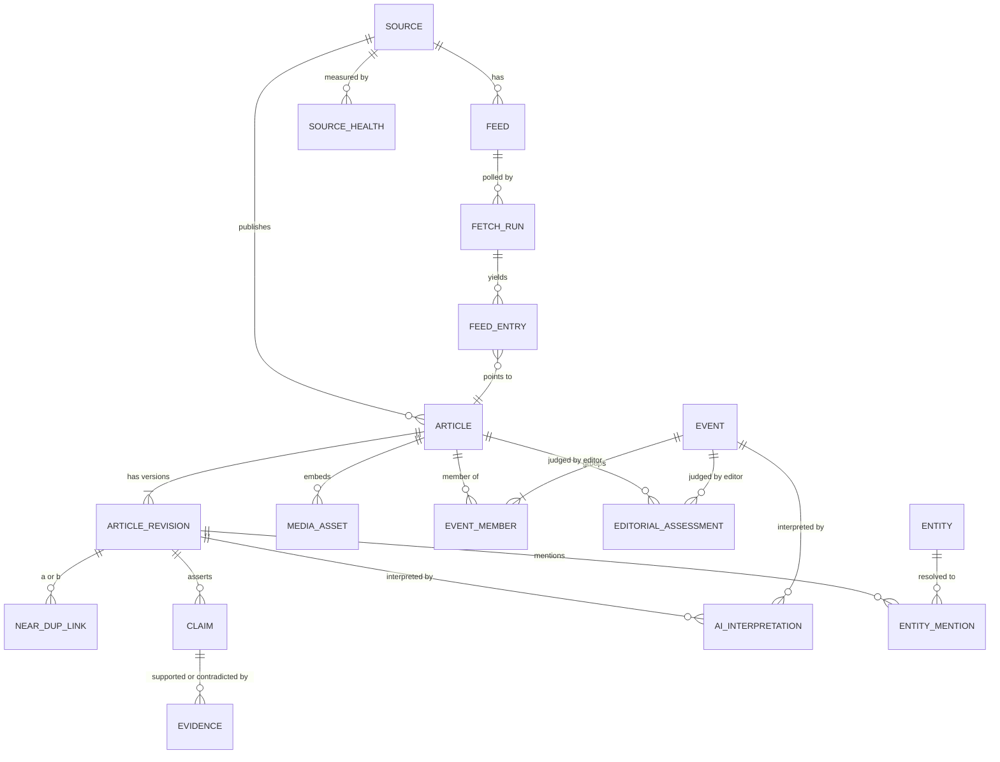

# Data model, lifecycle and database choice (R6, Workstream E, 2026-11-25)

> **Status: Design proposal (not built).** Research input to the data model. The implemented schema differs in places.
> Part of the [Newsmon research library](../README.md). Evidence dates default to 2026-11-25; first-person statements are by the AI research agents that wrote the notes.

**Informs:** D4 (storage) and D5 (dedup and clustering), and the data model behind deliverables 11 and 12.

**Evidence:**
- R6 experiments: [`experiments/deduplication/results.md`](../experiments/deduplication/results.md), [`experiments/event-clustering/results.md`](../experiments/event-clustering/results.md),
  [`experiments/korean-fts/results.md`](../experiments/korean-fts/results.md).
- Where a design choice rests on those experiments, it is tagged TESTED. Otherwise it is INFERRED.

## 1. Design principles
1. **What a source said, what the system inferred and what an editor decided are kept in separate tables.** An AI
   summary never overwrites an article, and an editorial verdict never overwrites an AI score.
2. **Every derived row names its inputs and its producer.** That means the model or algorithm, its version and its
   parameters, so any output can be re-derived or invalidated.
3. **Immutable observations, mutable heads.** Each fetch of an article is an `article_revision` row. The `article`
   row points at the current revision.
4. **Idempotent collection.** Re-running a fetch never creates duplicates. The natural keys are
   `(source_id, canonical_url)` for articles and `content_sha256` for revisions.
5. **All timestamps are stored in UTC** (ISO-8601 text in SQLite, `timestamptz` in Postgres). KST is applied only at
   display time.
   - Source-local raw strings are kept, because RSS `pubDate` strings were malformed or absent for 50 of the 971 rows.
     That count is TESTED: `published_parsed` was missing.
   - The publisher's timestamp and the time the system first saw the item are distinct columns.

## 2. Entity-relationship diagram



## 3. Schema sketch (SQLite dialect; it ports to Postgres by changing types)

```sql
-- Sources and collection -------------------------------------------------------------
CREATE TABLE source (
  source_id      INTEGER PRIMARY KEY,
  name           TEXT NOT NULL,
  registrable_domain TEXT NOT NULL,          -- eTLD+1: the unit of source independence (TESTED: 75 GDELT hosts = 31 domains)
  owner_group    TEXT,                       -- e.g. 'iHeartMedia', 'Yonhap'; syndication family
  lang_default   TEXT, country TEXT,
  terms_note     TEXT, licence_ref TEXT,     -- R9 licence registry row id
  is_wire        INTEGER DEFAULT 0,
  created_at     TEXT NOT NULL
);
CREATE TABLE feed (
  feed_id        INTEGER PRIMARY KEY,
  source_id      INTEGER NOT NULL REFERENCES source,
  url            TEXT NOT NULL UNIQUE,
  discovered_from TEXT NOT NULL,             -- the publisher page the feed was found on (never guessed)
  kind           TEXT NOT NULL CHECK (kind IN ('rss','atom','api','sitemap','gdelt','manual')),
  poll_seconds   INTEGER NOT NULL DEFAULT 600,
  etag TEXT, last_modified TEXT,             -- conditional GET
  active         INTEGER NOT NULL DEFAULT 1
);
CREATE TABLE fetch_run (
  run_id         INTEGER PRIMARY KEY,
  feed_id        INTEGER NOT NULL REFERENCES feed,
  started_at     TEXT NOT NULL, finished_at TEXT,
  http_status    INTEGER, bytes INTEGER, entries INTEGER, new_articles INTEGER,
  error_class    TEXT,                       -- timeout | http_4xx | http_5xx | parse | rate_limited | robots
  error_detail   TEXT, attempt INTEGER NOT NULL DEFAULT 1
);
CREATE TABLE feed_entry (                     -- raw observation; same URL in many feeds = many rows (TESTED: 49 URLs)
  entry_id       INTEGER PRIMARY KEY,
  run_id         INTEGER NOT NULL REFERENCES fetch_run,
  guid TEXT, raw_url TEXT NOT NULL, title TEXT, summary TEXT,
  published_raw  TEXT, published_utc TEXT, updated_utc TEXT,
  article_id     INTEGER REFERENCES article,
  UNIQUE (run_id, raw_url)
);
-- Articles and revisions -------------------------------------------------------------
CREATE TABLE article (
  article_id     INTEGER PRIMARY KEY,
  uid            TEXT NOT NULL UNIQUE,        -- persistent id, e.g. ULID; exposed in APIs
  source_id      INTEGER NOT NULL REFERENCES source,
  canonical_url  TEXT NOT NULL,
  lang           TEXT,
  first_seen_utc TEXT NOT NULL,
  published_utc  TEXT,                        -- publisher claim
  current_revision_id INTEGER REFERENCES article_revision,
  status         TEXT NOT NULL DEFAULT 'live' CHECK (status IN ('live','corrected','withdrawn','gone')),
  story_key      TEXT,                        -- links publisher revisions under new URLs (Yonhap '(종합)')
  UNIQUE (source_id, canonical_url)
);
CREATE TABLE article_revision (
  revision_id    INTEGER PRIMARY KEY,
  article_id     INTEGER NOT NULL REFERENCES article,
  fetched_utc    TEXT NOT NULL,
  title TEXT, summary TEXT, body TEXT,
  body_extractor TEXT,                        -- 'trafilatura 2.4.0' | 'rss-summary'
  content_sha256 TEXT NOT NULL,               -- normalised title+summary+body
  minhash        BLOB,                        -- 128 x uint32 signature (TESTED parameters)
  change_kind    TEXT CHECK (change_kind IN ('initial','update','correction','withdrawal')),
  UNIQUE (article_id, content_sha256)
);
CREATE TABLE near_dup_link (
  a_revision_id  INTEGER NOT NULL REFERENCES article_revision,
  b_revision_id  INTEGER NOT NULL REFERENCES article_revision,
  jaccard_est    REAL NOT NULL,
  kind           TEXT NOT NULL CHECK (kind IN ('same_item','syndicated','revision')),  -- t>=0.9 | t>=0.5 x-source | same source
  method         TEXT NOT NULL,               -- 'minhash128-char4-v1'
  PRIMARY KEY (a_revision_id, b_revision_id)
);
CREATE TABLE media_asset (
  asset_id INTEGER PRIMARY KEY, article_id INTEGER REFERENCES article,
  kind TEXT CHECK (kind IN ('image','video','audio','transcript')), url TEXT, sha256 TEXT, local_path TEXT,
  duration_s REAL, rights_note TEXT, fetched_utc TEXT
);
-- Events, claims, evidence -----------------------------------------------------------
CREATE TABLE event (
  event_id INTEGER PRIMARY KEY, uid TEXT NOT NULL UNIQUE,
  first_seen_utc TEXT NOT NULL, last_update_utc TEXT NOT NULL,
  centroid BLOB,                              -- running mean embedding
  status TEXT NOT NULL DEFAULT 'open' CHECK (status IN ('open','dormant','closed','merged')),
  merged_into INTEGER REFERENCES event,
  algo TEXT NOT NULL                          -- 'incr-embed3s-ts0.55-tx0.45-w48h-v1'
);
CREATE TABLE event_member (
  event_id INTEGER NOT NULL REFERENCES event, article_id INTEGER NOT NULL REFERENCES article,
  similarity REAL, added_utc TEXT NOT NULL, added_by TEXT NOT NULL,   -- algo id or 'editor:<user>'
  PRIMARY KEY (event_id, article_id)
);
CREATE TABLE claim (
  claim_id INTEGER PRIMARY KEY, revision_id INTEGER NOT NULL REFERENCES article_revision,
  text TEXT NOT NULL, span_start INTEGER, span_end INTEGER,         -- offsets into the revision body
  attributed_to TEXT, extracted_by TEXT NOT NULL
);
CREATE TABLE evidence (
  evidence_id INTEGER PRIMARY KEY, claim_id INTEGER NOT NULL REFERENCES claim,
  revision_id INTEGER REFERENCES article_revision, asset_id INTEGER REFERENCES media_asset,
  stance TEXT CHECK (stance IN ('supports','contradicts','mentions')), found_by TEXT NOT NULL
);
-- Interpretation vs judgement --------------------------------------------------------
CREATE TABLE ai_interpretation (
  interp_id INTEGER PRIMARY KEY,
  target_kind TEXT NOT NULL CHECK (target_kind IN ('revision','event')), target_id INTEGER NOT NULL,
  task TEXT NOT NULL,                         -- summary_ko | translation | iptc_topic | ner | newsworthiness | contradiction
  output_json TEXT NOT NULL,
  model TEXT NOT NULL, prompt_version TEXT NOT NULL, input_sha256 TEXT NOT NULL,
  cost_usd REAL, created_utc TEXT NOT NULL,
  UNIQUE (target_kind, target_id, task, model, prompt_version, input_sha256)   -- idempotent re-run
);
CREATE TABLE editorial_assessment (
  assess_id INTEGER PRIMARY KEY,
  target_kind TEXT NOT NULL CHECK (target_kind IN ('article','event')), target_id INTEGER NOT NULL,
  editor TEXT NOT NULL, verdict TEXT NOT NULL,   -- report_to_desk | ignore | verify | archived
  note TEXT, based_on_interp_id INTEGER REFERENCES ai_interpretation, created_utc TEXT NOT NULL
);
CREATE TABLE entity (entity_id INTEGER PRIMARY KEY, kind TEXT, canonical_name TEXT, wikidata_qid TEXT, names_json TEXT);
CREATE TABLE entity_mention (revision_id INTEGER REFERENCES article_revision, entity_id INTEGER REFERENCES entity,
  surface TEXT, span_start INTEGER, span_end INTEGER, method TEXT);
CREATE TABLE source_health (source_id INTEGER REFERENCES source, day TEXT, fetches INTEGER, failures INTEGER,
  median_latency_ms INTEGER, items INTEGER, last_success_utc TEXT, PRIMARY KEY (source_id, day));
-- Search (TESTED tokenizer choice for KO/ZH) -----------------------------------------
CREATE VIRTUAL TABLE revision_fts USING fts5(title, body, content='article_revision', content_rowid='revision_id', tokenize='trigram');
-- queries < 3 chars must use LIKE on this table (trigram MATCH returns 0 rows for them)
-- optional vectors: sqlite-vec  CREATE VIRTUAL TABLE revision_vec USING vec0(embedding float[1536]);
```

## 4. Lifecycle, stage by stage

| Stage | What it does | Keys, rules and parameters | Failure handling |
|---|---|---|---|
| **1. Collection** | Poll each `feed` on its schedule using a conditional GET (ETag / Last-Modified). One polite request per resource, with a descriptive User-Agent. robots.txt is re-checked daily per host. | A `fetch_run` row is written for every attempt. `feed_entry` is unique on `(run_id, raw_url)`. | Classify every error: timeout, 4xx, 5xx, parse, rate_limited, robots. Retry only transient classes, with exponential backoff and jitter, at most 3 times; never retry a 4xx or a parse error. **Serialise per-host clients:** GDELT rate-limited 8 of 9 calls when the IP was shared (TESTED). After N consecutive failures, mark the feed degraded in `source_health` and alert. Raise an "empty but HTTP 200" alert when a feed's entry count drops to 0 against its baseline, because a silent empty feed looks healthy. |
| **2. Extraction** | Map each entry to an article: canonical URL plus `(source_id, canonical_url)`. Fetch the body with trafilatura only when it is needed and allowed. | Body fetch is gated by the licence registry and robots.txt. | On extractor failure or a body under 300 characters (TESTED: 3 of 60 pages), fall back to the RSS summary and set `body_extractor='rss-summary'`. Never block the pipeline on a body. |
| **3. Normalisation** | NFC/NFKC text normalisation, HTML strip, timestamps to UTC (the raw string is kept), language detection (deterministic or from feed metadata), per-source boilerplate stripping. | `content_sha256` over the normalised text. | Unparseable date: `published_utc = NULL`, keep `first_seen_utc`, flag it. 50 of 971 rows had no parsed date (TESTED). |
| **4. Validation** | Schema checks, non-empty title, plausible timestamps (not in the future, not older than the window for "breaking" use), language allowed. | | Quarantine table for rejects, with the reason. Rejects are counted per source in `source_health`. |
| **5. Dedup** | Exact match on canonical URL and content hash. Then MinHash-LSH (128 perms, char 4-grams): t ≥ 0.9 → `same_item`; t ≥ 0.5 → `syndicated`, or `revision` if same source within 48 h (TESTED). | A new content hash on an existing article creates an `article_revision` with `change_kind='update'`. Retraction phrases such as "기사 삭제", "correction" and "撤回" set `change_kind`. A URL that returns 404 or 410 later sets `status='withdrawn'/'gone'`. | The LSH index is rebuilt from stored signatures on restart. This stage is deterministic, so a failure is a bug, not a retry case. |
| **6. Classification / clustering** | Embed (OpenAI `text-embedding-3-small`), then incremental event assignment (θs 0.55–0.6, θx 0.45, 48 h window; TESTED, needs re-tuning). Then IPTC topic, NER and summaries via an LLM, written to `ai_interpretation`. | Idempotent on `(target, task, model, prompt_version, input_sha256)`. | **If the cloud is unavailable,** the article is stored and searchable, and clustering falls back to the per-language TF-IDF incremental method (precision 0.87, recall 0.21 at θ = 0.2; TESTED). A backlog re-embeds items when the API returns. |
| **7. Storage** | One SQLite file in WAL mode. Raw HTML and media live on disk, addressed by SHA-256. | Daily `VACUUM INTO` backup. Retention: feed entries 90 days; revisions and articles kept indefinitely (text is small); raw HTML 30 days; media according to rights. | WAL plus a single-writer queue; readers are never blocked. Integrity check runs on backup. |
| **8. Retrieval** | FTS5 (trigram, with LIKE for queries under 3 characters), filters by source, language, time and event, optional vector KNN (sqlite-vec). | | A known-answer and nonsense query suite runs in CI (TESTED design). |
| **9. Delivery** | Desk queue (events ranked by rules plus BM25), alerts on spikes (rolling z ≥ 2.5 on per-event counts), digests on a schedule. | Every delivered item carries article and event UIDs plus provenance links. | A delivery log is kept; failures go to an outbox and are retried. |

## 5. Database choice (D4)

**Volume estimate.**
- **Measured:** 23 feeds gave 571 unique items in 24 h (TESTED).
- **Projected for an MVP:** about 100 feeds gives about 2,500–5,000 items per day, or about 1–2 M items per year,
  roughly 5–10 GB of text with bodies. Plus about 1,536 float32 values (6 KB) per item if vectors are stored, which
  is about 6–12 GB per year. That projection is INFERRED.

| Option | Fits MVP volume? | KO/ZH search | Vectors | Operations | Verdict |
|---|---|---|---|---|---|
| **SQLite + FTS5 (+ sqlite-vec)** | Yes. Single writer, millions of rows. | **TESTED adequate** with trigram + LIKE, or bigram pre-tokenisation | sqlite-vec does brute-force KNN, which is fine for the 48 h live window (a few thousand vectors) | Zero: a single file, trivial backup | **Recommended for the MVP** |
| PostgreSQL + pgvector (+ pg_trgm or pg_bigm) | Yes, with headroom | pg_trgm has the same issue with queries under 3 characters as FTS5 trigram (INFERRED from the shared trigram principle; not tested here) | HNSW indexes | A server, users, upgrades | Migrate when the triggers below fire |
| OpenSearch / Elasticsearch (nori, smartcn analysers) | Over-provisioned | Best-in-class analysers and ranking | kNN plugin | A JVM cluster; heavy | Only if search UX becomes the product |

**Migration triggers (any one):**
1. More than one concurrent writer process, or several analysts writing assessments at once with lock contention
   (`SQLITE_BUSY` above 1% of writes).
2. More than 10 M revisions, or FTS queries above 300 ms at p95.
3. A multi-tenant client service (the D3 clipping option) that needs per-client access control.
4. A vector search need beyond the live window, for example semantic search over a year of archive.

**Mitigation:** write the schema in the portable subset above, and keep search behind one repository interface, so
the move to Postgres is a data copy, not a rewrite.
